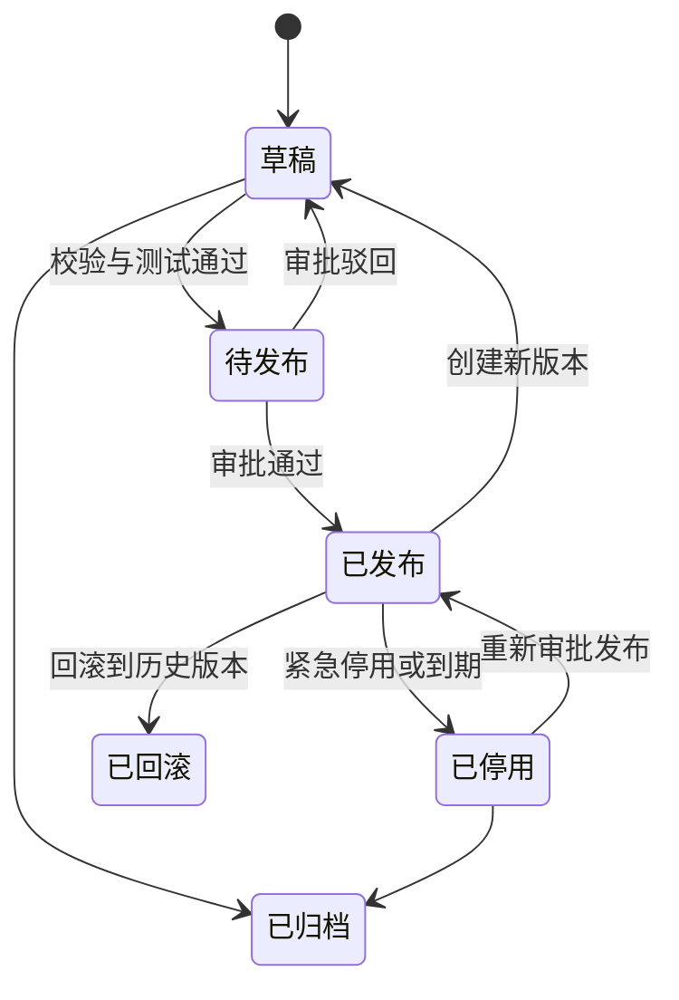
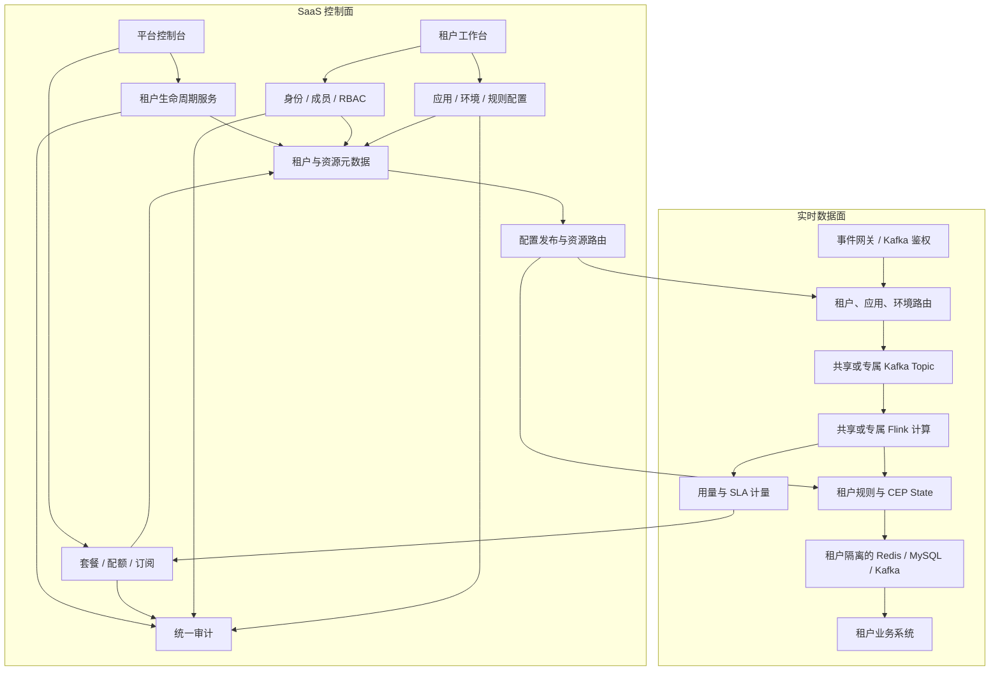
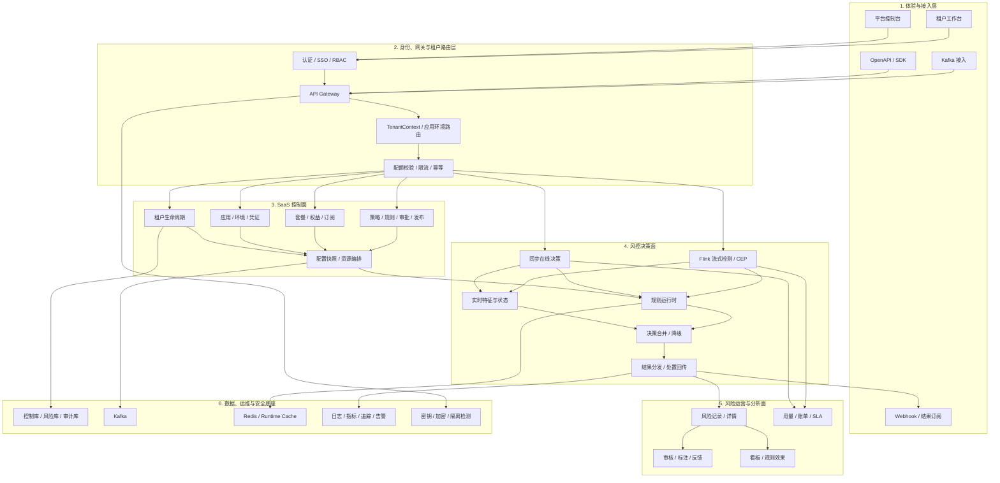
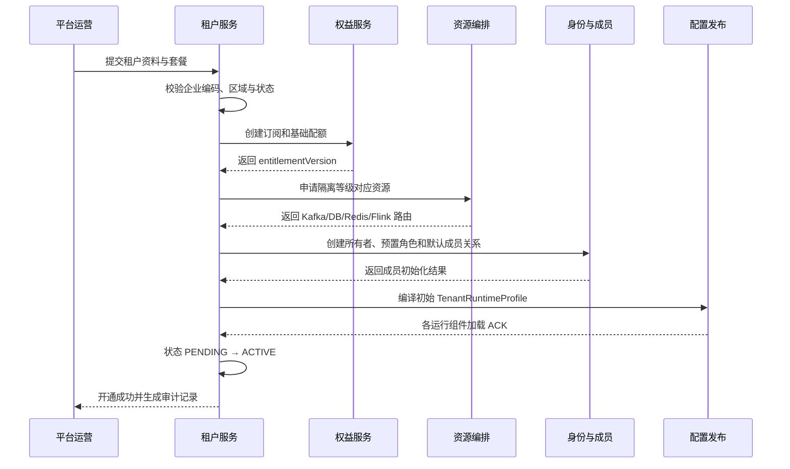
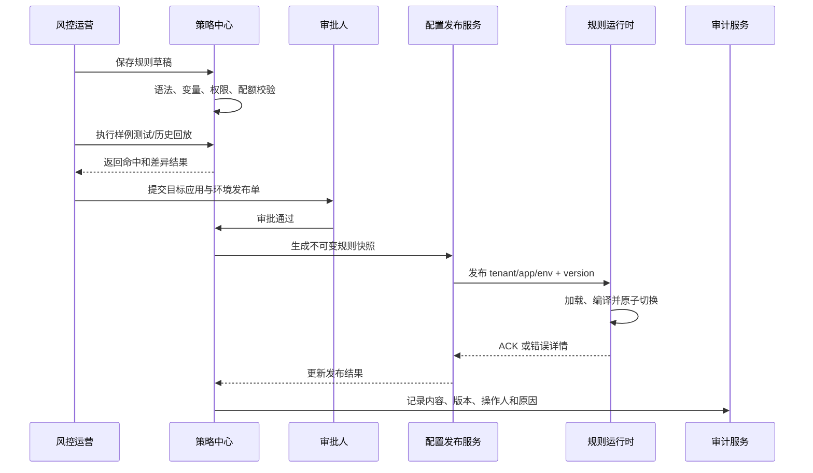
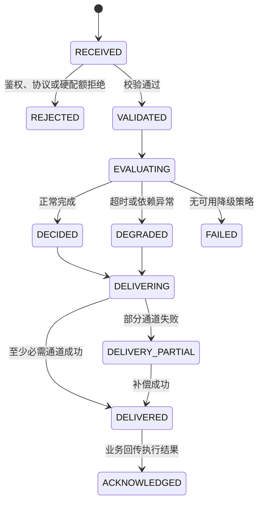
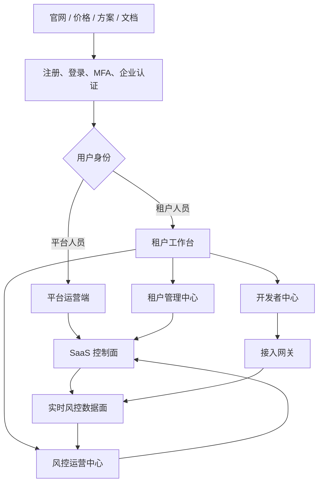
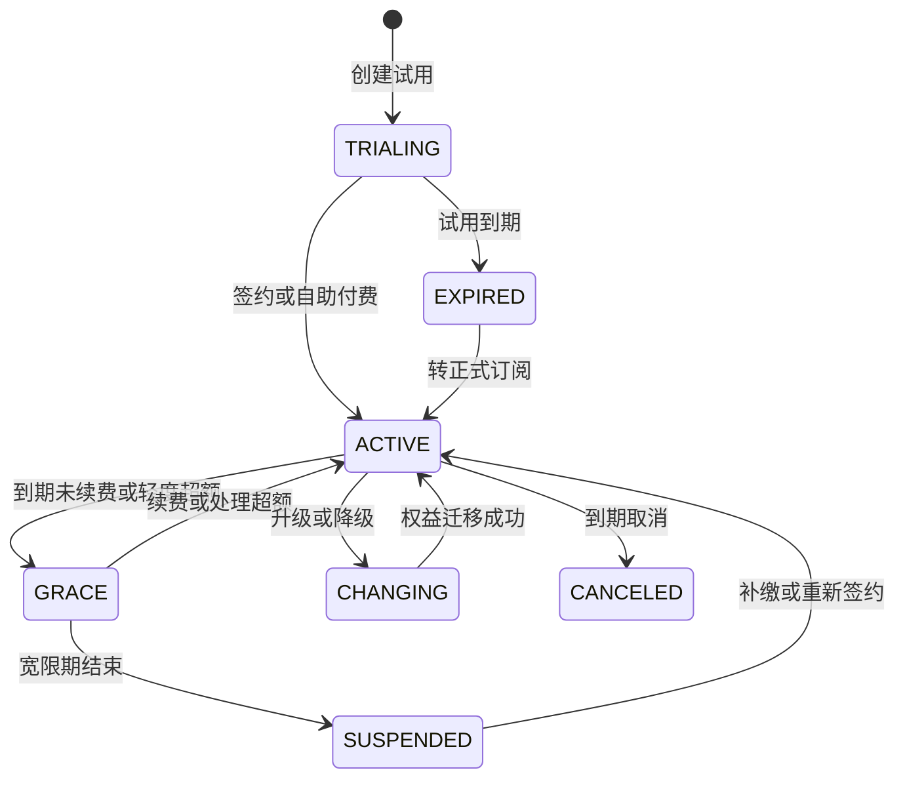

# RiskFlow 实时风控 SaaS 平台产品需求文档（PRD）

> 本文档已按一级章节拆分。日常评审和维护请从 [章节目录](product-prd/README.md) 进入；本文件保留为完整合并稿。

## 0. 文档信息

| 项目 | 内容 |
|---|---|
| 产品名称 | RiskFlow 实时风控 SaaS 平台 |
| PRD 版本 | v1.3 |
| 文档状态 | 评审稿 |
| 编写日期 | 2026-08-16 |
| 代码基线 | `main` / `da84f4f` |
| 目标版本 | 多租户 SaaS V1.0 |
| 目标读者 | 产品、风控运营、研发、测试、运维、业务接入方 |

### 0.1 文档口径

本文基于当前仓库的实际代码、数据库脚本、管理端页面及部署文档整理，不把历史文档中的过期描述视为最终口径。当前代码按单实例、单规则空间运行，SaaS 与多租户部分属于目标产品设计。

- **现状**：当前代码已经具备的能力。
- **本期**：V1.0 产品化必须完成的需求。
- **后续**：不阻塞 V1.0 上线的增强能力。
- 本文中的性能目标是产品验收目标，正式数值仍需结合业务峰值完成容量评审。

### 0.2 版本记录

| 版本 | 日期 | 变更内容 |
|---|---|---|
| v1.0 | 2026-08-16 | 基于现有项目形成实时风控产品 PRD |
| v1.1 | 2026-08-16 | 增加 SaaS 平台侧、租户侧、套餐配额和多租户隔离设计 |
| v1.2 | 2026-08-16 | 细化产品分层、领域边界、双决策链路、配置发布和关键业务状态逻辑 |
| v1.3 | 2026-08-16 | 按完整 SaaS 重构产品蓝图，补齐官网、身份、平台运营、租户管理、开发者、商业化、通知与服务体系 |

---

## 1. 产品摘要

### 1.1 产品定义

RiskFlow 是一套面向多个企业客户提供服务的实时风控 SaaS。平台运营方通过统一控制台管理租户、套餐、配额、资源和全局运行状态；每个租户在独立的工作空间内接入登录、订单、活动行为事件，使用 Flink CEP 识别短时间内的异常行为序列，再通过租户自己的动态规则计算风险等级和建议动作。决策结果写入 Redis、MySQL 和 Kafka，供对应租户的业务系统拦截、验证、审核、限制或告警。

一句话定位：**为不同企业提供开箱即用、数据隔离、按需扩展的实时风控能力，让租户无需自建 Flink 平台即可配置规则并完成风险处置闭环。**

### 1.2 核心价值

| 价值对象 | 核心价值 |
|---|---|
| 业务系统 | 获得统一、实时、可解释的风险决策结果，减少各业务重复建设 |
| 风控运营 | 在线管理规则，快速响应新型攻击和营销作弊 |
| 风险分析师 | 查看风险事件、命中规则和趋势，评估规则效果 |
| 技术与运维 | 统一事件接入、决策输出、监控和审计，降低排障成本 |
| 租户管理员 | 管理企业成员、应用、环境、密钥、配额和数据权限 |
| SaaS 平台运营 | 管理租户生命周期、套餐权益、用量、全局风险与服务质量 |

### 1.3 当前基础与产品化缺口

| 能力 | 当前状态 | V1.0 结论 |
|---|---|---|
| 登录、订单、活动事件接入 | 已实现 3 个 Kafka Topic | 保留并补充协议校验、坏数据处理、监控 |
| CEP 行为序列检测 | 已实现 6 类模式 | 保留并统一页面、代码和配置口径 |
| 动态规则 | MySQL 规则每 30 秒轮询并广播 | 增加保存前校验、测试、版本、发布状态 |
| 决策输出 | Redis、MySQL、Kafka 三路输出 | 增加幂等、重试、失败追踪和一致性指标 |
| 在线同步决策 | 当前没有，仅支持 Kafka 异步检测 | 新增低延迟 Decision API，明确同步与流式职责 |
| 规则管理 | 支持查询、新建、编辑、删除、启停 | 增加权限、审计、复制、批量操作和发布流程 |
| 风险记录 | 支持分页与条件查询 | 增加详情、事件链、规则解释和处置状态 |
| 统计看板 | 概览、7 日趋势、今日规则排行 | 增加时间筛选、场景下钻、规则效果指标 |
| 业务处置闭环 | 当前只输出建议动作 | V1.0 明确下游执行协议并回传执行状态 |
| 安全治理 | 无登录、RBAC、审计 | V1.0 上线前必须补齐 |
| 租户控制面 | 当前没有租户、成员、应用和环境概念 | 新建平台控制台与租户工作台 |
| 数据隔离 | 事件、规则、状态、缓存和结果均无 `tenant_id` | V1.0 完成全链路租户隔离 |
| 套餐与配额 | 当前没有权益、用量和限额 | 增加套餐、权益、用量计量及限流 |
| SaaS 运维 | 当前只能查看共享系统状态 | 增加全局视角和租户级服务质量视角 |

### 1.4 完整 SaaS 产品定义

本 PRD 所说的“完整 SaaS 平台”不是只做规则管理后台，而是同时具备获客、注册、租户开通、业务配置、风控运行、商业计量和持续服务能力。目标产品由“六个产品端 + 一个实时底座”组成：

| 产品组成 | 服务对象 | 核心职责 | 是否直接处理租户业务数据 |
|---|---|---|---:|
| 产品官网与商业门户 | 访客、潜在客户 | 产品介绍、价格、方案、试用、演示预约、文档入口 | 否 |
| 统一身份与账户中心 | 所有用户 | 注册登录、MFA、个人资料、租户选择、会话与安全设备 | 否 |
| SaaS 平台运营端 | 平台运营、运维、客服、安全、财务 | 租户、套餐、订阅、资源、SLA、安全和服务运营 | 默认仅见元数据与脱敏聚合 |
| 租户管理中心 | 租户所有者、管理员 | 企业、成员、角色、应用、环境、凭证、套餐与审计 | 仅本租户 |
| 风控运营中心 | 风控运营、负责人、分析师、审核员 | 策略、规则、发布、风险、审核、分析和名单 | 仅授权应用与环境 |
| 开发者中心 | 技术接入方 | API/SDK 文档、事件协议、凭证、Webhook、调用日志和沙箱 | 仅授权应用与环境 |
| 实时风控底座 | 业务系统、平台运行组件 | 接入、特征、规则、CEP、决策、分发、计量和可观测 | 按租户运行档案严格隔离 |

完整性判断采用以下十二个产品域。任一域完全缺失，都只能称为技术平台或内部系统，不能称为完整 SaaS：

1. 产品获客与试用。
2. 统一身份、账号安全与企业认证。
3. 租户、成员、组织、应用和环境。
4. 套餐、订阅、权益、配额、用量和账单。
5. API、SDK、事件协议、凭证和回调。
6. 策略、规则、测试、审批、发布和回滚。
7. 同步决策、流式检测、特征与结果分发。
8. 风险记录、审核、处置和反馈闭环。
9. 看板、规则效果、用量和 SLA 分析。
10. 通知、告警、工单、公告和客户支持。
11. 平台资源运营、租户运维和故障治理。
12. 多租户隔离、审计、合规、备份和数据生命周期。

### 1.5 SaaS 业务闭环


产品必须同时打通客户闭环和决策闭环：

- **客户闭环**：获客 → 试用 → 开通 → 使用 → 计量 → 续费/升级 → 服务支持。
- **决策闭环**：事件 → 特征/模式 → 规则/模型 → 决策 → 执行 → 反馈 → 策略优化。
- **运营闭环**：租户状态 → 资源与 SLA → 告警/工单 → 故障处置 → 服务复盘。

---

## 2. 背景与问题

### 2.1 业务背景

登录暴力破解、脚本批量下单、营销活动刷量等风险通常表现为短时间内的一组连续行为，单个事件往往不足以判定。传统硬编码规则存在以下问题：

1. 规则修改依赖研发发版，无法快速应对攻击方式变化。
2. 不同业务各自实现判断逻辑，规则口径和风险等级不统一。
3. 只保留拦截结果，缺少原始行为链、命中依据和审计记录。
4. 实时结果、历史分析和下游订阅的延迟诉求不同，单一输出方式无法兼顾。
5. 缺少规则效果评估和处置闭环，无法回答“规则是否有效、是否误伤”。

### 2.2 要解决的核心问题

- 如何在秒级发现同一用户的异常行为序列。
- 如何让风控人员安全地配置和更新规则，而不重启 Flink 作业。
- 如何输出统一、可解释、可追踪的风险决策。
- 如何让业务系统真正执行决策，并将执行结果回流。
- 如何持续衡量风险规模、规则命中、误伤和处置效果。
- 如何让多个企业共享 SaaS 基础设施，同时保证身份、配置、计算状态和业务数据严格隔离。
- 如何按租户提供可配置的套餐、配额、用量和服务等级，并支持租户自助接入。

---

## 3. 产品目标与边界

### 3.1 V1.0 产品目标

1. 覆盖登录、订单、营销活动三类核心场景及 6 类行为模式。
2. 支持规则从创建、校验、测试、发布、热更新到停用的完整生命周期。
3. 对每条风险决策提供事件链、命中规则、风险等级、分数和建议动作解释。
4. 建立“识别—决策—输出—执行回传—分析”的最小闭环。
5. 补齐权限、审计、监控、降级和幂等能力，使系统达到受控试运行条件。
6. 建立平台、租户、应用、环境四级资源边界，实现成员、规则、事件和结果的租户隔离。
7. 支持租户自助开通、接入凭证、套餐权益、配额控制和用量查询。
8. 同时提供同步在线决策和异步流式检测，覆盖业务准入与行为序列发现两类场景。

### 3.2 建议成功指标

| 指标 | V1.0 目标 | 说明 |
|---|---:|---|
| 规则生效时延 | ≤ 60 秒 | 从发布成功到所有运行实例使用新规则 |
| 决策处理时延 P95 | ≤ 10 秒 | 从构成模式的最后一个事件进入 Kafka 到结果进入 `risk-results`；不含需要等待完整窗口结束的特殊模式 |
| 在线决策时延 P95 | ≤ 200 毫秒 | 从 Decision API 完整请求进入到返回结果，暂不包含租户外部依赖，正式值待容量评审 |
| 标准场景识别正确率 | 100% | 对本 PRD 定义的 6 组标准验收数据 |
| 决策结果可解释率 | 100% | 非系统异常结果必须包含规则、模式和关键上下文 |
| 重复结果率 | < 0.01% | 同一决策幂等键重复落库的比例 |
| 规则变更审计覆盖率 | 100% | 新建、编辑、发布、停用、删除均可追溯 |
| 输出成功率 | ≥ 99.9% | Redis、MySQL、Kafka 分通道统计；压测基线待容量评审确认 |
| 跨租户数据泄露 | 0 | 接口、数据库、缓存、消息、日志、导出和监控全链路验证 |
| 租户开通时长 | ≤ 5 分钟 | 审批完成到工作空间、默认角色和接入凭证可用 |
| 配额计量误差 | ≤ 0.1% | 计量账本与 Kafka 接收成功事件对账 |
| 租户级可观测覆盖率 | 100% | 核心输入、计算、规则和输出指标均带租户维度 |
| 首个决策耗时 | ≤ 15 分钟 | 从创建试用应用到沙箱返回第一个有效决策 |
| 新租户技术激活率 | ≥ 60% | 注册后 7 日内完成应用、事件、规则和首个决策 |
| PROD 接入成功率 | ≥ 95% | 通过正式接入验收的租户占提交生产申请租户比例 |
| 用量与账单对账一致率 | ≥ 99.9% | 租户用量页、平台计量和账单快照口径一致 |
| 工单首次响应达标率 | ≥ 95% | 按套餐约定的客户支持 SLA 统计 |
| 续费风险可识别率 | 100% | 到期、低活跃、持续错误、超额和高工单租户进入运营清单 |

### 3.3 非目标

以下能力不纳入 V1.0：

- 机器学习模型训练平台和特征平台。
- 跨机构黑名单联盟或外部征信数据采购。
- 复杂案件协同、工单 SLA 和完整反欺诈调查平台。
- 自动签约、在线支付、开票和复杂财税系统；V1.0 只提供套餐、订阅、用量与账单明细能力。
- 移动端管理后台。

---

## 4. 用户、角色与资源模型

### 4.1 平台侧角色

| 角色 | 主要目标 | 核心权限 |
|---|---|---|
| 平台超级管理员 | 管理整个平台与高危操作 | 平台配置、租户处置、角色权限、密钥策略、全局审计 |
| 平台运营 | 完成租户开通和商业运营 | 租户、套餐、订阅、配额、用量和公告管理 |
| 平台运维 | 保证所有租户服务稳定 | 全局及租户级运行状态、告警、容量和故障处置 |
| 平台安全审计员 | 监督敏感操作和隔离合规 | 只读访问全局审计、越权告警和数据访问记录 |
| 平台客服 | 协助租户排查使用问题 | 经授权查看租户基础配置和脱敏运行信息，不可查看业务明文数据 |

### 4.2 租户侧角色

| 角色 | 主要目标 | 核心权限 |
|---|---|---|
| 租户所有者 | 对租户空间和订阅负责 | 成员、套餐、应用、环境、安全策略和租户注销 |
| 租户管理员 | 管理企业成员和接入资源 | 成员、角色、应用、密钥、Webhook、配额和数据权限 |
| 风控运营 | 快速上线、调整、停用规则 | 查看规则；创建草稿；测试；申请发布；查看风险记录 |
| 风控负责人 | 控制风险策略和误伤 | 审批发布；回滚；查看全量数据和规则效果 |
| 风险分析师 | 分析风险趋势和规则质量 | 查看、筛选、导出、下钻；标注误报/确认风险 |
| 审核员 | 处理人工审核结果 | 查看分配案件、提交审核结论和备注 |
| 业务接入方 | 接入事件并执行决策 | 查看协议、管理受限凭证、订阅结果、回传执行状态 |
| 租户只读用户 | 查看授权范围内的数据 | 只读访问看板、规则和风险记录 |

### 4.3 权限原则

- 规则“编辑”和“发布”必须分权，至少支持双人复核配置。
- 生产规则不得直接物理删除，只能归档；物理删除仅限管理员处理未发布草稿。
- 风险详情中的 IP、设备、地址等敏感字段按角色脱敏展示。
- 所有写操作记录操作人、时间、变更前后内容、原因和客户端信息。
- 用户可加入多个租户，但每个访问令牌只能绑定一个当前租户上下文；切换租户必须重新签发或刷新令牌。
- 服务端从受信任的登录令牌或 API 凭证解析租户，不信任请求 Body 中自行传入的 `tenantId`。
- 平台客服如需协助租户，必须经过租户授权或工单审批，使用限时、只读、全量审计的支持会话。

### 4.4 SaaS 资源层级

```text
SaaS 平台
└── 租户 Tenant
    ├── 成员与角色 Membership / Role
    ├── 工作空间 Workspace（可选，用于业务部门或品牌隔离）
    │   └── 应用 Application（登录中心、商城、营销平台等）
    │       ├── 开发环境 DEV
    │       ├── 测试环境 TEST
    │       └── 生产环境 PROD
    ├── 策略集 Strategy Set
    │   └── 规则及版本 Rule / Rule Version
    ├── 风险决策、审核与分析
    └── 接入凭证、Webhook、套餐、配额与用量
```

资源唯一作用域建议为：`tenantId + workspaceId + appId + environment`。V1.0 可将工作空间设为可选，默认每个租户自动创建一个工作空间，但数据模型必须预留该层级。

### 4.5 租户生命周期

| 状态 | 进入条件 | 平台行为 |
|---|---|---|
| `PENDING` 待开通 | 注册或销售录入完成 | 仅允许完善资料，不分配生产资源 |
| `ACTIVE` 正常 | 审核及订阅生效 | 按套餐提供全部已授权能力 |
| `GRACE` 宽限期 | 套餐到期或轻度超额 | 保持检测，限制新增资源并持续提醒 |
| `SUSPENDED` 已暂停 | 严重欠费、违规或安全事件 | 禁止写操作和新事件接入，保留只读数据访问 |
| `CLOSING` 注销中 | 所有者申请注销 | 冻结配置，进入可恢复等待期并支持数据导出 |
| `DELETED` 已删除 | 等待期结束且审批完成 | 清理密钥与在线数据，仅保留法定审计记录 |

租户暂停或注销不得通过直接删除数据库行完成，必须执行可审计、可重试的状态机流程。

---

## 5. 核心业务场景

### 5.1 账户安全

- 同一用户 60 秒内出现 3 次登录失败，识别暴力破解风险。
- 同一用户 60 秒内出现 2 次成功登录，且 IP 发生变化，识别异地登录风险。
- 根据设备、IP、位置和浏览器进一步区分验证、阻断等级。

### 5.2 订单安全

- 同一用户 60 秒内完成 3 次有效下单，识别频繁下单或刷单风险。
- 同一用户 30 秒内完成 2 次金额大于 100 元的下单，识别快速连续下单风险。
- 根据下单间隔、订单金额、商品和支付方式决定审核或阻断。

### 5.3 营销活动安全

- 同一用户 60 秒内连续参与活动 4 次，识别活动刷量风险。
- 同一用户 60 秒内连续领取优惠券 3 次，识别重复领券风险。
- 根据渠道、来源、活动、优惠券进一步决定告警、限流、禁用或阻断。

### 5.4 决策处置

识别结果需支持以下标准动作：

| 动作 | 中文含义 | 业务语义 |
|---|---|---|
| `ALLOW` | 放行 | 继续原业务流程 |
| `WARN` | 告警 | 放行业务，但产生告警 |
| `VERIFY` | 验证 | 触发验证码、二次认证等增强验证 |
| `REVIEW` | 审核 | 暂缓流程并进入人工审核 |
| `LIMIT` | 限制 | 限频、限额或限制活动资格 |
| `DISABLE` | 禁用 | 禁用优惠券、账户功能或特定权益 |
| `BLOCK` | 阻断 | 终止当前业务请求 |

> 当前前端未配置 `WARN` 展示映射，但初始化规则中存在该动作；V1.0 必须统一动作字典。

---

## 6. 产品流程

### 6.1 风险决策主流程


### 6.2 规则生命周期



当前实现只有 `enabled=true/false`，V1.0 需补充草稿、审批、版本与回滚语义。规则生命周期只能在所属租户、应用和环境内流转，跨环境发布必须生成新的发布记录。

### 6.3 决策优先级

当一次模式结果命中多条规则时：

1. 风险等级分数高者优先：`CRITICAL(100) > HIGH(80) > MEDIUM(50) > LOW(10)`。
2. 风险等级相同时，规则权重高者优先。
3. 最终输出最高优先级规则的动作，同时保留全部命中规则清单用于解释和分析。
4. 没有规则命中时默认 `LOW / 0 / ALLOW`，但需标注 `NO_RULE_MATCHED`。
5. 规则未加载或引擎异常时不得与普通放行混淆，必须输出降级状态并告警；是否放行由场景级降级策略决定。

### 6.4 SaaS 控制面与数据面



设计原则：控制面负责“谁可以用、能用什么、使用多少、配置是什么”，数据面负责“稳定处理已授权租户的实时事件”。控制面短时故障不能中断数据面，数据面继续使用最后一个已验证配置版本。

### 6.5 产品逻辑分层

目标产品不是把现有规则页面简单增加一个 `tenant_id`，而是由六层能力共同组成。上层只通过稳定服务契约使用下层能力，不直接跨层读写数据库。



| 层级 | 核心产品问题 | 关键输出 |
|---|---|---|
| 体验与接入层 | 谁通过什么方式使用平台 | 页面、API、SDK、Topic、Webhook |
| 身份与租户路由层 | 调用者属于谁、能访问什么、是否超额 | 受信任 `TenantContext`、鉴权结果、路由与限流结果 |
| SaaS 控制面 | 租户拥有什么能力、配置的哪个版本生效 | 租户运行档案、权益、规则发布单、配置快照 |
| 风控决策面 | 当前请求或行为序列应做什么 | 决策 ID、风险等级、动作、解释、运行状态 |
| 风险运营与分析面 | 风险是否处理、规则是否有效、使用了多少资源 | 审核结论、效果指标、用量和账单明细 |
| 数据与治理底座 | 如何安全、稳定、可审计地运行 | 隔离存储、消息、监控、审计与安全告警 |

### 6.6 产品领域边界

| 产品域 | 职责 | 权威数据 | 主要消费者 | 明确不负责 |
|---|---|---|---|---|
| 身份域 | 登录、SSO、MFA、账号状态 | `user_account`、身份源 | 平台与租户控制台、网关 | 不决定租户内业务权限 |
| 租户与授权域 | 租户、成员、角色、应用范围 | `tenant`、`membership`、RBAC | 网关、所有业务服务 | 不保存风险规则和风险明细 |
| 商业权益域 | 套餐、订阅、权益、配额 | `plan`、`subscription`、`entitlement` | 网关、资源编排、用量中心 | 不直接执行流量处理 |
| 应用接入域 | 应用、环境、凭证、协议、回调 | `application`、`environment`、`credential` | 事件网关、输出分发 | 不配置风险判断逻辑 |
| 策略中心 | 策略集、规则、测试、审批、版本、发布 | 规则仓库、发布记录 | 配置发布服务、租户工作台 | 不直接处理在线事件 |
| 配置发布域 | 将控制面配置编译为不可变运行快照 | 配置快照、发布状态、运行档案 | 网关、Flink、在线决策服务 | 不允许运行时反向修改草稿 |
| 决策域 | 归一化事件、特征/模式判断、规则执行与合并 | 决策日志、运行版本 | 租户业务、风险中心、分析 | 不负责人工审核结论 |
| 风险运营域 | 风险检索、审核、标注和处置回传 | 风险记录、案件、处置记录 | 风控运营、分析和业务系统 | 不改变历史决策事实 |
| 分析域 | 聚合风险、规则效果和租户运营指标 | 指标口径、聚合事实 | 租户看板、平台看板 | 不直接扫描跨租户明细提供报表 |
| 计量域 | 记录用量、对账、预警和账单明细 | 不可变 `usage_ledger` | 商业运营、租户管理员 | 不作为风控决策事实源 |
| 运维安全域 | 运行监控、审计、告警、密钥和支持会话 | 审计库、指标和安全事件 | 平台运维、安全审计 | 不绕过授权修改租户业务数据 |

#### 6.6.1 平台与租户的数据所有权

| 数据或配置 | 所有者 | 平台可见范围 | 租户可操作范围 |
|---|---|---|---|
| 租户主档、状态、隔离等级 | SaaS 平台 | 完整可见并按权限维护 | 查看企业资料，有限字段可编辑 |
| 套餐、权益模板 | SaaS 平台 | 完整维护 | 只读查看当前订阅和可升级项 |
| 租户成员与角色绑定 | 租户 | 平台默认只见统计和安全状态 | 所有者/管理员在本租户维护 |
| 应用、环境、接入凭证 | 租户 | 平台只见元数据和健康状态，Secret 不可见 | 在套餐范围内维护 |
| 规则、策略和测试数据 | 租户 | 默认不可查看业务明文 | 在授权应用和环境内维护 |
| 风险事件、决策和审核 | 租户 | 默认只见脱敏聚合及故障定位元数据 | 按角色与数据范围访问 |
| 用量、配额、SLA 指标 | 平台计量，租户可核对 | 完整可见 | 查看本租户及明细口径 |
| 全局审计和越权安全事件 | SaaS 平台 | 按平台角色访问 | 查看与本租户相关的审计子集 |

### 6.7 配置继承与运行时路由

#### 6.7.1 配置优先级

配置按以下顺序由低到高覆盖，但下层配置不能突破上层安全和商业约束：

```text
平台安全基线（不可降低）
  → 套餐权益与配额上限
    → 租户级合法覆盖项
      → 工作空间默认配置
        → 应用配置
          → 环境配置
            → 策略集与规则版本
```

- 平台安全基线包括密码策略、审计保留、禁用函数、最大请求体、跨域和最低加密要求，租户只能收紧不能放宽。
- 套餐定义可用功能和数值上限；租户覆盖项必须在平台授权范围内。
- 应用与环境决定事件协议、凭证、规则快照、降级方式和输出路由。
- 规则只决定业务风险，不允许修改租户身份、数据路由、计费口径和平台安全配置。
- 每次计算后的最终配置生成 `effectiveConfigVersion`，便于决策解释和故障回溯。

#### 6.7.2 租户运行档案

控制面将分散配置编译为不可变 `TenantRuntimeProfile`，数据面只消费该档案，不在实时链路中联表查询控制面数据库。

| 字段组 | 内容 |
|---|---|
| 身份 | `tenantId`、`workspaceId`、`appId`、`environment` |
| 状态 | 租户状态、应用状态、环境状态、凭证版本 |
| 权益 | 功能开关、EPS、月事件量、规则数、保留周期 |
| 路由 | 输入 Topic、输出 Topic、Flink 资源池、DB Route、Redis Route |
| 策略 | 已发布策略集、规则快照版本、模式元数据版本 |
| 运行 | 降级策略、超时、重试、幂等窗口、回调配置 |
| 安全 | 隔离等级、密钥引用、IP 白名单、脱敏策略 |
| 版本 | `profileVersion`、发布时间、校验和、上一稳定版本 |

发布逻辑：

1. 控制面校验租户状态、订阅权益和配置完整性。
2. 编译运行档案并计算校验和，不直接覆盖当前有效档案。
3. 写入版本库并发送配置变更事件。
4. 网关、在线决策服务和 Flink 分别加载新版本并回报 ACK。
5. 所有必需组件 ACK 后标记 `ACTIVE`；超时则保持旧版本并标记发布失败。
6. 回滚只切换到已验证的历史档案，不临时拼接旧配置。

#### 6.7.3 资源路由逻辑

```text
TenantContext
  → 查询本地缓存的 TenantRuntimeProfile
    → 根据 isolationLevel 选择共享池 / 增强池 / 专属池
      → 选择 Kafka、Flink、DB、Redis 和输出通道
        → 在目标资源内再次校验 tenant/app/env 绑定
```

- 路由配置变更必须版本化，并支持新旧资源双写或灰度切换。
- 运行档案不存在、签名非法、版本过旧或租户非 `ACTIVE/GRACE` 时，网关拒绝新流量，不使用默认租户路由。
- 资源路由缓存采用短 TTL 加主动失效；控制面不可用时只允许使用未过安全有效期的最后稳定档案。

### 6.8 三类决策链路

目标 SaaS 同时支持同步在线决策、异步流式检测和离线测试回放。三条链路共享规则语义、风险等级、动作字典、解释模型和版本体系，但有不同的入口与时延目标。

| 链路 | 适用场景 | 入口 | 核心能力 | 输出 | 建议时延目标 |
|---|---|---|---|---|---|
| 同步在线决策 | 登录前验证、支付前拦截、下单准入 | HTTPS/gRPC Decision API | 当前事件 + 在线特征 + 单事件/组合特征规则 | 同步返回动作，同时异步留痕 | P95 ≤ 200ms，待容量评审 |
| 异步流式检测 | 登录失败序列、频繁下单、活动刷量 | Kafka Event API | Flink EventTime、CEP、实时聚合 | Kafka/Webhook/风险中心 | 构成模式后 P95 ≤ 10s |
| 离线测试与回放 | 规则测试、历史效果评估、发布前对比 | 样例 JSON/历史数据集 | 固定版本规则和隔离沙箱 | 命中差异、预计风险量 | 非实时，任务化执行 |

当前项目只具备异步流式检测链路。V1.0 若要对外宣称支持“在线阻断”，必须新增同步决策 API；不能把 Kafka 异步结果包装成同步阻断能力。

#### 6.8.1 同步与异步结果关系

- 同步决策负责当前业务请求是否继续，必须在超时预算内返回。
- 异步检测负责跨事件序列和持续行为风险，可更新用户风险画像、触发后续限制或告警。
- 两条链路生成独立 `decisionId`，通过 `subjectId`、来源 `eventId` 和 `correlationId` 关联。
- 如果同一业务同时收到同步和异步决策，不覆盖历史结果，而是按租户配置触发升级处置。
- 在线特征与 Flink 指标必须使用统一特征定义和版本，避免相同指标在两条链路中含义不同。

### 6.9 关键端到端业务逻辑

#### 6.9.1 租户开通逻辑



开通过程采用 Saga/任务编排：每一步都有幂等键、状态和补偿动作。资源创建失败时租户保持 `PENDING`，不得出现控制台显示正常但数据面无路由的半开通状态。

#### 6.9.2 规则发布逻辑



发布状态建议为 `DRAFT → VALIDATED → PENDING_APPROVAL → PUBLISHING → ACTIVE`，异常进入 `REJECTED` 或 `FAILED`。只有 `ACTIVE` 快照可以参与决策；`PUBLISHING` 期间继续使用上一 `ACTIVE` 版本。

#### 6.9.3 同步在线决策逻辑

1. 网关认证凭证并生成 `TenantContext`，校验租户、应用和环境状态。
2. 配额服务执行峰值 EPS 限流；幂等服务检查 `Idempotency-Key`。
3. 协议服务归一化请求，生成 `requestId`、`eventId` 和 `correlationId`。
4. 在线特征服务读取并原子更新必要计数，所有特征带租户、应用和环境作用域。
5. 规则运行时读取内存中的 `ACTIVE` 快照，执行规则并返回全部命中项。
6. 决策解析器按风险等级、权重、显式优先级和稳定决胜规则合并结果。
7. 在同步超时预算内返回 `decisionId`、动作、原因码、规则版本和降级状态。
8. 决策事实、计量事件和输出事件异步写入；异步留痕失败进入补偿队列，不重复执行租户业务动作。
9. 超时或依赖异常时执行对应环境的降级策略，并明确返回 `DEGRADED`，不能伪装成正常 `ALLOW`。

#### 6.9.4 异步流式检测逻辑

1. 接入层验证 Kafka 凭证及事件信封，完成协议校验、幂等和接收计量。
2. 消息按 `tenantId|appId|environment|subjectId` 分区。
3. Flink 从事件信封恢复租户上下文，使用组合 Key 访问 Keyed State。
4. CEP 生成包含来源事件列表和稳定 `patternInstanceId` 的模式结果。
5. 规则运行时按同一租户、应用和环境读取广播快照，禁止跨作用域回退。
6. 决策解析器生成稳定 `decisionId`，保存全部命中规则和最终动作。
7. Redis、MySQL、Kafka/Webhook 输出分别记录状态；失败由通道级补偿任务处理。
8. 决策进入风险中心，并根据动作进入告警、审核或业务回调流程。

#### 6.9.5 配额与计量逻辑

```text
请求到达
  → 先做身份与租户状态校验
    → 检查瞬时配额（EPS、并发、任务数）
      → 接收成功后写 RECEIVED 用量事件
        → 完成计算后写 EVALUATED / DECIDED 用量事件
          → 完成输出后写 DELIVERED 用量事件
            → 按时间桶聚合并与 Kafka/决策库对账
```

- 限流判断使用近实时计数，计费使用不可变账本，两者不能共用一个可覆盖计数器。
- 请求被身份或协议校验拒绝时是否计费必须由套餐口径明确；默认不计费但保留安全统计。
- 重试请求只有首次成功接收计入事件量；补偿输出不重复计费。
- 账本聚合延迟不影响实时风控处理，账本不可用时进入本地/消息缓冲并告警。

### 6.10 核心对象状态逻辑

#### 6.10.1 决策状态



- `DECIDED/DEGRADED` 是不可修改的决策事实；业务执行结果记录在处置对象中。
- `DELIVERY_PARTIAL` 不能改变风险等级和动作，只描述分发状态。
- 同一幂等请求再次到达时返回原决策及当前分发状态，不创建新决策。

#### 6.10.2 凭证状态

```text
CREATED → ACTIVE → ROTATING → REVOKED / EXPIRED
```

- `CREATED` 时 Secret 仅展示一次，完成确认后进入 `ACTIVE`。
- `ROTATING` 允许新旧凭证在配置的重叠窗口内同时有效。
- 租户暂停时凭证逻辑冻结；租户恢复后只有原本未过期且未撤销的凭证恢复。
- `REVOKED` 不可恢复，只能创建新凭证。

### 6.11 模块间一致性与故障边界

| 场景 | 正确行为 | 禁止行为 |
|---|---|---|
| 控制面数据库短时不可用 | 数据面使用最后稳定运行档案并告警 | 清空规则、切换默认租户或停止所有租户 |
| 单租户配置发布失败 | 该租户保持上一版本，其他租户不受影响 | 全量重建全局广播状态 |
| 单租户流量超限 | 仅限流该租户/应用/环境 | 共享线程池耗尽后拖慢其他租户 |
| 某 Sink 失败 | 决策事实保留，通道状态失败并补偿 | 重新执行规则产生不同决策 |
| 计量服务失败 | 缓冲用量事件，继续按安全策略处理 | 因无法计费而静默丢弃已接收事件 |
| 审计服务失败 | 高危控制面写操作失败关闭；数据面日志进入可靠缓冲 | 高危变更无审计直接成功 |
| 租户被暂停 | 拒绝新写入和事件，保留受控只读访问 | 删除租户数据或影响共享作业中的其他租户 |
| 运行档案版本不一致 | 标记租户配置未完全生效，继续旧稳定版或隔离实例 | 混用新规则和旧路由形成不可解释结果 |

### 6.12 当前系统向目标架构的模块映射

| 当前模块 | 当前职责 | SaaS 目标归属 | 主要改造 |
|---|---|---|---|
| `frontend` | 单一管理后台 | 平台控制台 + 租户工作台 | 双路由、租户切换、权限菜单、应用环境上下文 |
| `flink-risk-web` | 规则、风险、统计 API | 租户业务 API + 控制面服务拆分 | TenantContext、RBAC、领域服务、审计、版本发布 |
| `RuleController/RuleService` | 直接 CRUD 当前规则 | 策略中心 | 草稿/审批/发布模型，禁止直接覆盖生产规则 |
| `RuleSourceFunction` | 每 30 秒全量查询启用规则 | 配置发布与规则分发 | 版本化配置事件、租户分桶、ACK 和回滚 |
| `RiskControlApplication` | 三类 Kafka 流统一处理 | 流式决策数据面 | 组合 Key、租户路由、资源池隔离和用量埋点 |
| `PatternFactory/CepJob` | 固定 6 类 CEP | 模式运行时 | 模式元数据版本、稳定实例 ID、跳过策略和环境隔离 |
| `RuleEvaluationFunction` | 单一全局规则广播 | 租户规则运行时 | `tenant/app/env → snapshot` 映射与原子版本切换 |
| `Mysql/Redis/Kafka Sink` | 三路直接输出 | 决策分发域 | 租户路由、稳定决策 ID、通道状态、重试和补偿 |
| `StatsController` | 直接聚合业务表 | 分析域 | 租户聚合、平台脱敏聚合、统一指标口径 |
| 当前不存在 | 同步在线决策 | 在线决策服务 | 新增低延迟 API、在线特征、超时与降级能力 |
| 当前不存在 | 租户/套餐/用量 | SaaS 控制面 | 新增租户、IAM、权益、配额、计量和资源编排 |

---

## 7. 信息架构

完整产品采用“公共入口 + 统一身份 + 平台运营端 + 租户工作台 + 开发者中心 + 实时数据面”的结构。平台运营端和租户工作台可以复用组件与身份中心，但必须使用不同的权限命名空间、路由前缀和服务接口。



### 7.1 产品官网与公共门户

| 一级页面 | 二级内容 | 核心目标 | 主要动作 |
|---|---|---|---|
| 首页 | 产品价值、核心能力、数据指标、客户场景 | 建立认知 | 申请试用、预约演示 |
| 产品 | 在线决策、流式检测、策略中心、风险运营 | 解释产品 | 查看能力详情 |
| 解决方案 | 账号安全、交易风控、营销反作弊、API 防滥用 | 对应业务问题 | 查看方案、咨询顾问 |
| 架构与安全 | 控制面/数据面、多租户隔离、SLA、合规 | 建立技术信任 | 下载白皮书 |
| 价格 | 开发者、专业、企业版和权益对比 | 支持商业决策 | 免费开始、联系销售 |
| 开发者资源 | 快速开始、API、SDK、事件协议、状态页 | 降低接入门槛 | 登录控制台 |
| 客户服务 | 帮助中心、服务状态、联系我们 | 提供持续服务 | 提交工单 |
| 法务 | 隐私、服务条款、数据处理协议、安全说明 | 满足合规 | 阅读与下载 |

官网表单只创建线索或试用申请，不直接创建生产租户。自助试用需经过邮箱验证、企业基本信息校验和反滥用控制。

### 7.2 统一身份与账户中心

| 模块 | 页面或能力 | 关键规则 |
|---|---|---|
| 注册与登录 | 邮箱/手机号注册、密码登录、验证码、企业 SSO | 登录账号与租户成员关系分离 |
| 账号安全 | MFA、密码修改、设备与会话、登录历史、恢复方式 | 高危操作必须二次认证 |
| 企业认证 | 企业名称、统一信用信息、联系人、认证状态 | 认证结果影响试用、生产环境和商务能力 |
| 租户选择 | 最近租户、租户搜索、申请加入、创建租户 | 每个会话只有一个当前租户上下文 |
| 个人资料 | 姓名、头像、语言、时区、通知偏好 | 不存放租户内角色配置 |
| 邀请处理 | 接受/拒绝邀请、邀请过期、身份冲突处理 | 接受邀请后生成 Membership |
| API 个人令牌 | 创建、撤销、到期和最近使用记录 | 仅允许访问本人被授权的租户资源 |

### 7.3 SaaS 平台运营端

路由建议统一使用 /platform，仅对平台角色开放。

| 一级模块 | 二级页面 | 关键功能 |
|---|---|---|
| 平台总览 | 经营概览 | 租户、试用、转化、续费、订阅收入、事件量、决策量和 SLA |
| 客户与线索 | 试用申请、演示线索 | 分配销售/运营、跟进状态、转租户申请 |
| 租户管理 | 租户列表、租户 360° 详情 | 审核、开通、暂停、恢复、注销、隔离等级和健康状态 |
| 商业中心 | 套餐、权益、价格版本 | 版本化套餐、功能开关、数值配额、折扣与定制权益 |
| 商业中心 | 订阅、合同、账单 | 试用、续费、升降配、宽限期、账单预览和冲正 |
| 计量中心 | 用量明细、对账、异常计量 | 事件量、决策量、峰值 EPS、存储、回放任务和资源用量 |
| 资源中心 | 资源池、租户路由、容量 | Kafka、Flink、MySQL、Redis 共享/专属资源分配 |
| 运维中心 | 全局监控、租户 SLA、告警事件 | 延迟、积压、错误、容量、故障范围和恢复进度 |
| 安全中心 | 越权、密钥、隔离和异常导出 | 安全事件分级、处置、证据和复盘 |
| 客户成功 | 工单、支持会话、服务记录 | 租户授权、限时支持、客户健康度和续费风险 |
| 内容运营 | 公告、帮助文档、模板市场 | 服务公告、规则模板、场景方案和版本发布说明 |
| 平台设置 | 平台成员、角色、字典、全局策略 | 平台 RBAC、动作字典、默认安全基线和审计 |

平台租户详情采用 360° 视图，但业务数据遵循最小可见原则：

- 商务页签：企业资料、合同、订阅、权益、账单。
- 使用页签：事件量、决策量、用量趋势、配额预测。
- 服务页签：SLA、资源路由、告警、工单、变更记录。
- 安全页签：认证、SSO、密钥状态、越权事件、支持授权。
- 数据页签默认只显示脱敏聚合，不允许平台人员直接浏览租户规则表达式与业务明细。

### 7.4 租户工作台

路由建议统一使用 /app。顶部固定展示当前租户、工作空间、应用和环境，PROD 使用强提醒样式。

| 一级模块 | 二级页面 | 适用角色 | 关键功能 |
|---|---|---|---|
| 工作台 | 总览、待办、最近活动 | 全部租户成员 | 风险摘要、规则发布、审核待办、用量、服务健康 |
| 应用管理 | 应用、环境、场景配置 | 所有者、管理员、接入方 | 应用生命周期、DEV/TEST/PROD、场景与降级策略 |
| 策略中心 | 策略集、规则、名单、模板 | 风控运营、负责人 | 创建、测试、复制、版本、审批、灰度、发布、回滚 |
| 风险中心 | 风险记录、风险详情、审核队列 | 运营、分析师、审核员 | 检索、解释、标注、审核、处置和导出 |
| 数据分析 | 风险看板、规则效果、业务反馈 | 负责人、分析师 | 命中、误报、确认风险、阻断、损失与趋势 |
| 接入管理 | 事件协议、数据源、凭证、Webhook | 管理员、接入方 | API/Kafka 接入、Secret 轮换、回调、调用日志 |
| 运行中心 | 实时链路、任务、告警、状态页 | 管理员、接入方 | 输入、Flink、规则快照、输出和服务质量 |
| 组织权限 | 成员、团队、角色、数据范围 | 所有者、管理员 | 邀请、禁用、移交、预置/自定义角色和应用权限 |
| 商业与用量 | 当前套餐、配额、账单、升级 | 所有者、财务、管理员 | 权益、实时用量、预测、续费和升级申请 |
| 安全与审计 | SSO、MFA、IP 白名单、审计 | 所有者、安全管理员 | 企业安全策略、日志、导出和数据生命周期 |
| 服务支持 | 工单、公告、服务状态、顾问 | 所有者、管理员 | 提交问题、授权支持、查看进展和服务记录 |

### 7.5 风控运营中心

风控运营中心属于租户工作台的业务核心，不单独建立另一套租户体系。

| 功能域 | 核心对象 | 关键页面 | 完成标准 |
|---|---|---|---|
| 策略设计 | 策略集、规则、特征、名单 | 策略画布、规则编辑器、变量字典 | 可以表达一个完整风险场景 |
| 策略验证 | 样例、测试集、历史回放 | 单次调试、批量回放、版本对比 | 发布前可以评估命中与变化 |
| 发布治理 | 发布单、审批、快照、灰度 | 发布中心、差异、审批记录 | 生产变更可控、可审计、可回滚 |
| 决策运营 | 风险记录、决策解释 | 列表、详情、事件链、命中规则 | 每个结果可解释、可追踪 |
| 人工处置 | 案件、任务、审核结论 | 审核队列、分配、批量处理 | REVIEW 有明确负责人和结果 |
| 效果反馈 | 标签、执行结果、业务损失 | 标注、反馈导入、效果分析 | 能衡量误报、确认风险和规则价值 |

### 7.6 开发者中心

| 模块 | 页面 | 核心能力 |
|---|---|---|
| 快速开始 | 接入向导 | 创建应用 → 获取测试凭证 → 发送首个事件 → 查看首个决策 |
| API 文档 | Decision API、事件 API、反馈 API、管理 OpenAPI | 按版本展示请求、响应、错误码、幂等和限流 |
| SDK | Java、JavaScript、Go 等 | 初始化、签名、重试、超时、示例和版本兼容 |
| 事件模型 | Schema、字段字典、样例、变更记录 | 在线校验、协议版本和兼容性说明 |
| 凭证 | API Key、OAuth Client、Kafka 凭证 | 创建一次展示、轮换、禁用、范围和来源限制 |
| Webhook | Endpoint、事件订阅、签名、重试 | 测试发送、失败记录、重放和死信 |
| API 观察 | 调用日志、延迟、错误、限流 | 按应用和环境查询，不展示 Secret |
| 沙箱工具 | 请求构造器、事件模拟器、签名工具 | 不接触生产数据即可完成联调 |
| 变更与状态 | Changelog、弃用计划、服务状态 | 提前通知破坏性变更与故障 |

### 7.7 通知、工单与全局能力

以下能力跨平台运营端和租户工作台，不应由各模块重复实现：

| 能力 | 触发来源 | 通道 | 用户控制 |
|---|---|---|---|
| 站内通知 | 审批、发布、配额、账单、成员和工单 | 站内消息中心 | 已读、归档、跳转目标 |
| 告警通知 | 决策异常、链路故障、延迟和安全事件 | 邮件、短信、Webhook、IM | 订阅规则、接收人、静默时段 |
| 服务公告 | 版本发布、维护、故障和合规更新 | 官网状态页、站内、邮件 | 按影响租户和区域投递 |
| 工单 | 接入、计费、故障、安全和产品咨询 | 站内工单、邮件回复 | 优先级、SLA、附件、授权支持 |
| 审批待办 | 规则、权限、密钥、导出和高危配置 | 站内待办、邮件 | 委托、催办、过期和审计 |

### 7.8 全局上下文与导航规则

1. 平台端只有 PlatformContext，不允许通过修改 URL 切换为租户数据访问。
2. 租户端必须建立 TenantContext → WorkspaceContext → AppContext → EnvironmentContext。
3. 切换租户时重新签发令牌并清空接口缓存、订阅连接和未保存表单。
4. 切换应用或环境时保留租户身份，但重新加载权限范围、规则快照、凭证和数据筛选。
5. PROD 的发布、密钥、删除和导出操作必须二次确认；规则发布可要求 MFA 或双人审批。
6. 页面菜单由权限服务返回，隐藏菜单不是授权手段，服务端仍需对资源和字段再次鉴权。
7. 当前代码已有系统概览、规则管理、风险记录和数据看板，只覆盖租户工作台的一部分；完整 SaaS 需要按上述信息架构逐步拆分。

---

## 8. 功能需求

### 8.1 FR-01 事件接入

#### 8.1.1 接入方式

- 三类事件分别进入 `login-events`、`order-events`、`activity-events`。
- 事件格式为 UTF-8 JSON，时间戳使用 Unix 毫秒。
- 事件网关根据 API Key、OAuth Client 或 Kafka 凭证解析租户、应用和环境，并写入受信任的事件信封。
- 默认按 `tenantId + appId + environment + userId` 进行 CEP 分组；`userId` 不能为空，任何状态不得跨租户或跨生产/测试环境聚合。
- 标准版可使用共享 Topic；企业版可配置专属 Topic。两种模式使用相同事件协议和隔离校验。
- Kafka 消息 Key 使用 `tenantId|appId|environment|userId`，保证同一租户业务主体的事件有序路由。
- Flink 接受最多 5 秒乱序事件，超过允许迟到范围的事件进入迟到事件侧输出，不得静默丢弃。
- 接入管理页按租户和环境展示 Topic、协议版本、必填字段、样例、消费延迟及最近接入时间。

#### 8.1.2 公共字段

| 字段 | 类型 | 必填 | 说明 |
|---|---|---:|---|
| `tenantId` | String | 系统注入 | 租户 ID；必须与接入凭证绑定租户一致 |
| `workspaceId` | String | 系统注入 | 工作空间 ID；V1.0 默认工作空间可省略展示 |
| `appId` | String | 是 | 租户内应用 ID |
| `environment` | Enum | 是 | `DEV`、`TEST`、`PROD` |
| `eventId` | String | 是 | 来源事件唯一 ID，用于追踪和幂等 |
| `eventType` | Enum | 是 | `LOGIN`、`ORDER`、`ACTIVITY` |
| `userId` | String | 是 | 风控主体 ID |
| `timestamp` | Long | 是 | 事件发生时间，Unix 毫秒 |
| `attributes` | Object | 否 | 扩展属性，需受字段白名单和大小限制 |

#### 8.1.3 场景字段

| 事件 | 关键字段 |
|---|---|
| 登录 | `ip`、`deviceId`、`success`、`failureReason`、`location`、`browser` |
| 订单 | `orderId`、`amount`、`productId`、`productName`、`quantity`、`paymentMethod`、`deliveryAddress` |
| 活动 | `activityId`、`activityName`、`couponCode`、`couponValue`、`actionType`、`channel`、`source` |

#### 8.1.4 校验与异常处理

- 必填字段缺失、枚举非法、金额为负、时间戳异常时进入坏数据 Topic，并记录错误码和原始消息摘要。
- `tenantId + appId + environment + eventId + eventType` 作为来源事件幂等键；不同租户可使用相同的业务事件 ID，重复事件不得重复参与模式计算。
- 支持协议版本字段，新增字段保持向后兼容，删除或改义必须升级主版本。
- 管理端可查看最近坏数据、错误原因和重放状态。
- 凭证绑定的租户、应用、环境与消息声明不一致时直接拒绝，并产生安全审计；不得采用消息中的声明覆盖受信任上下文。

### 8.2 FR-02 行为模式检测

#### 8.2.1 当前标准模式

| 模式编码 | 场景 | CEP 触发条件 | 窗口 | 当前上下文 |
|---|---|---|---:|---|
| `LOGIN_FAILURE` | 登录 | 同一用户 3 次 `success=false` | 60 秒 | `failCount`、IP、设备、位置、浏览器 |
| `LOCATION_CHANGE` | 登录 | 同一用户 2 次 `success=true`，规则再判断前后 IP | 60 秒 | `prevIp`、`currIp`、位置、设备 |
| `ORDER_FREQUENT` | 订单 | 同一用户 3 次 `amount>0` | 60 秒 | `orderCount`、`totalAmount`、末次订单信息 |
| `ORDER_RAPID` | 订单 | 同一用户 2 次 `amount>100` | 30 秒 | `intervalMs`、末次订单信息 |
| `ACTIVITY_FREQUENT` | 活动 | 同一用户 4 次 `actionType=PARTICIPATE` | 60 秒 | `participationCount`、活动、渠道、来源 |
| `COUPON_REPEAT` | 活动 | 同一用户 3 次 `actionType=CLAIM_COUPON` | 60 秒 | `participationCount`、优惠券、渠道、来源 |

CEP 使用宽松连续匹配，满足条件的事件之间可以穿插不相关事件。V1.0 需明确匹配后跳过策略，避免同一事件组合产生大量重叠结果。

#### 8.2.2 模式管理要求

- V1.0 模式定义由研发维护，管理端只读展示模式编码、条件、窗口和上下文变量。
- 模式窗口必须以代码实际配置为准并自动暴露给管理端，禁止页面硬编码另一套口径。
- 变更模式条件需要版本号和回归用例，不允许只改说明文档。
- 后续版本可提供可视化模式编排，但不纳入 V1.0。

### 8.3 FR-03 规则中心

#### 8.3.1 规则字段

| 字段 | 必填 | 说明 |
|---|---:|---|
| 所属租户 | 系统生成 | 从当前租户上下文写入，不允许表单修改 |
| 应用与环境 | 是 | 规则生效的应用和 DEV/TEST/PROD 环境 |
| 规则 ID | 系统生成 | 全局唯一、不可修改 |
| 规则名称 | 是 | 同一场景内不可重名 |
| 场景类型 | 是 | 登录、订单、活动、通用；必须独立存储，不再从名称推断 |
| 适用模式 | 是 | 选择一个或多个 CEP 模式，或选择“单事件规则” |
| 表达式 | 是 | Aviator 表达式 |
| 风险等级 | 是 | LOW、MEDIUM、HIGH、CRITICAL |
| 执行动作 | 是 | 标准动作字典中的一个值 |
| 权重 | 是 | 同等级规则的优先级，建议范围 1～100 |
| 描述 | 是 | 业务意图和风险说明 |
| 生效时间 | 否 | 不填则发布后立即生效 |
| 失效时间 | 否 | 到期自动停用 |
| 版本 | 系统生成 | 每次发布递增 |
| 状态 | 系统生成 | 草稿、待发布、已发布、已停用、已归档、已回滚 |

#### 8.3.2 列表与查询

- 按名称、场景、模式、风险等级、动作、状态、创建人、更新时间筛选。
- 支持分页、刷新、排序、批量启停、批量导出。
- 列表展示名称、场景、模式、等级、动作、版本、状态、命中次数、更新时间和操作人。
- 风险等级、动作和状态使用统一字典，不允许出现未映射的裸值。

#### 8.3.3 新建与编辑

- 提供登录、订单、活动三类参考模板，并允许复制现有规则。
- 表达式编辑器根据选中的模式展示可用变量、类型、说明和样例。
- 不允许引用当前模式不存在的变量。
- 保存草稿不影响线上规则；发布成功后才进入 Flink 广播状态。
- 已发布规则不可原地覆盖，编辑时创建新版本。
- 规则名称唯一性、复制、版本和审批均限定在租户、应用和环境作用域内；平台管理员无权直接修改租户业务规则。

#### 8.3.4 规则校验与测试

- 保存前执行语法编译校验；错误需定位到表达式位置并给出可理解提示。
- 校验 `=~` 正则语法，统一采用 Aviator 支持的正则字面量。
- 校验风险等级、动作、权重、时间范围和变量类型。
- 支持输入上下文 JSON 或选择标准样例，返回：是否命中、全部命中规则、最终规则、分数、动作、执行耗时。
- 支持发布前回放最近一段历史样本，展示预计命中量和结果变化；V1.0 可先实现小样本回放。

#### 8.3.5 发布、热更新与回滚

- 发布需填写变更原因；高风险动作规则需负责人审批。
- 发布后 60 秒内在所有 Flink 并行实例生效，并展示生效状态。
- 规则广播状态按 `tenantId + appId + environment` 保存快照；更新一个租户规则不得重建或覆盖其他租户的规则集。
- 发布失败时保留旧版本，不得把空规则集当作正常发布。
- 支持一键回滚到上一已发布版本。
- 紧急停用无需等待常规审批，但必须填写原因并触发告警。

### 8.4 FR-04 决策引擎

- 同一模式结果可以命中多条规则，系统必须保存全部命中规则及最终决策规则。
- 规则查询和执行必须使用事件中的受信任租户、应用、环境上下文，只能访问完全相同作用域的已发布规则快照。
- 最终优先级遵循“风险等级 > 权重”；若仍相同，按显式优先级或规则 ID 稳定决胜，确保可复现。
- 风险分数与等级映射需配置化。V1.0 默认分数：LOW=10、MEDIUM=50、HIGH=80、CRITICAL=100。
- 单事件规则必须有独立执行入口。当前实现只有 CEP 命中后才执行规则，因此“单笔大额订单”等规则并非对所有订单生效；V1.0 必须修正执行模型或在产品上禁止创建此类误导规则。
- 决策结果至少包含：决策 ID、来源事件 ID 列表、用户、事件类型、模式、等级、分数、动作、全部命中规则、最终规则、关键上下文、决策时间、规则版本和引擎状态。
- 决策结果必须包含 `tenantId`、`workspaceId`、`appId`、`environment`，作为查询、存储、输出和计量的强制隔离字段。
- 降级策略按场景配置：`FAIL_OPEN`、`FAIL_CLOSED`、`VERIFY_ONLY`。规则未加载、规则引擎异常、下游不可用时必须记录降级原因。

### 8.5 FR-05 风险记录

#### 8.5.1 列表

- 按用户 ID、事件类型、模式、风险等级、动作、规则、处置状态和时间范围筛选。
- 租户用户只能查询当前租户及获授权应用/环境的记录；平台人员默认只能看到聚合指标和脱敏故障信息。
- 默认按检测时间倒序，支持分页和 CSV 导出。
- 展示决策 ID、用户、场景、模式、等级、分数、动作、最终规则、处置状态、检测时间。
- 支持从概览和看板带筛选条件跳转到列表。

#### 8.5.2 详情

- 基本信息：用户、事件、模式、风险等级、分数、动作和时间。
- 事件链：参与本次判断的事件按发生时间排列，显示关键字段。
- 决策解释：全部命中规则、最终规则、规则版本、表达式和实际变量值。
- 输出状态：Redis、MySQL、Kafka 各通道是否成功、重试次数和最后错误。
- 处置记录：业务执行结果、审核结果、操作人、原因和更新时间。
- 敏感信息按权限脱敏，原始详情不直接暴露数据库 JSON。

### 8.6 FR-06 审核与处置闭环

- `REVIEW` 结果自动进入审核队列，支持待处理、处理中、已通过、已拒绝、已关闭。
- 审核员可以查看事件链和规则解释，填写结论、原因和备注。
- `VERIFY`、`LIMIT`、`DISABLE`、`BLOCK` 等动作由业务系统执行，并通过接口或 Kafka 回传执行结果。
- 回传字段包括决策 ID、执行状态、执行时间、业务流水号、失败原因和最终业务结果。
- 分析师可标注“确认风险、误报、待确认”，为规则效果分析提供标签。

### 8.7 FR-07 系统概览与数据看板

#### 8.7.1 系统概览

- 租户工作台展示本租户的规则总数、已发布规则数、今日风险事件数、今日高风险事件数。
- 登录、订单、活动场景分布。
- LOW、MEDIUM、HIGH、CRITICAL 等级分布。
- Kafka 消费延迟、规则最近同步时间、Sink 异常数和配额使用率摘要。
- 平台控制台展示租户总数、活跃租户、各套餐租户数、事件量、决策量、资源水位和异常租户数，不默认展示租户业务明细。

#### 8.7.2 数据看板

- 支持今日、近 7 日、近 30 日和自定义时间范围。
- 展示风险总量趋势、高风险趋势、场景分布、动作分布和 Top 规则。
- 规则效果指标包括命中数、独立用户数、阻断数、确认风险数、误报数和误报率。
- 点击图表可下钻到带筛选条件的风险记录。
- 指标口径在页面展示定义；“命中规则数”需区分规则种类数与命中次数。
- 租户看板只聚合当前租户数据；平台看板使用独立的脱敏聚合表，不通过绕过租户过滤直接查询业务明细。

### 8.8 FR-08 决策输出与业务接入

#### 8.8.1 输出通道

| 通道 | 用途 | 当前实现 | V1.0 要求 |
|---|---|---|---|
| Redis | 低延迟临时查询 | Key 为 `risk:{eventType}:{userId}:{eventId}`，TTL 1 小时 | 内容包含完整决策摘要；支持按决策 ID 查询 |
| MySQL | 历史检索与分析 | 写入 `risk_result` | 增加决策唯一键、规则版本、模式、处置状态和输出状态 |
| Kafka | 下游实时订阅 | `risk-results` | 定义协议版本、幂等键、重试与死信 Topic |

SaaS V1.0 的 Redis Key 调整为 `risk:{tenantId}:{environment}:{eventType}:{userId}:{decisionId}`；Kafka 共享输出 Topic 的消息 Key 必须包含租户和决策 ID，企业专属 Topic 通过租户订阅权益配置。

#### 8.8.2 幂等与一致性

- 生成稳定的 `decisionId`，同一模式实例重复处理时保持一致。
- MySQL 对 `decisionId` 建唯一索引，使用幂等写入。
- Kafka 消息 Key 使用 `decisionId` 或明确的业务幂等键。
- 任何通道失败必须可观测、可重试；不得仅写日志后忽略。
- 不承诺三通道分布式事务，但必须记录每个通道状态并提供补偿任务。

### 8.9 FR-09 用户、权限与审计

- 支持用户名密码或企业统一身份认证接入。
- 身份账号与租户成员关系分离：一个用户账号可加入多个租户，在各租户拥有不同角色和应用范围。
- 平台角色与租户角色使用两套权限命名空间，禁止给租户角色授予平台权限。
- 租户侧至少提供所有者、管理员、只读、运营、审批、分析、审核、接入八类预置角色，并支持自定义角色。
- 页面、接口和数据字段三层权限控制。
- 审计日志不可由普通用户删除，默认保留 1 年。
- API 错误响应不返回服务端堆栈和数据库敏感信息。
- 生产环境禁止通配来源 CORS，按域名白名单配置。

### 8.10 FR-10 运行监控

- 展示 Flink Job 状态、Checkpoint 成功率、重启次数、反压、各算子吞吐和延迟。
- 展示 Kafka Topic 积压、消费速率、坏数据和迟到事件数量。
- 展示 MySQL、Redis、Kafka Sink 成功率、耗时、重试和失败数量。
- 展示当前规则版本、规则数量、最后同步时间和各并行实例同步状态。
- 支持对作业失败、规则空集、同步超时、消费积压、Sink 失败率超阈值发送告警。
- 所有核心指标必须包含 `tenantId`、`appId`、`environment` 标签或等价的安全聚合维度。
- 平台运维可以查看各租户资源使用和服务质量；租户运维只能查看本租户数据，且不能由查询参数切换到其他租户。

### 8.11 FR-11 SaaS 平台控制台

#### 8.11.1 租户管理

- 平台运营可创建、审核、编辑、暂停、恢复和发起注销租户。
- 租户字段包括租户 ID、名称、编码、企业主体、联系人、区域、时区、状态、套餐、到期时间、隔离等级和备注。
- 开通任务自动创建默认工作空间、生产前测试环境、租户所有者、预置角色、基础配额和审计上下文。
- 租户详情展示基本资料、订阅、配额、用量、成员数、应用数、服务健康、告警和生命周期记录。
- 暂停、恢复、注销和隔离等级变更属于高危操作，需要二次确认、原因和审批记录。

#### 8.11.2 套餐与权益

- 套餐采用版本化设计。修改套餐只影响新订阅，存量租户需显式迁移。
- 权益分为功能权益和数值配额，例如是否支持生产环境、审核队列、SSO、专属 Topic、专属计算资源。
- 支持按租户覆盖套餐默认配额，但覆盖项必须记录原因、有效期和审批人。
- 套餐到期、超额或降级时先做影响预览，不得直接删除规则、风险数据或密钥。

#### 8.11.3 平台支持与安全

- 平台客服只能查看租户基础配置、用量和脱敏故障上下文。
- 进入租户支持会话必须绑定工单、租户授权、有效期和操作范围，页面持续显示“支持模式”。
- 平台支持会话不能创建、发布或删除租户规则，除非走独立的紧急授权流程。
- 全局记录跨租户访问、异常导出、连续鉴权失败、密钥泄露风险和隔离校验失败。

### 8.12 FR-12 租户工作台

#### 8.12.1 租户初始化与切换

- 首位开通用户成为租户所有者，并通过向导完成企业信息、应用、环境、场景和接入方式配置。
- 多租户用户登录后选择租户；切换租户会刷新访问令牌、菜单、角色、应用列表和缓存数据。
- 页面顶部始终显示当前租户、应用和环境，生产环境使用明显标识。
- 浏览器多标签页切换租户时不得复用上一租户的接口缓存或表单草稿。

#### 8.12.2 成员与组织

- 支持邮箱或手机号邀请成员、撤回邀请、禁用成员、移交所有者。
- 角色可绑定全部应用或指定应用，并可限制 DEV/TEST/PROD 环境。
- 成员离开租户后，其个人令牌、未完成审批和临时支持授权立即失效。
- 最后一个租户所有者不能被删除或主动退出，必须先移交所有权。

#### 8.12.3 应用与环境

- 租户可按套餐创建应用，每个应用具有稳定 `appId`。
- 每个应用支持 DEV、TEST、PROD 环境；不同环境拥有独立凭证、规则版本、CEP 状态、结果和回调配置。
- 规则从 DEV 向 TEST、PROD 发布时生成发布单，展示差异、测试结果和目标环境审批。
- 删除应用前必须停用接入、导出数据并经过等待期；生产应用默认只能归档。

#### 8.12.4 接入凭证

- 支持创建、查看一次、禁用、轮换 API Key、OAuth Client 和 Kafka 凭证。
- 凭证绑定租户、应用、环境、权限范围、来源 IP 白名单和失效时间。
- Secret 只在创建时展示一次，服务端只保存安全哈希或加密密文。
- 密钥轮换支持新旧凭证短期并行，避免业务中断；所有使用和变更均可审计。

### 8.13 FR-13 多租户隔离

#### 8.13.1 隔离等级

| 等级 | 适用套餐 | 计算与消息 | 数据存储 | 说明 |
|---|---|---|---|---|
| 共享逻辑隔离 | 开发版/标准版 | 共享 Flink 作业和 Kafka Topic | 共享库表，强制 `tenant_id` | 成本优先，必须完成全链路租户过滤 |
| 增强隔离 | 专业版 | 共享集群、租户独立 Topic 或作业槽位 | 独立 Schema 或分片 | 适合较高吞吐和合规要求 |
| 专属隔离 | 企业版 | 专属 Topic、Flink 作业或集群 | 独立数据库/Redis | 提供独立容量、密钥和 SLA |

隔离等级可以升级，降级必须先完成数据和资源迁移评估。V1.0 默认实现共享逻辑隔离，同时预留路由到专属资源的能力。

#### 8.13.2 全链路隔离规则

| 层级 | 强制要求 |
|---|---|
| 身份与请求 | JWT/API Key 绑定当前租户；网关生成租户上下文；Body 中的租户字段仅用于一致性校验 |
| 数据库 | 所有租户业务表包含 `tenant_id`；DAO/ORM 自动注入租户条件；唯一键和索引包含租户作用域 |
| Redis | Key 必须以租户和环境为前缀；禁止全局模糊扫描后在应用层过滤 |
| Kafka | 凭证 ACL、消息租户信封和消费端三重校验；共享 Topic 消息 Key 包含租户作用域 |
| Flink Keyed State | Key 为租户、应用、环境和业务主体的组合，禁止只按 `userId` 分组 |
| Flink Broadcast State | 规则按租户、应用和环境分桶，单租户更新不得全量覆盖全局状态 |
| Sink | 落库、缓存和输出前再次校验决策上下文完整且与目标资源绑定一致 |
| 文件与导出 | 导出文件使用租户独立路径和临时签名地址，下载时再次鉴权 |
| 日志与指标 | 日志中的敏感字段脱敏；租户指标通过授权查询，平台侧仅看安全聚合 |
| 备份与删除 | 具备按租户定位、导出、恢复和删除的能力，并保留操作证明 |

#### 8.13.3 防越权控制

- 业务服务内部统一使用 `TenantContext`，禁止 Controller 将客户端传入的 `tenantId` 直接下传到查询条件。
- MyBatis 层启用租户拦截器或等价机制；对原生 SQL、异步任务和批处理建立扫描与测试规则。
- 所有缓存、消息、异步任务、定时任务都必须显式携带租户上下文；上下文缺失时拒绝执行，不使用“默认租户”。
- 在 CI 中执行双租户隔离测试：使用相同用户 ID、事件 ID、规则名和业务流水号验证结果互不可见。
- 对跨租户读取、租户上下文缺失和凭证声明不一致建立高优先级安全告警。

### 8.14 FR-14 套餐、配额与用量

#### 8.14.1 建议套餐模型

下表为产品结构建议，不包含最终价格，需商业评审后确认。

| 权益 | 开发版 | 标准版 | 企业版 |
|---|---|---|---|
| 适用场景 | 接入验证与 PoC | 中小规模生产使用 | 高吞吐、强隔离与合规场景 |
| 环境 | DEV/TEST | DEV/TEST/PROD | DEV/TEST/PROD |
| 应用数 | 少量固定配额 | 可扩展配额 | 合同约定 |
| 月事件量与峰值 EPS | 低额度 | 分档额度 | 合同容量 |
| 活跃规则数 | 基础额度 | 较高额度 | 合同约定 |
| 数据保留 | 短周期 | 标准周期 | 可定制 |
| 成员数 | 少量 | 可扩展 | 可定制 |
| SSO | 不支持 | 可选 | 支持 |
| 资源隔离 | 共享 | 共享或增强 | 专属可选 |
| 服务支持 | 社区/文档 | 工作时段支持 | 专属支持与 SLA |

#### 8.14.2 配额项

- 月接收事件数、峰值 EPS、日决策数。
- 应用数、生产环境数、活跃规则数、成员数和 API 凭证数。
- 风险数据保留天数、导出次数、单次导出行数和并发导出任务数。
- Webhook 数、通知通道数、历史回放量和审核席位数。

#### 8.14.3 超额策略

- 支持 `SOFT_LIMIT` 告警、`THROTTLE` 限流、`HARD_LIMIT` 拒绝三种策略。
- 达到 70%、85%、100% 时向租户管理员和平台运营发送分级提醒。
- 已接收事件的计量与处理必须保持一致；不得先接收计费后因内部配额判断静默丢弃。
- 生产环境默认优先限流并返回明确错误码，是否允许超额继续使用由订阅约定决定。

#### 8.14.4 用量计量

- 计量事件使用独立、不可变、可幂等的使用账本，至少包含租户、应用、环境、指标、数量、时间桶和来源 ID。
- 区分接收成功、协议拒绝、参与计算、产生决策和结果输出，避免一个模糊“事件量”同时承担运营和计费口径。
- 租户可查看小时、日、月用量及配额预测；平台可按租户、套餐和资源池对账。
- 用量修正必须通过冲正记录完成，不直接修改历史计量行。

### 8.15 FR-15 同步在线决策

#### 8.15.1 请求模型

- 接口示例：`POST /openapi/v1/decisions/evaluate`。
- 租户、应用和环境从接入凭证解析；客户端不能通过 Body 切换作用域。
- 请求至少包含 `eventId`、`eventType`、`subjectId`、`timestamp`、场景编码和事件属性。
- 请求头必须包含 `Idempotency-Key`；同一租户、应用、环境下在幂等窗口内唯一。
- 支持同步决定是否将本次事件同时写入异步事件流，默认写入，保证在线决策与后续行为检测可关联。

#### 8.15.2 响应模型

| 字段 | 说明 |
|---|---|
| `requestId` | 本次接口调用追踪 ID |
| `decisionId` | 稳定的风险决策 ID |
| `riskLevel` / `riskScore` | 风险等级和分数 |
| `action` | ALLOW、WARN、VERIFY、REVIEW、LIMIT、DISABLE、BLOCK |
| `reasonCode` | 面向业务系统的稳定原因码，不直接依赖可变规则名称 |
| `matchedRules` | 按租户配置返回规则 ID/名称摘要，敏感表达式默认不返回 |
| `ruleSnapshotVersion` | 实际执行的规则快照版本 |
| `effectiveConfigVersion` | 实际执行的租户运行档案版本 |
| `engineStatus` | NORMAL、DEGRADED、FAILED |
| `expireAt` | 该决策允许被业务复用的截止时间，可为空 |

#### 8.15.3 执行约束

- 同步主链路只使用内存规则快照、低延迟在线特征和有明确超时预算的依赖。
- 任何外部名单或特征调用必须配置独立超时、熔断、缓存和降级方式，不允许无限等待。
- 规则运行时必须返回确定性结果；相同配置版本、相同特征快照和相同输入得到相同决策。
- 决策响应成功后，即使异步留痕短时失败，也不得再次要求业务执行相同动作；通过决策 ID 补偿留痕。
- 业务系统必须回传执行状态，区分“平台建议 BLOCK”和“业务实际已 BLOCK”。

### 8.16 FR-16 注册、认证与租户激活

#### 8.16.1 获客与注册

- 官网的“免费开始”进入开发者试用注册，“预约演示”进入销售线索流程，两者状态独立。
- 注册必须完成邮箱或手机号验证，并经过验证码、频率限制、设备/IP 风险检测和黑名单检查。
- 用户账号是全局身份，不直接等于租户；创建企业、接受邀请或申请加入后才生成租户成员关系。
- 一个用户可以属于多个租户，但同一时间只在一个当前租户上下文内操作。
- 企业版支持销售代录租户申请，但首位所有者必须本人接受邀请并完成 MFA。

#### 8.16.2 首次激活向导

首次进入租户工作台时按以下顺序完成激活：

1. 完善企业资料、行业、区域和默认时区。
2. 选择试用/正式套餐，并确认数据处理及服务条款。
3. 创建首个应用，选择账号、交易、营销等场景。
4. 创建 DEV 环境和测试凭证。
5. 通过请求构造器发送首个事件或同步决策请求。
6. 从模板创建第一条规则并完成样例测试。
7. 查看首个决策结果后标记租户“技术激活完成”。
8. 申请 PROD 环境时再次完成企业认证、套餐和安全检查。

激活看板至少跟踪“创建租户、创建应用、发送事件、创建规则、产生决策、邀请成员、进入 PROD”七个里程碑，用于客户成功运营。

#### 8.16.3 认证与会话

- 支持密码、验证码、MFA 和企业 SSO；生产高危操作强制二次认证。
- Access Token 短时有效，Refresh Token 可撤销并绑定设备；租户切换重新签发令牌。
- 成员禁用、角色收回、所有权移交、租户暂停或密码重置后，相关会话和个人令牌立即失效。
- 登录、失败、MFA、设备、会话撤销和账号恢复全部进入身份审计。

### 8.17 FR-17 商业化、订阅与账单

商业对象必须区分套餐定义、套餐版本、租户订阅、实际权益、配额、用量账本和账单，禁止只在租户表保存一个套餐名称。



#### 8.17.1 套餐与报价

- 套餐由不可变 PlanVersion 定义；名称、价格、功能权益和数值配额变更时创建新版本。
- 支持开发者、专业和企业三类标准套餐，以及租户级 Custom Entitlement。
- 报价展示基础费用、包含用量、超额单价、专属资源、SLA、服务期和折扣。
- 试用权益与正式套餐权益分离；试用默认不开放 PROD、专属资源和高风险批量导出。

#### 8.17.2 订阅变更

- 支持开通、续费、升级、降级、暂停、恢复和取消。
- 升级可以立即生效；降级默认在下一周期生效，并提前检查应用数、规则数、保留周期和专属资源影响。
- 任何权益变更先生成影响预览和新 EntitlementVersion，再由运行档案发布流程生效。
- 套餐到期或欠费不得删除租户数据；按 TRIALING/ACTIVE/GRACE/SUSPENDED 状态控制接入和写操作。

#### 8.17.3 用量、账单与财务

- 用量中心展示小时、日、月趋势、配额百分比、预测值和超额明细。
- 账单快照由不可变用量账本聚合，支持出账、确认、冲正和下载，不允许修改历史账单行。
- V1.0 支持后台维护合同和账单明细；在线支付、自动开票和多币种进入后续版本。
- 平台运营与租户财务看到的统计口径必须一致，并可以按用量来源 ID 对账。

### 8.18 FR-18 开发者中心与接入体验

- 所有公开 API 使用版本化 OpenAPI 定义，并由同一份定义生成文档、SDK 类型和契约测试。
- 文档按当前应用和环境展示 Base URL、权限范围、限流、幂等、错误码和可复制样例。
- 快速开始必须让用户在 15 分钟内完成“创建测试凭证 → 发送请求 → 查看决策”。
- 凭证 Secret 只展示一次；页面显示名称、前缀、范围、创建人、失效时间、最后使用和来源 IP。
- Webhook 支持签名、时间戳防重放、测试发送、指数退避、失败记录、手工重放和死信。
- API 日志至少展示请求 ID、时间、接口、状态码、耗时、应用、环境和错误码；请求体按数据策略脱敏。
- 协议或 API 发生破坏性变更时提供弃用日期、迁移说明、双版本并行期和调用方影响清单。
- 沙箱与 PROD 使用完全独立的凭证、规则、状态和数据，不允许将沙箱结果计入生产账单。

### 8.19 FR-19 通知、告警、工单与客户服务

#### 8.19.1 消息中心

- 统一管理审批、发布、配额、账单、成员、安全和系统公告等消息类型。
- 每条消息包含租户、接收人、严重级别、业务对象、跳转地址、去重键和过期时间。
- 支持站内、邮件、短信、Webhook 和企业 IM 通道；通道失败可重试并可查看投递状态。
- 用户可配置普通消息偏好，但账号安全、生产故障、套餐暂停等强制通知不可全部关闭。

#### 8.19.2 告警中心

- 告警规则支持指标阈值、持续时间、恢复条件、严重级别、接收组和静默时段。
- 同一故障使用指纹聚合，避免持续重复通知；恢复时发送恢复消息。
- 平台告警和租户告警分域。平台人员不得把包含租户敏感数据的告警发送到非授权群组。

#### 8.19.3 工单与支持会话

- 工单分类至少包括接入、故障、计费、安全、产品建议和数据请求。
- 工单具有优先级、状态、SLA、负责人、评论、附件、关联告警和服务记录。
- 需要查看租户运行上下文时，必须由租户所有者/管理员批准限时支持会话。
- 支持会话默认只读、字段脱敏、持续提示、到期自动关闭并全量审计。

### 8.20 FR-20 平台运营与产品治理

- 平台总览分别展示经营、客户、产品使用、服务质量和安全五类指标，不能只展示技术吞吐。
- 提供租户健康度：激活完成度、近 7/30 日使用、错误率、配额、工单、到期时间和续费风险。
- 提供模板中心，管理场景模板、规则模板、变量字典、动作字典和默认看板；模板发布版本化，不覆盖租户已复制内容。
- 提供功能开关和灰度能力，可按套餐、租户、区域或白名单开放新功能，并记录有效期与变更原因。
- 资源中心维护共享/增强/专属资源池、容量水位、租户路由和迁移任务。
- 故障管理记录事件级别、影响范围、时间线、处置、恢复、根因和改进行动，并向受影响租户发布状态。
- 数据治理中心管理数据分类分级、保留周期、导出审批、删除任务和租户数据处理请求。
- 运营配置不得直接绕过版本、审批和审计写入实时数据面。

---

## 9. 当前 API 基线

### 9.1 规则接口

| 方法 | 路径 | 当前能力 |
|---|---|---|
| GET | `/api/rules` | 分页查询；支持名称、风险等级、动作、启用状态 |
| GET | `/api/rules/enabled` | 获取全部启用规则 |
| GET | `/api/rules/{id}` | 查询规则详情 |
| POST | `/api/rules` | 创建规则 |
| PUT | `/api/rules/{id}` | 更新规则 |
| DELETE | `/api/rules/{id}` | 删除规则 |
| PUT | `/api/rules/{id}/toggle` | 启用或停用 |
| PUT | `/api/rules/batch/enable` | 批量启用 |
| PUT | `/api/rules/batch/disable` | 批量停用 |

### 9.2 风险与统计接口

| 方法 | 路径 | 当前能力 |
|---|---|---|
| GET | `/api/risks` | 按用户、事件类型、等级、动作分页查询 |
| GET | `/api/risks/{id}` | 查询单条记录 |
| GET | `/api/stats/overview` | 今日概览和分布 |
| GET | `/api/stats/trend` | 近 7 日风险趋势 |
| GET | `/api/stats/top-rules` | 今日最终命中规则 Top 10 |

V1.0 接口统一返回结构：`code`、`message`、`data`、`requestId`，并补充参数校验、认证、授权、审计和 OpenAPI 文档。

### 9.3 SaaS 目标 API 分层

| API 域 | 路径示例 | 调用方 | 租户解析方式 |
|---|---|---|---|
| 平台控制面 | `/platform/api/v1/tenants` | 平台运营与运维 | 平台身份令牌，不接受租户角色 |
| 租户控制面 | `/tenant/api/v1/apps` | 租户工作台 | 当前租户访问令牌 |
| 风控业务面 | `/tenant/api/v1/rules`、`/risks` | 租户工作台 | 当前租户访问令牌 + 应用权限 |
| 开放接入面 | `/openapi/v1/events` | 租户业务系统 | API Key/OAuth Client 绑定租户、应用和环境 |
| 在线决策面 | `/openapi/v1/decisions/evaluate` | 租户在线业务 | 接入凭证 + 幂等键 + 场景权限 |
| 处置回传面 | `/openapi/v1/decisions/{id}/disposition` | 租户业务系统 | 接入凭证 + 决策归属校验 |
| 用量查询面 | `/tenant/api/v1/usage` | 租户管理员 | 当前租户访问令牌 |

API 设计约束：

- 租户身份以服务端验证后的令牌或凭证为准。`X-Tenant-Id` 如保留，只能用于与令牌声明交叉校验，不能作为授权依据。
- 用户切换租户后获取新的租户作用域令牌；后端不得让同一令牌通过请求参数访问多个租户。
- 所有创建类开放接口支持 `Idempotency-Key`，幂等记录也必须包含租户和应用作用域。
- 资源 ID 使用全局不可猜测 ID，但全局唯一不能替代租户归属校验。
- 平台 API 与租户 API 使用不同权限前缀、审计类型和限流策略。

---

## 10. 数据需求

### 10.1 SaaS 控制面数据

建议新增以下核心实体：

| 实体 | 关键字段 | 说明 |
|---|---|---|
| `tenant` | `id`、`code`、`name`、`status`、`region`、`timezone`、`isolation_level` | 租户主档 |
| `user_account` | `id`、登录标识、身份源、状态 | 平台级身份账号，不直接承载租户权限 |
| `tenant_membership` | `tenant_id`、`user_id`、状态、加入时间 | 用户与租户的多对多关系 |
| `role` / `permission` | 权限命名空间、作用域、系统预置标记 | 平台与租户角色分域 |
| `membership_role` | 成员、角色、应用和环境范围 | 租户内授权关系 |
| `workspace` / `application` | `tenant_id`、编码、状态 | 租户业务资源层级 |
| `app_environment` | 应用、环境、接入状态、资源路由 | DEV/TEST/PROD 隔离 |
| `api_credential` | 归属、范围、密文/哈希、过期时间、状态 | API、OAuth、Kafka 凭证 |
| `plan` / `plan_version` | 套餐、版本、状态 | 套餐版本化定义 |
| `entitlement` | 功能编码、配额项、限制方式 | 功能和数值权益 |
| `subscription` | 租户、套餐版本、周期、状态 | 租户订阅关系 |
| `tenant_quota_override` | 配额项、覆盖值、原因、有效期 | 租户个性化额度 |
| `tenant_runtime_profile` | 租户作用域、配置版本、资源路由、快照、校验和、状态 | 控制面编译给数据面的不可变运行档案 |
| `config_release` | 目标作用域、旧/新版本、组件 ACK、发布状态 | 跟踪配置生效和回滚 |
| `resource_route` | 隔离等级、Kafka/Flink/DB/Redis 路由、有效期 | 共享或专属资源选择依据 |
| `usage_ledger` | 租户、指标、时间桶、数量、来源幂等键 | 不可变用量账本 |
| `idempotency_record` | 租户、应用、环境、幂等键、原响应、过期时间 | 防止开放接口重复处理 |
| `audit_log` | 主体、租户、资源、动作、前后值、结果 | 平台和租户全量审计 |
| `support_session` | 工单、租户、授权人、范围、有效期 | 平台支持租户的受控会话 |
| `lead` / `trial_application` | 来源、联系人、状态、负责人、转化租户 | 官网线索和试用申请 |
| `invitation` | 租户、邀请人、接收标识、角色、到期时间、状态 | 成员邀请及接受流程 |
| `identity_session` / `mfa_factor` | 用户、设备、会话、认证方式、撤销状态 | 登录安全与全局会话管理 |
| `onboarding_progress` | 租户、里程碑、完成时间、来源对象 | 首次激活和客户成功漏斗 |
| `contract` / `billing_account` | 租户、主体、周期、币种、付款条款 | 商务合同和账单账户 |
| `bill` / `bill_line` / `adjustment` | 账期、状态、用量快照、金额、冲正 | 可追溯账单及修正 |
| `webhook_endpoint` / `webhook_delivery` | 作用域、订阅事件、签名密钥、投递结果 | 回调配置、重试和重放 |
| `api_request_log` | 请求、租户、应用、环境、接口、耗时、结果 | 开发者调用观察与问题定位 |
| `notification` / `delivery_record` | 类型、接收人、通道、去重键、投递状态 | 站内及多通道消息 |
| `alert_rule` / `incident` | 指标、阈值、指纹、级别、状态、影响范围 | 告警聚合与故障管理 |
| `support_ticket` / `ticket_comment` | 租户、分类、优先级、SLA、负责人、状态 | 客户服务闭环 |
| `service_announcement` | 影响范围、发布时间、状态、内容版本 | 维护、故障和产品公告 |
| `feature_flag` | 功能、目标套餐/租户/区域、有效期、状态 | 功能灰度和产品治理 |
| `product_template` | 类型、场景、版本、发布状态、内容引用 | 规则、策略和场景模板 |

### 10.2 租户业务数据约束

- `rule_config`、规则版本、策略集、风险结果、审核、Webhook、导出任务等所有租户业务表强制包含 `tenant_id`。
- 应用级数据同时包含 `workspace_id`、`app_id`、`environment`；字段非空规则由资源类型决定。
- 唯一约束采用租户作用域，例如规则名称唯一键为 `tenant_id + app_id + environment + name + version`。
- 查询索引以 `tenant_id` 为首列，再结合应用、环境、时间和业务检索字段设计。
- 分库分表路由首先使用 `tenant_id`，企业专属租户可映射到独立数据源。
- 禁止业务表以固定默认租户填充缺失上下文；历史数据迁移必须建立明确的系统租户或迁移租户映射。

### 10.3 规则数据

当前 `rule_config` 已包含名称、表达式、等级、动作、权重、启用状态和描述。V1.0 建议补充：

- `tenant_id`、`workspace_id`、`app_id`、`environment`：租户及应用作用域。
- `scene_type`：场景类型。
- `pattern_types`：适用模式集合。
- `version`：发布版本。
- `status`：生命周期状态。
- `priority`：稳定决胜优先级。
- `effective_time`、`expire_time`：生效与失效时间。
- `created_by`、`updated_by`、`published_by`、`published_at`。
- `change_reason`：变更原因。

另建规则版本表和规则操作审计表，禁止仅依赖当前行保存历史。

### 10.4 风险结果数据

当前 `risk_result` 已包含用户、事件、类型、等级、分数、动作、详情和创建时间。V1.0 建议补充：

- `tenant_id`、`workspace_id`、`app_id`、`environment`：强制隔离和查询作用域。
- `decision_id`：决策唯一 ID。
- `request_id`、`correlation_id`：同步调用和跨链路关联 ID。
- `pattern_type`：模式编码。
- `source_event_ids`：参与判断的来源事件 ID。
- `matched_rule_ids`、`final_rule_id`、`rule_version`。
- `engine_status`、`degrade_reason`。
- `decision_status`、`delivery_status`、`reason_code`：决策与分发状态及稳定原因码。
- `rule_snapshot_version`、`effective_config_version`：实际执行版本。
- `disposition_status`、`disposition_result`、`disposition_time`。
- `redis_status`、`kafka_status`、`mysql_status`。
- `occur_time`、`decision_time`：区分业务发生时间与系统处理时间。

### 10.5 数据保留与租户删除

- Redis 决策缓存默认 1 小时，可按场景配置。
- MySQL 风险明细默认在线保留 180 天，之后归档；实际周期由合规和数据量评审确认。
- 审计日志默认保留 1 年。
- IP、设备、地址等敏感字段应加密存储或脱敏展示，并设置访问审计。
- 数据保留周期受套餐和合规上限共同控制，套餐升级可延长后续数据保留，但不得自动恢复已清理数据。
- 租户进入 `CLOSING` 后提供一次完整导出窗口；进入 `DELETED` 后按数据清单清理业务表、缓存、Topic、对象文件、搜索索引和备份引用。
- 删除任务生成不可篡改的执行报告，记录各存储介质的删除状态；法定必须保留的审计数据与业务数据分库存放并持续脱敏。

---

## 11. 非功能需求

### 11.1 性能与容量

- 容量评审前收集业务平均 EPS、峰值 EPS、消息大小、用户基数和热点用户比例。
- 容量模型需同时评估总吞吐、单租户峰值、活跃租户数、规则总量和大租户对共享资源的影响。
- 压测至少覆盖平均负载、2 倍峰值、热点 Key、规则批量发布和 Sink 短时故障。
- 多租户压测至少包含一个大租户和多个小租户并发，验证公平调度、限流及资源争用。
- 管理端列表接口 P95 响应时间 ≤ 2 秒；复杂统计接口 P95 ≤ 5 秒。
- 分页查询必须使用索引，禁止无时间范围的大规模同步导出。

### 11.2 可用性与容错

- Flink Checkpoint、Kafka offset 和外部 Sink 的语义需分别验证，不得仅因开启 Checkpoint 就宣称端到端 Exactly-Once。
- 规则源短时不可用时继续使用最近一次成功规则快照，并告警。
- 单租户规则加载、回调或流量异常不得导致其他租户规则快照被清空或整体作业不可用。
- 共享资源池需要租户级限流和熔断，防止单租户耗尽线程、连接、状态或 Sink 队列。
- MySQL、Redis 或 Kafka 输出失败时主链路可按配置降级，同时进入补偿队列。
- 作业恢复后不得因历史 offset 重放产生重复业务处置。

### 11.3 安全

- 所有生产接口启用认证与最小权限控制。
- 所有租户业务访问先鉴权再注入 `TenantContext`，并在数据访问层执行第二次租户约束。
- 密码和连接信息通过密钥管理或环境变量注入，不写入代码和公开文档。
- 表达式执行限定函数、资源和超时，防止危险函数或超长执行。
- 前后端输入均校验；数据库操作参数化；错误响应不泄露堆栈。
- 每次发布前执行跨租户越权测试、IDOR 测试、缓存隔离测试、消息伪造测试和导出下载鉴权测试。
- 租户级加密密钥应支持轮换；企业版可选择租户独立密钥。

### 11.4 可观测性

- 日志统一包含 `requestId`、`decisionId`、`eventId`、`userId` 哈希、规则版本。
- 日志和追踪统一包含安全的 `tenantId`、`appId`、`environment` 标签，但不得输出接入 Secret 或原始敏感业务数据。
- 指标至少覆盖输入、匹配、规则执行、输出和处置五个阶段。
- 支持沿事件 ID 查询完整链路，定位“未接收、未匹配、未命中、输出失败、业务未执行”。

### 11.5 可维护性

- 页面中的模式窗口、变量和动作字典从后端元数据接口获取。
- 平台控制面与实时数据面解耦；控制面短时不可用时，已开通租户的实时计算应继续使用最后有效配置。
- SQL 初始化规则、YAML 示例规则和线上 MySQL 规则明确用途；当前运行时实际以 MySQL 启用规则为准。
- 关键规则、模式、序列化、接口和幂等逻辑均需自动化测试。
- 提供统一的租户上下文、数据源路由、缓存 Key、消息信封和审计 SDK，禁止各模块自行拼装租户隔离逻辑。

---

## 12. 验收标准

### 12.1 场景验收

| 编号 | Given | When | Then |
|---|---|---|---|
| AC-01 | 同一用户、60 秒内 | 连续发送 3 条失败登录事件 | 产生 `LOGIN_FAILURE` 决策，包含 3 个来源事件和 `failCount=3` |
| AC-02 | 同一用户、60 秒内 | 发送 2 条成功登录且 IP 不同 | 产生 `LOCATION_CHANGE` 决策并记录前后 IP |
| AC-03 | 同一用户、60 秒内 | 发送 3 条金额大于 0 的订单 | 产生 `ORDER_FREQUENT` 决策，`orderCount=3` 且总额正确 |
| AC-04 | 同一用户、30 秒内 | 发送 2 条金额均大于 100 的订单 | 产生 `ORDER_RAPID` 决策，间隔计算正确 |
| AC-05 | 同一用户、60 秒内 | 发送 4 条 `PARTICIPATE` 活动事件 | 产生 `ACTIVITY_FREQUENT` 决策 |
| AC-06 | 同一用户、60 秒内 | 发送 3 条 `CLAIM_COUPON` 事件 | 产生 `COUPON_REPEAT` 决策 |
| AC-07 | 事件不满足数量、金额、动作或窗口 | 发送测试数据 | 不产生对应模式决策 |

### 12.2 规则与决策验收

- 无效表达式不能发布，页面给出明确错误位置和原因。
- 新规则发布后 60 秒内生效，旧规则版本仍可查询和回滚。
- 同时命中多条规则时，最终规则符合等级和权重优先级，全部命中规则可见。
- 没有规则命中、规则尚未加载和引擎异常三种状态必须可区分。
- 相同决策被重放时 MySQL 不新增重复记录，下游可依据幂等键去重。
- 所有规则写操作均生成审计记录。
- 同步 Decision API 在基准容量内 P95 不超过 200 毫秒，并返回 `decisionId`、动作、原因码、配置版本和降级状态。
- 同步请求超时或依赖异常时按照目标环境的降级策略返回，不能以普通 `ALLOW` 掩盖异常。
- 同一幂等键重复调用同步 Decision API 时返回原决策，不重复累计业务动作和计费用量。

### 12.3 管理端验收

- 各角色只能看到并操作授权页面、接口和字段。
- 风险记录可按规定条件筛选，详情展示完整事件链和规则解释。
- 概览和看板指标与同一时间口径的明细聚合一致。
- 看板下钻携带正确筛选条件。
- `WARN` 等所有标准动作均能正确展示。

### 12.4 异常验收

- 规则库暂时不可用时继续使用最后成功快照，并产生告警。
- Kafka、Redis、MySQL 任一输出短时失败时可查看失败记录并完成补偿。
- 坏数据和迟到事件可查询、统计和重放。
- API 异常不返回服务端堆栈、数据库地址或账号信息。

### 12.5 SaaS 与租户验收

| 编号 | Given | When | Then |
|---|---|---|---|
| AC-T01 | 新租户审核通过 | 执行自动开通 | 5 分钟内创建默认空间、角色、环境和基础配额，且过程可审计、可重试 |
| AC-T02 | 租户 A 与 B 使用相同 `userId` 和 `eventId` | 同时发送事件 | CEP 状态、决策 ID、缓存、数据库和输出消息互不混合 |
| AC-T03 | 租户 A 的访问令牌 | 请求租户 B 的规则、风险或导出资源 ID | 返回无权限或资源不存在，并产生越权审计 |
| AC-T04 | 租户 A 更新规则 | 规则热更新完成 | 只更新 A 对应应用与环境的规则快照，B 的规则数量和版本不变 |
| AC-T05 | 同一租户 DEV 与 PROD 使用相同用户和事件 | 同时发送事件 | 两个环境的 CEP 状态、规则和结果严格隔离 |
| AC-T06 | API Key 绑定租户 A/应用 X/PROD | 消息声明租户 B 或 TEST | 接入被拒绝，错误可追踪且不进入计算链路 |
| AC-T07 | 租户达到软配额阈值 | 继续接入事件 | 按策略告警或限流，用量账本与实际接收数量一致 |
| AC-T08 | 租户进入 `SUSPENDED` | 继续写规则或发送事件 | 写操作和新事件被拒绝，只读范围符合平台策略 |
| AC-T09 | 多租户用户切换租户 | 页面与令牌刷新 | 菜单、数据、缓存、WebSocket/轮询和表单上下文全部切换，不残留上一租户数据 |
| AC-T10 | 平台客服发起支持会话 | 查看租户故障信息 | 需要有效工单和租户授权，仅显示许可范围，所有操作进入审计 |
| AC-T11 | 租户完成注销等待期 | 执行删除任务 | 业务数据按清单清理并生成删除报告，法定审计记录保持脱敏 |
| AC-T12 | 大租户产生突发流量 | 与多个小租户同时运行 | 大租户被限流或独立扩容，小租户延迟和成功率不突破各自 SLA |

### 12.6 完整 SaaS 主链路验收

| 编号 | 用户旅程 | 验收结果 |
|---|---|---|
| AC-S01 | 访客从官网注册试用 | 完成身份验证、创建试用租户、接受条款并进入首次激活向导 |
| AC-S02 | 新租户完成技术激活 | 15 分钟内创建应用、测试凭证、规则并得到首个沙箱决策 |
| AC-S03 | 所有者邀请运营和开发者 | 两人分别获得策略权限与接入权限，不能操作对方未授权模块 |
| AC-S04 | 开发者接入 Webhook | 可以测试签名、查看投递、定位失败并安全重放指定消息 |
| AC-S05 | 规则从 DEV 发布到 PROD | 完成差异、测试、审批、发布 ACK 和审计，失败时继续使用旧版本 |
| AC-S06 | 专业版租户达到 80% 配额 | 租户管理员和平台运营收到去重通知，并能查看用量预测和升级入口 |
| AC-S07 | 租户升级套餐 | 新权益版本生效，运行档案更新，历史数据和生产规则不被删除 |
| AC-S08 | 租户申请降级 | 系统展示超限资源和影响；处理完成前不允许直接执行破坏性降级 |
| AC-S09 | 月度出账 | 租户用量、平台计量和账单行可按来源对账，修正通过冲正记录完成 |
| AC-S10 | 租户提交故障工单 | 工单按套餐 SLA 计时；需排障访问时产生限时、只读、可撤销支持会话 |
| AC-S11 | 平台发布故障公告 | 仅受影响租户收到站内/邮件通知，恢复后收到恢复通知并可查看时间线 |
| AC-S12 | 用户同时属于多个租户 | 切换租户后令牌、菜单、应用、数据和实时订阅全部刷新，无上下文残留 |

---

## 13. 版本规划与优先级

“完整 SaaS”是目标产品范围，不代表所有模块必须在同一版本上线。版本策略为：V1.0 打通可销售、可开通、可接入、可决策、可计量的主链路；V1.1 补齐规模运营和客户成功；V2.0 建立高级智能与自助商业化。

### 13.1 P0：V1.0 上线前必须完成

1. 建立租户、成员、角色、应用和环境模型，以及平台/租户双控制台基础框架。
2. 事件、规则、CEP State、Broadcast State、MySQL、Redis、Kafka 和导出的全链路租户隔离。
3. 租户开通、暂停、恢复、注销状态机和全量审计。
4. 接入凭证绑定租户、应用、环境及权限范围，支持禁用和轮换。
5. 套餐权益、核心配额、实时用量账本和软硬限额。
6. 新增同步在线 Decision API、在线特征读取、超时预算和场景级降级策略。
7. 统一 6 类模式的时间窗口、变量和页面说明。
8. 规则语法校验、测试、版本、发布、环境间发布、回滚和审计。
9. 明确单事件规则与 CEP 后置规则的执行边界。
10. 风险详情、事件链、全部命中规则和决策解释。
11. 决策 ID、来源事件去重、结果幂等和输出补偿。
12. 规则未加载等异常状态的降级策略与租户级告警。
13. 登录认证、RBAC、敏感字段保护和安全错误响应。
14. Flink、Kafka、规则同步及三路 Sink 的平台级和租户级监控。
15. 标准动作字典统一，补齐 `WARN`。
16. 上线产品官网、价格页、登录/注册入口、隐私与服务条款。
17. 完成统一身份、账号安全、租户选择和首次激活向导。
18. 完成平台租户 360°、套餐版本、订阅、权益、用量和基础账单管理。
19. 完成开发者快速开始、API 文档、测试凭证、请求日志和 Webhook 测试。
20. 完成站内通知、邮件通知、基础告警和工单主流程。

### 13.2 P1：V1.1 增强

1. 审核队列和业务执行结果回传。
2. 规则历史样本回放、灰度发布和效果对比。
3. 自定义时间范围、图表下钻、误报率和确认风险率。
4. 接入管理、协议版本、坏数据查看和重放。
5. 黑白名单、设备维度和 IP 维度的基础名单管理。
6. 订阅变更、用量对账、账单预览和超额计费明细。
7. 租户 SSO、SCIM 成员同步和企业专属资源路由。
8. 租户级服务状态页和平台受控支持会话。
9. 客户健康度、激活漏斗、续费风险和客户成功工作台。
10. 规则模板市场、场景方案、功能灰度和内容运营。
11. 多通道通知、告警升级、值班和完整工单 SLA。
12. SDK 自动生成、API 弃用治理和调用方影响分析。

### 13.3 P2：后续规划

1. 可视化 CEP 模式编排。
2. 特征服务、名单服务和模型分数融合。
3. 案件调查、关联图谱和复杂审核工作流。
4. 在线支付、自动开票、多币种及复杂渠道结算。
5. 跨区域部署、租户数据驻留和自助专属集群。
6. 自助购买、自动续费、优惠券和渠道伙伴结算。
7. 面向大型企业的自定义域名、白标门户和私有化控制台。

### 13.4 从当前项目迁移到 SaaS 的建议顺序

1. **建立控制面模型**：先实现租户、成员、应用、环境、角色、套餐和审计，不直接改动实时判断逻辑。
2. **引入统一租户上下文**：Web 请求、异步任务、缓存和 DAO 使用同一个 `TenantContext`；创建默认迁移租户承接历史数据。
3. **数据库扩展**：给规则与风险表增加可空租户字段，回填默认租户，补齐组合索引和唯一键后再改为非空。
4. **升级事件协议**：增加受信任事件信封和接入凭证，提供短期兼容入口，将旧事件映射到默认租户及默认应用。
5. **改造 Flink 分区与状态**：将 `keyBy(userId)` 改为组合 Key，将单一规则广播快照改为租户规则 Map，并完成 Savepoint 兼容或明确停机迁移方案。
6. **改造三路 Sink**：Redis Key、MySQL 唯一键和 Kafka 输出全部加入租户、应用、环境与稳定决策 ID。
7. **拆分双工作台**：上线平台控制台和租户工作台，完成租户切换、RBAC、凭证、审计与越权测试。
8. **启用计量与配额**：先影子计量并对账，不立即拦截；数据稳定后再逐租户启用软限额和硬限额。
9. **迁出租户试点**：选择低风险试点租户完成双写、对账、回滚演练，再逐步迁移存量业务。

迁移期间禁止同时存在“有租户过滤的新接口”和“无租户过滤的旧管理接口”对外开放；旧接口必须限制为迁移用途并设置下线时间。

---

## 14. 当前实现风险与产品决策建议

| 风险 | 当前表现 | 产品影响 | 建议 |
|---|---|---|---|
| 没有租户主数据 | 用户、规则、事件和结果均无租户归属 | 无法作为 SaaS 安全交付 | P0 新增租户控制面和所有业务表租户字段 |
| CEP 状态只按用户分组 | 当前 `keyBy(userId)` | 不同租户相同用户 ID 会串联成模式 | 改为租户、应用、环境、用户组合 Key |
| 规则广播是全局快照 | 广播状态只有一个空 Key 对应全量规则 | 某租户更新可能覆盖其他租户规则 | 按租户、应用、环境分桶并增量更新 |
| 缓存和结果 Key 无租户 | Redis Key 只含事件类型、用户和事件 | 跨租户碰撞或越权读取 | 所有 Key 和唯一约束加入租户作用域 |
| 无套餐与计量 | 当前不记录租户权益和用量 | 无法限流、运营、对账或商业化 | 建立版本化套餐、配额和不可变用量账本 |
| 平台与租户权限未分域 | 当前无认证和角色体系 | 平台人员或租户用户可能越权 | 使用双权限命名空间和租户作用域令牌 |
| 单事件规则执行边界不清 | 规则只在 CEP 命中后执行 | “单笔大额订单”可能无法覆盖所有订单 | P0 增加单事件规则通道，或限制规则类型 |
| 异地登录候选过宽 | 任意两次成功登录先形成候选 | 同 IP 也可能产生 LOW/ALLOW 记录 | CEP 直接判断 IP 变化，或不持久化无规则命中的候选 |
| 规则保存不校验 | 无效表达式可进入数据库，加载时才跳过 | 运营以为规则已生效 | 发布前编译、样例测试和实例生效确认 |
| 多套规则来源 | MySQL 为实际运行源，仓库仍有 YAML 示例 | 容易误判线上规则口径 | 明确 YAML 仅测试/示例或移除，管理端显示实际版本 |
| 动作字典不一致 | SQL 有 `WARN`，前端无映射 | 页面出现裸值，统计口径混乱 | 建立统一元数据接口和字典 |
| 模式说明过期 | 前端与 README 曾使用 5 秒，代码为 30/60 秒 | 测试、运营配置错误 | 页面从后端读取实际模式元数据 |
| 默认放行不可区分 | 无规则、未加载规则均可能输出 ALLOW | 真实风险可能被静默放行 | 增加引擎状态和场景级降级策略 |
| 结果可能重复 | 模式可重叠，决策使用随机 UUID，落库无唯一键 | 重复告警、重复阻断、统计膨胀 | 稳定 decisionId、匹配跳过策略、幂等落库 |
| 仅输出建议动作 | 平台不执行真实阻断 | 无法确认是否完成风险处置 | 定义业务执行协议与结果回传 |
| 缺少认证审计 | 管理接口可直接修改或删除规则 | 生产安全风险高 | 上线前补齐 RBAC、审批、审计和归档 |
| 输出可靠性口径过强 | MySQL 异步写入并非事务 Sink | 端到端 Exactly-Once 无法保证 | 对各阶段单独定义语义并做幂等补偿 |
| 规则类型靠名称推断 | 看板按中文/英文名称猜测场景 | 改名后统计可能错误 | 规则表增加显式场景字段 |

---

## 15. 待业务评审问题

1. V1.0 首要落地场景是账户安全、电商订单还是营销活动？三者的优先级如何？
2. `BLOCK` 等动作是同步返回给在线业务，还是继续采用 Kafka 异步通知？在线拦截的最大可接受延迟是多少？
3. 规则未加载或引擎异常时，各场景应放行、阻断还是强制验证？
4. 6 类模式的窗口和阈值是否符合真实业务，是否需要按商户、活动或用户等级差异化？
5. 是否需要双人审批、灰度发布及紧急变更通道？
6. 风险明细和审计日志的保留周期、脱敏和合规要求是什么？
7. 预计平均与峰值 EPS、消息大小、热点用户比例和可用性 SLA 是多少？
8. 谁负责审核 `REVIEW` 结果，业务系统通过何种方式回传处置结论？
9. 误报、漏报和资损的业务标签从哪里获得，如何作为规则效果的最终依据？
10. SaaS 首发采用邀请制、销售开通还是用户自助注册？是否需要企业资质审核？
11. 首发套餐如何划分，核心计费单位是接收事件、产生决策、峰值 EPS，还是组合计费？
12. 标准版和企业版分别需要何种数据隔离、资源隔离、SLA 和数据驻留能力？
13. 一个租户是否需要多个工作空间，应用和环境的最大数量是多少？
14. 租户暂停、欠费宽限和注销期间，实时事件应拒绝、缓存还是继续计费处理？
15. 平台客服能否进入租户支持模式，授权人、审批人和最长有效期如何规定？
16. 是否需要租户自定义域名、品牌、SSO、IP 白名单和租户独立加密密钥？
17. 开发者试用期是 7 天、14 天还是按事件额度结束，是否允许无需销售介入自助开通？
18. V1.0 是否需要合同和账单管理，在线支付、开票和退款分别在哪个版本提供？
19. 首发通知通道采用站内信+邮件，还是同步支持短信、企业微信、钉钉和飞书？
20. 不同套餐的工单首次响应、故障更新和恢复目标分别是多少？
21. 首发 SDK 优先支持 Java、JavaScript、Go、Python 中的哪些语言？
22. 官网演示预约、试用申请和客户成功数据是否需要对接现有 CRM？
23. RiskFlow 品牌域名、正式联系邮箱、隐私主体和服务条款签约主体是什么？

---

## 16. 产品结论

当前项目已经完成单实例实时风控平台最关键的技术闭环：**事件接入 → CEP 模式识别 → 动态规则决策 → 多路结果输出 → 管理端查询**，适合作为内部演示或技术验证版本，但目前还没有租户、应用、环境、配额和隔离边界，不能直接作为多客户 SaaS 对外提供服务。

升级为风控 SaaS 的首要任务是建设平台控制面和租户隔离底座：统一租户身份、应用环境、凭证、规则状态、实时计算状态、存储、缓存、消息与审计边界，再补齐套餐配额和用量计量。在这个基础上完成规则生命周期、决策可解释性、幂等可靠性、业务处置回传和运行监控后，平台才具备从“可运行的规则引擎 Demo”进入“可安全运营的多租户风控 SaaS”的条件。

RiskFlow 的最终产品形态明确为：**一个公开官网、一套统一身份、一个平台运营端、一个整合式租户工作台、一个开发者中心和一套多租户实时风控底座**。租户工作台内部再按管理、策略、风险、分析、接入、运行、商业和服务八个业务域组织，而不是为每个域建立割裂的后台。

V1.0 的完成标志也不再只是“规则可以运行”，而是一个新客户能够独立完成：**了解产品 → 注册试用 → 创建租户 → 邀请成员 → 创建应用 → 接入数据 → 测试并发布规则 → 获取决策 → 处理风险 → 查看效果与用量 → 获得通知和服务支持**。只有这条主链路完整可用，产品才具备正式 SaaS 交付条件。
