# 1. 产品摘要

[返回章节目录](README.md)

## 1.1 产品定义

RiskFlow 是一套面向多个企业客户提供服务的实时风控 SaaS。平台运营方通过统一控制台管理租户、套餐、配额、资源和全局运行状态；每个租户在独立的工作空间内接入登录、订单、活动行为事件，使用 Flink CEP 识别短时间内的异常行为序列，再通过租户自己的动态规则计算风险等级和建议动作。决策结果写入 Redis、MySQL 和 Kafka，供对应租户的业务系统拦截、验证、审核、限制或告警。

一句话定位：**为不同企业提供开箱即用、数据隔离、按需扩展的实时风控能力，让租户无需自建 Flink 平台即可配置规则并完成风险处置闭环。**

## 1.2 核心价值

| 价值对象 | 核心价值 |
|---|---|
| 业务系统 | 获得统一、实时、可解释的风险决策结果，减少各业务重复建设 |
| 风控运营 | 在线管理规则，快速响应新型攻击和营销作弊 |
| 风险分析师 | 查看风险事件、命中规则和趋势，评估规则效果 |
| 技术与运维 | 统一事件接入、决策输出、监控和审计，降低排障成本 |
| 租户管理员 | 管理企业成员、应用、环境、密钥、配额和数据权限 |
| SaaS 平台运营 | 管理租户生命周期、套餐权益、用量、全局风险与服务质量 |

## 1.3 当前基础与产品化缺口

| 能力 | 当前状态 | V1.0 结论 |
|---|---|---|
| 登录、订单、活动事件接入 | 已实现 3 个 Kafka Topic | 保留并补充协议校验、坏数据处理、监控 |
| CEP 行为序列检测 | 已实现 6 类模式 | 保留并统一页面、代码和配置口径 |
| 动态规则 | MySQL 规则每 30 秒轮询并广播 | 增加保存前校验、测试、版本、发布状态 |
| 决策输出 | Redis、MySQL、Kafka 三路输出 | 增加幂等、重试、失败追踪和一致性指标 |
| 在线同步决策 | 当前没有，仅支持 Kafka 异步检测 | 新增低延迟 Decision API，明确同步与流式职责 |
| 规则管理 | 支持查询、新建、编辑、删除、启停 | 增加权限、审计、复制、批量操作和发布流程 |
| 风险记录 | 支持分页与条件查询 | 增加详情、事件链、规则解释和处置状态 |
| 统计看板 | 概览、7 日趋势、今日规则排行 | 增加时间筛选、场景下钻、规则效果指标 |
| 业务处置闭环 | 当前只输出建议动作 | V1.0 明确下游执行协议并回传执行状态 |
| 安全治理 | 无登录、RBAC、审计 | V1.0 上线前必须补齐 |
| 租户控制面 | 当前没有租户、成员、应用和环境概念 | 新建平台控制台与租户工作台 |
| 数据隔离 | 事件、规则、状态、缓存和结果均无 `tenant_id` | V1.0 完成全链路租户隔离 |
| 套餐与配额 | 当前没有权益、用量和限额 | 增加套餐、权益、用量计量及限流 |
| SaaS 运维 | 当前只能查看共享系统状态 | 增加全局视角和租户级服务质量视角 |

## 1.4 完整 SaaS 产品定义

本 PRD 所说的“完整 SaaS 平台”不是只做规则管理后台，而是同时具备获客、注册、租户开通、业务配置、风控运行、商业计量和持续服务能力。目标产品由“六个产品端 + 一个实时底座”组成：

| 产品组成 | 服务对象 | 核心职责 | 是否直接处理租户业务数据 |
|---|---|---|---:|
| 产品官网与商业门户 | 访客、潜在客户 | 产品介绍、价格、方案、试用、演示预约、文档入口 | 否 |
| 统一身份与账户中心 | 所有用户 | 注册登录、MFA、个人资料、租户选择、会话与安全设备 | 否 |
| SaaS 平台运营端 | 平台运营、运维、客服、安全、财务 | 租户、套餐、订阅、资源、SLA、安全和服务运营 | 默认仅见元数据与脱敏聚合 |
| 租户管理中心 | 租户所有者、管理员 | 企业、成员、角色、应用、环境、凭证、套餐与审计 | 仅本租户 |
| 风控运营中心 | 风控运营、负责人、分析师、审核员 | 策略、规则、发布、风险、审核、分析和名单 | 仅授权应用与环境 |
| 开发者中心 | 技术接入方 | API/SDK 文档、事件协议、凭证、Webhook、调用日志和沙箱 | 仅授权应用与环境 |
| 实时风控底座 | 业务系统、平台运行组件 | 接入、特征、规则、CEP、决策、分发、计量和可观测 | 按租户运行档案严格隔离 |

完整性判断采用以下十二个产品域。任一域完全缺失，都只能称为技术平台或内部系统，不能称为完整 SaaS：

1. 产品获客与试用。
2. 统一身份、账号安全与企业认证。
3. 租户、成员、组织、应用和环境。
4. 套餐、订阅、权益、配额、用量和账单。
5. API、SDK、事件协议、凭证和回调。
6. 策略、规则、测试、审批、发布和回滚。
7. 同步决策、流式检测、特征与结果分发。
8. 风险记录、审核、处置和反馈闭环。
9. 看板、规则效果、用量和 SLA 分析。
10. 通知、告警、工单、公告和客户支持。
11. 平台资源运营、租户运维和故障治理。
12. 多租户隔离、审计、合规、备份和数据生命周期。

## 1.5 SaaS 业务闭环

```mermaid
flowchart LR
    A["官网获客"] --> B["注册 / 邀请 / 企业认证"]
    B --> C["创建租户 / 试用订阅"]
    C --> D["初始化应用、环境与成员"]
    D --> E["接入事件 / Decision API"]
    E --> F["创建策略并在沙箱测试"]
    F --> G["审批、灰度、发布到 PROD"]
    G --> H["实时决策与流式检测"]
    H --> I["告警、审核、业务执行"]
    I --> J["处置结果与风险标签回流"]
    J --> K["规则效果、用量与 SLA 分析"]
    K --> L["续费、升级、扩容或专属资源"]
    L --> D
```

产品必须同时打通客户闭环和决策闭环：

- **客户闭环**：获客 → 试用 → 开通 → 使用 → 计量 → 续费/升级 → 服务支持。
- **决策闭环**：事件 → 特征/模式 → 规则/模型 → 决策 → 执行 → 反馈 → 策略优化。
- **运营闭环**：租户状态 → 资源与 SLA → 告警/工单 → 故障处置 → 服务复盘。

---

