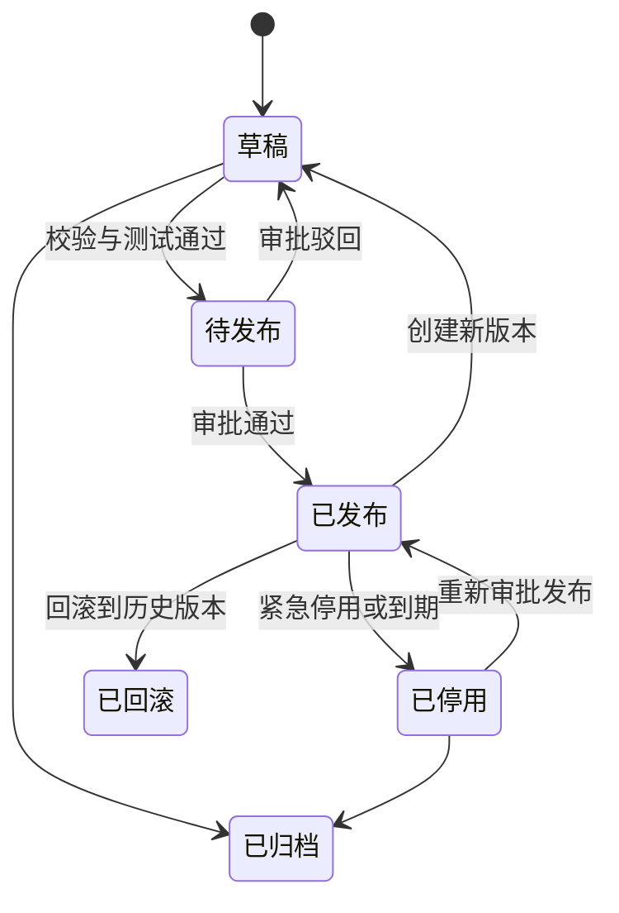
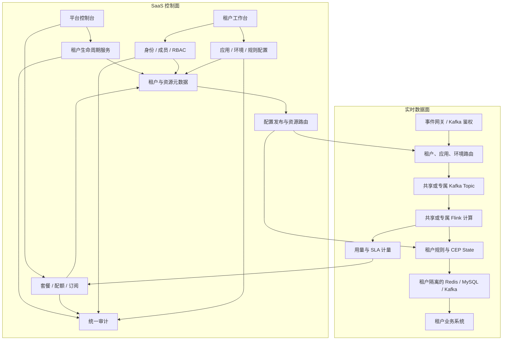
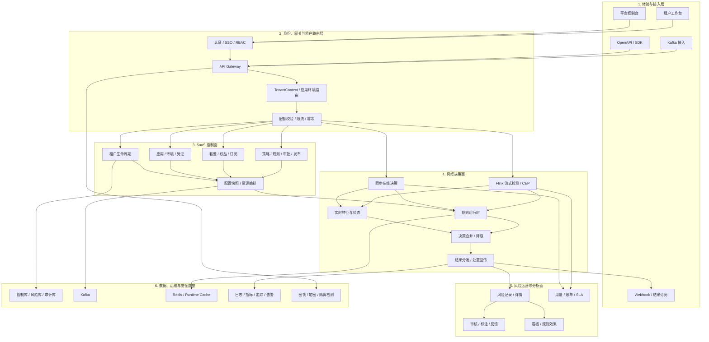
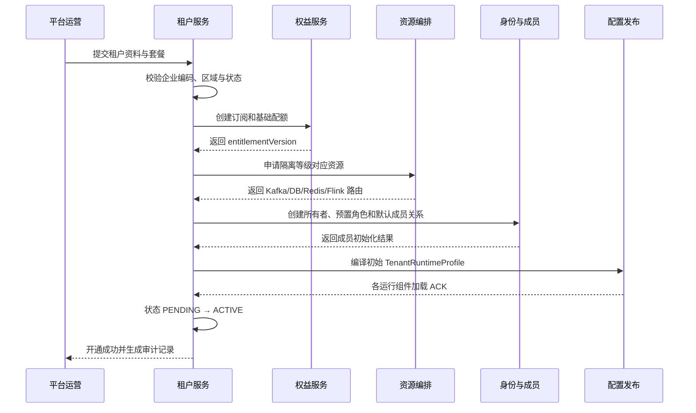
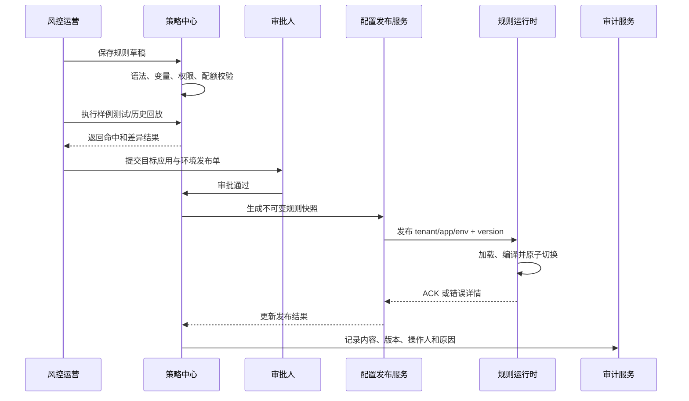
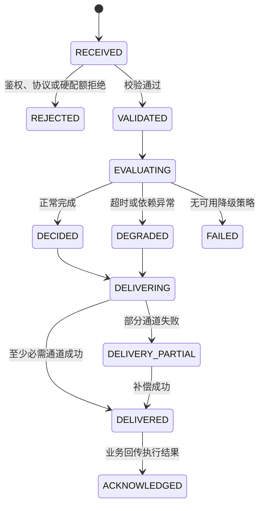

# 6. 产品流程

[返回章节目录](README.md)

## 6.1 风险决策主流程


## 6.2 规则生命周期



当前实现只有 `enabled=true/false`，V1.0 需补充草稿、审批、版本与回滚语义。规则生命周期只能在所属租户、应用和环境内流转，跨环境发布必须生成新的发布记录。

## 6.3 决策优先级

当一次模式结果命中多条规则时：

1. 风险等级分数高者优先：`CRITICAL(100) > HIGH(80) > MEDIUM(50) > LOW(10)`。
2. 风险等级相同时，规则权重高者优先。
3. 最终输出最高优先级规则的动作，同时保留全部命中规则清单用于解释和分析。
4. 没有规则命中时默认 `LOW / 0 / ALLOW`，但需标注 `NO_RULE_MATCHED`。
5. 规则未加载或引擎异常时不得与普通放行混淆，必须输出降级状态并告警；是否放行由场景级降级策略决定。

## 6.4 SaaS 控制面与数据面



设计原则：控制面负责“谁可以用、能用什么、使用多少、配置是什么”，数据面负责“稳定处理已授权租户的实时事件”。控制面短时故障不能中断数据面，数据面继续使用最后一个已验证配置版本。

## 6.5 产品逻辑分层

目标产品不是把现有规则页面简单增加一个 `tenant_id`，而是由六层能力共同组成。上层只通过稳定服务契约使用下层能力，不直接跨层读写数据库。



| 层级 | 核心产品问题 | 关键输出 |
|---|---|---|
| 体验与接入层 | 谁通过什么方式使用平台 | 页面、API、SDK、Topic、Webhook |
| 身份与租户路由层 | 调用者属于谁、能访问什么、是否超额 | 受信任 `TenantContext`、鉴权结果、路由与限流结果 |
| SaaS 控制面 | 租户拥有什么能力、配置的哪个版本生效 | 租户运行档案、权益、规则发布单、配置快照 |
| 风控决策面 | 当前请求或行为序列应做什么 | 决策 ID、风险等级、动作、解释、运行状态 |
| 风险运营与分析面 | 风险是否处理、规则是否有效、使用了多少资源 | 审核结论、效果指标、用量和账单明细 |
| 数据与治理底座 | 如何安全、稳定、可审计地运行 | 隔离存储、消息、监控、审计与安全告警 |

## 6.6 产品领域边界

| 产品域 | 职责 | 权威数据 | 主要消费者 | 明确不负责 |
|---|---|---|---|---|
| 身份域 | 登录、SSO、MFA、账号状态 | `user_account`、身份源 | 平台与租户控制台、网关 | 不决定租户内业务权限 |
| 租户与授权域 | 租户、成员、角色、应用范围 | `tenant`、`membership`、RBAC | 网关、所有业务服务 | 不保存风险规则和风险明细 |
| 商业权益域 | 套餐、订阅、权益、配额 | `plan`、`subscription`、`entitlement` | 网关、资源编排、用量中心 | 不直接执行流量处理 |
| 应用接入域 | 应用、环境、凭证、协议、回调 | `application`、`environment`、`credential` | 事件网关、输出分发 | 不配置风险判断逻辑 |
| 策略中心 | 策略集、规则、测试、审批、版本、发布 | 规则仓库、发布记录 | 配置发布服务、租户工作台 | 不直接处理在线事件 |
| 配置发布域 | 将控制面配置编译为不可变运行快照 | 配置快照、发布状态、运行档案 | 网关、Flink、在线决策服务 | 不允许运行时反向修改草稿 |
| 决策域 | 归一化事件、特征/模式判断、规则执行与合并 | 决策日志、运行版本 | 租户业务、风险中心、分析 | 不负责人工审核结论 |
| 风险运营域 | 风险检索、审核、标注和处置回传 | 风险记录、案件、处置记录 | 风控运营、分析和业务系统 | 不改变历史决策事实 |
| 分析域 | 聚合风险、规则效果和租户运营指标 | 指标口径、聚合事实 | 租户看板、平台看板 | 不直接扫描跨租户明细提供报表 |
| 计量域 | 记录用量、对账、预警和账单明细 | 不可变 `usage_ledger` | 商业运营、租户管理员 | 不作为风控决策事实源 |
| 运维安全域 | 运行监控、审计、告警、密钥和支持会话 | 审计库、指标和安全事件 | 平台运维、安全审计 | 不绕过授权修改租户业务数据 |

### 6.6.1 平台与租户的数据所有权

| 数据或配置 | 所有者 | 平台可见范围 | 租户可操作范围 |
|---|---|---|---|
| 租户主档、状态、隔离等级 | SaaS 平台 | 完整可见并按权限维护 | 查看企业资料，有限字段可编辑 |
| 套餐、权益模板 | SaaS 平台 | 完整维护 | 只读查看当前订阅和可升级项 |
| 租户成员与角色绑定 | 租户 | 平台默认只见统计和安全状态 | 所有者/管理员在本租户维护 |
| 应用、环境、接入凭证 | 租户 | 平台只见元数据和健康状态，Secret 不可见 | 在套餐范围内维护 |
| 规则、策略和测试数据 | 租户 | 默认不可查看业务明文 | 在授权应用和环境内维护 |
| 风险事件、决策和审核 | 租户 | 默认只见脱敏聚合及故障定位元数据 | 按角色与数据范围访问 |
| 用量、配额、SLA 指标 | 平台计量，租户可核对 | 完整可见 | 查看本租户及明细口径 |
| 全局审计和越权安全事件 | SaaS 平台 | 按平台角色访问 | 查看与本租户相关的审计子集 |

## 6.7 配置继承与运行时路由

### 6.7.1 配置优先级

配置按以下顺序由低到高覆盖，但下层配置不能突破上层安全和商业约束：

```text
平台安全基线（不可降低）
  → 套餐权益与配额上限
    → 租户级合法覆盖项
      → 工作空间默认配置
        → 应用配置
          → 环境配置
            → 策略集与规则版本
```

- 平台安全基线包括密码策略、审计保留、禁用函数、最大请求体、跨域和最低加密要求，租户只能收紧不能放宽。
- 套餐定义可用功能和数值上限；租户覆盖项必须在平台授权范围内。
- 应用与环境决定事件协议、凭证、规则快照、降级方式和输出路由。
- 规则只决定业务风险，不允许修改租户身份、数据路由、计费口径和平台安全配置。
- 每次计算后的最终配置生成 `effectiveConfigVersion`，便于决策解释和故障回溯。

### 6.7.2 租户运行档案

控制面将分散配置编译为不可变 `TenantRuntimeProfile`，数据面只消费该档案，不在实时链路中联表查询控制面数据库。

| 字段组 | 内容 |
|---|---|
| 身份 | `tenantId`、`workspaceId`、`appId`、`environment` |
| 状态 | 租户状态、应用状态、环境状态、凭证版本 |
| 权益 | 功能开关、EPS、月事件量、规则数、保留周期 |
| 路由 | 输入 Topic、输出 Topic、Flink 资源池、DB Route、Redis Route |
| 策略 | 已发布策略集、规则快照版本、模式元数据版本 |
| 运行 | 降级策略、超时、重试、幂等窗口、回调配置 |
| 安全 | 隔离等级、密钥引用、IP 白名单、脱敏策略 |
| 版本 | `profileVersion`、发布时间、校验和、上一稳定版本 |

发布逻辑：

1. 控制面校验租户状态、订阅权益和配置完整性。
2. 编译运行档案并计算校验和，不直接覆盖当前有效档案。
3. 写入版本库并发送配置变更事件。
4. 网关、在线决策服务和 Flink 分别加载新版本并回报 ACK。
5. 所有必需组件 ACK 后标记 `ACTIVE`；超时则保持旧版本并标记发布失败。
6. 回滚只切换到已验证的历史档案，不临时拼接旧配置。

### 6.7.3 资源路由逻辑

```text
TenantContext
  → 查询本地缓存的 TenantRuntimeProfile
    → 根据 isolationLevel 选择共享池 / 增强池 / 专属池
      → 选择 Kafka、Flink、DB、Redis 和输出通道
        → 在目标资源内再次校验 tenant/app/env 绑定
```

- 路由配置变更必须版本化，并支持新旧资源双写或灰度切换。
- 运行档案不存在、签名非法、版本过旧或租户非 `ACTIVE/GRACE` 时，网关拒绝新流量，不使用默认租户路由。
- 资源路由缓存采用短 TTL 加主动失效；控制面不可用时只允许使用未过安全有效期的最后稳定档案。

## 6.8 三类决策链路

目标 SaaS 同时支持同步在线决策、异步流式检测和离线测试回放。三条链路共享规则语义、风险等级、动作字典、解释模型和版本体系，但有不同的入口与时延目标。

| 链路 | 适用场景 | 入口 | 核心能力 | 输出 | 建议时延目标 |
|---|---|---|---|---|---|
| 同步在线决策 | 登录前验证、支付前拦截、下单准入 | HTTPS/gRPC Decision API | 当前事件 + 在线特征 + 单事件/组合特征规则 | 同步返回动作，同时异步留痕 | P95 ≤ 200ms，待容量评审 |
| 异步流式检测 | 登录失败序列、频繁下单、活动刷量 | Kafka Event API | Flink EventTime、CEP、实时聚合 | Kafka/Webhook/风险中心 | 构成模式后 P95 ≤ 10s |
| 离线测试与回放 | 规则测试、历史效果评估、发布前对比 | 样例 JSON/历史数据集 | 固定版本规则和隔离沙箱 | 命中差异、预计风险量 | 非实时，任务化执行 |

当前项目只具备异步流式检测链路。V1.0 若要对外宣称支持“在线阻断”，必须新增同步决策 API；不能把 Kafka 异步结果包装成同步阻断能力。

### 6.8.1 同步与异步结果关系

- 同步决策负责当前业务请求是否继续，必须在超时预算内返回。
- 异步检测负责跨事件序列和持续行为风险，可更新用户风险画像、触发后续限制或告警。
- 两条链路生成独立 `decisionId`，通过 `subjectId`、来源 `eventId` 和 `correlationId` 关联。
- 如果同一业务同时收到同步和异步决策，不覆盖历史结果，而是按租户配置触发升级处置。
- 在线特征与 Flink 指标必须使用统一特征定义和版本，避免相同指标在两条链路中含义不同。

## 6.9 关键端到端业务逻辑

### 6.9.1 租户开通逻辑



开通过程采用 Saga/任务编排：每一步都有幂等键、状态和补偿动作。资源创建失败时租户保持 `PENDING`，不得出现控制台显示正常但数据面无路由的半开通状态。

### 6.9.2 规则发布逻辑



发布状态建议为 `DRAFT → VALIDATED → PENDING_APPROVAL → PUBLISHING → ACTIVE`，异常进入 `REJECTED` 或 `FAILED`。只有 `ACTIVE` 快照可以参与决策；`PUBLISHING` 期间继续使用上一 `ACTIVE` 版本。

### 6.9.3 同步在线决策逻辑

1. 网关认证凭证并生成 `TenantContext`，校验租户、应用和环境状态。
2. 配额服务执行峰值 EPS 限流；幂等服务检查 `Idempotency-Key`。
3. 协议服务归一化请求，生成 `requestId`、`eventId` 和 `correlationId`。
4. 在线特征服务读取并原子更新必要计数，所有特征带租户、应用和环境作用域。
5. 规则运行时读取内存中的 `ACTIVE` 快照，执行规则并返回全部命中项。
6. 决策解析器按风险等级、权重、显式优先级和稳定决胜规则合并结果。
7. 在同步超时预算内返回 `decisionId`、动作、原因码、规则版本和降级状态。
8. 决策事实、计量事件和输出事件异步写入；异步留痕失败进入补偿队列，不重复执行租户业务动作。
9. 超时或依赖异常时执行对应环境的降级策略，并明确返回 `DEGRADED`，不能伪装成正常 `ALLOW`。

### 6.9.4 异步流式检测逻辑

1. 接入层验证 Kafka 凭证及事件信封，完成协议校验、幂等和接收计量。
2. 消息按 `tenantId|appId|environment|subjectId` 分区。
3. Flink 从事件信封恢复租户上下文，使用组合 Key 访问 Keyed State。
4. CEP 生成包含来源事件列表和稳定 `patternInstanceId` 的模式结果。
5. 规则运行时按同一租户、应用和环境读取广播快照，禁止跨作用域回退。
6. 决策解析器生成稳定 `decisionId`，保存全部命中规则和最终动作。
7. Redis、MySQL、Kafka/Webhook 输出分别记录状态；失败由通道级补偿任务处理。
8. 决策进入风险中心，并根据动作进入告警、审核或业务回调流程。

### 6.9.5 配额与计量逻辑

```text
请求到达
  → 先做身份与租户状态校验
    → 检查瞬时配额（EPS、并发、任务数）
      → 接收成功后写 RECEIVED 用量事件
        → 完成计算后写 EVALUATED / DECIDED 用量事件
          → 完成输出后写 DELIVERED 用量事件
            → 按时间桶聚合并与 Kafka/决策库对账
```

- 限流判断使用近实时计数，计费使用不可变账本，两者不能共用一个可覆盖计数器。
- 请求被身份或协议校验拒绝时是否计费必须由套餐口径明确；默认不计费但保留安全统计。
- 重试请求只有首次成功接收计入事件量；补偿输出不重复计费。
- 账本聚合延迟不影响实时风控处理，账本不可用时进入本地/消息缓冲并告警。

## 6.10 核心对象状态逻辑

### 6.10.1 决策状态



- `DECIDED/DEGRADED` 是不可修改的决策事实；业务执行结果记录在处置对象中。
- `DELIVERY_PARTIAL` 不能改变风险等级和动作，只描述分发状态。
- 同一幂等请求再次到达时返回原决策及当前分发状态，不创建新决策。

### 6.10.2 凭证状态

```text
CREATED → ACTIVE → ROTATING → REVOKED / EXPIRED
```

- `CREATED` 时 Secret 仅展示一次，完成确认后进入 `ACTIVE`。
- `ROTATING` 允许新旧凭证在配置的重叠窗口内同时有效。
- 租户暂停时凭证逻辑冻结；租户恢复后只有原本未过期且未撤销的凭证恢复。
- `REVOKED` 不可恢复，只能创建新凭证。

## 6.11 模块间一致性与故障边界

| 场景 | 正确行为 | 禁止行为 |
|---|---|---|
| 控制面数据库短时不可用 | 数据面使用最后稳定运行档案并告警 | 清空规则、切换默认租户或停止所有租户 |
| 单租户配置发布失败 | 该租户保持上一版本，其他租户不受影响 | 全量重建全局广播状态 |
| 单租户流量超限 | 仅限流该租户/应用/环境 | 共享线程池耗尽后拖慢其他租户 |
| 某 Sink 失败 | 决策事实保留，通道状态失败并补偿 | 重新执行规则产生不同决策 |
| 计量服务失败 | 缓冲用量事件，继续按安全策略处理 | 因无法计费而静默丢弃已接收事件 |
| 审计服务失败 | 高危控制面写操作失败关闭；数据面日志进入可靠缓冲 | 高危变更无审计直接成功 |
| 租户被暂停 | 拒绝新写入和事件，保留受控只读访问 | 删除租户数据或影响共享作业中的其他租户 |
| 运行档案版本不一致 | 标记租户配置未完全生效，继续旧稳定版或隔离实例 | 混用新规则和旧路由形成不可解释结果 |

## 6.12 当前系统向目标架构的模块映射

| 当前模块 | 当前职责 | SaaS 目标归属 | 主要改造 |
|---|---|---|---|
| `frontend` | 单一管理后台 | 平台控制台 + 租户工作台 | 双路由、租户切换、权限菜单、应用环境上下文 |
| `flink-risk-web` | 规则、风险、统计 API | 租户业务 API + 控制面服务拆分 | TenantContext、RBAC、领域服务、审计、版本发布 |
| `RuleController/RuleService` | 直接 CRUD 当前规则 | 策略中心 | 草稿/审批/发布模型，禁止直接覆盖生产规则 |
| `RuleSourceFunction` | 每 30 秒全量查询启用规则 | 配置发布与规则分发 | 版本化配置事件、租户分桶、ACK 和回滚 |
| `RiskControlApplication` | 三类 Kafka 流统一处理 | 流式决策数据面 | 组合 Key、租户路由、资源池隔离和用量埋点 |
| `PatternFactory/CepJob` | 固定 6 类 CEP | 模式运行时 | 模式元数据版本、稳定实例 ID、跳过策略和环境隔离 |
| `RuleEvaluationFunction` | 单一全局规则广播 | 租户规则运行时 | `tenant/app/env → snapshot` 映射与原子版本切换 |
| `Mysql/Redis/Kafka Sink` | 三路直接输出 | 决策分发域 | 租户路由、稳定决策 ID、通道状态、重试和补偿 |
| `StatsController` | 直接聚合业务表 | 分析域 | 租户聚合、平台脱敏聚合、统一指标口径 |
| 当前不存在 | 同步在线决策 | 在线决策服务 | 新增低延迟 API、在线特征、超时与降级能力 |
| 当前不存在 | 租户/套餐/用量 | SaaS 控制面 | 新增租户、IAM、权益、配额、计量和资源编排 |

---

