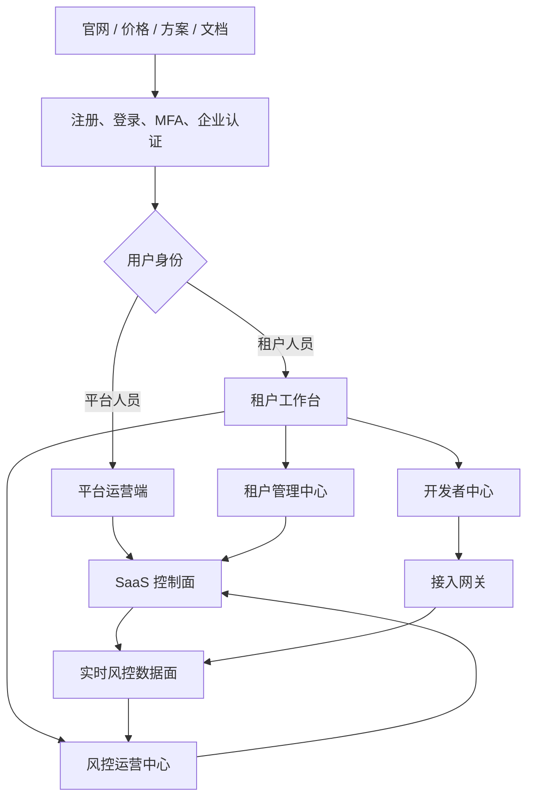

# 7. 信息架构

[返回章节目录](README.md)

完整产品采用“公共入口 + 统一身份 + 平台运营端 + 租户工作台 + 开发者中心 + 实时数据面”的结构。平台运营端和租户工作台可以复用组件与身份中心，但必须使用不同的权限命名空间、路由前缀和服务接口。

## 7.1 产品官网与公共门户

| 一级页面 | 二级内容 | 核心目标 | 主要动作 |
|---|---|---|---|
| 首页 | 产品价值、核心能力、数据指标、客户场景 | 建立认知 | 申请试用、预约演示 |
| 产品 | 在线决策、流式检测、策略中心、风险运营 | 解释产品 | 查看能力详情 |
| 解决方案 | 账号安全、交易风控、营销反作弊、API 防滥用 | 对应业务问题 | 查看方案、咨询顾问 |
| 架构与安全 | 控制面/数据面、多租户隔离、SLA、合规 | 建立技术信任 | 下载白皮书 |
| 价格 | 开发者、专业、企业版和权益对比 | 支持商业决策 | 免费开始、联系销售 |
| 开发者资源 | 快速开始、API、SDK、事件协议、状态页 | 降低接入门槛 | 登录控制台 |
| 客户服务 | 帮助中心、服务状态、联系我们 | 提供持续服务 | 提交工单 |
| 法务 | 隐私、服务条款、数据处理协议、安全说明 | 满足合规 | 阅读与下载 |

官网表单只创建线索或试用申请，不直接创建生产租户。自助试用需经过邮箱验证、企业基本信息校验和反滥用控制。

## 7.2 统一身份与账户中心

| 模块 | 页面或能力 | 关键规则 |
|---|---|---|
| 注册与登录 | 邮箱/手机号注册、密码登录、验证码、企业 SSO | 登录账号与租户成员关系分离 |
| 账号安全 | MFA、密码修改、设备与会话、登录历史、恢复方式 | 高危操作必须二次认证 |
| 企业认证 | 企业名称、统一信用信息、联系人、认证状态 | 认证结果影响试用、生产环境和商务能力 |
| 租户选择 | 最近租户、租户搜索、申请加入、创建租户 | 每个会话只有一个当前租户上下文 |
| 个人资料 | 姓名、头像、语言、时区、通知偏好 | 不存放租户内角色配置 |
| 邀请处理 | 接受/拒绝邀请、邀请过期、身份冲突处理 | 接受邀请后生成 Membership |
| API 个人令牌 | 创建、撤销、到期和最近使用记录 | 仅允许访问本人被授权的租户资源 |

## 7.3 SaaS 平台运营端

路由建议统一使用 /platform，仅对平台角色开放。

| 一级模块 | 二级页面 | 关键功能 |
|---|---|---|
| 平台总览 | 经营概览 | 租户、试用、转化、续费、订阅收入、事件量、决策量和 SLA |
| 客户与线索 | 试用申请、演示线索 | 分配销售/运营、跟进状态、转租户申请 |
| 租户管理 | 租户列表、租户 360° 详情 | 审核、开通、暂停、恢复、注销、隔离等级和健康状态 |
| 商业中心 | 套餐、权益、价格版本 | 版本化套餐、功能开关、数值配额、折扣与定制权益 |
| 商业中心 | 订阅、合同、账单 | 试用、续费、升降配、宽限期、账单预览和冲正 |
| 计量中心 | 用量明细、对账、异常计量 | 事件量、决策量、峰值 EPS、存储、回放任务和资源用量 |
| 资源中心 | 资源池、租户路由、容量 | Kafka、Flink、MySQL、Redis 共享/专属资源分配 |
| 运维中心 | 全局监控、租户 SLA、告警事件 | 延迟、积压、错误、容量、故障范围和恢复进度 |
| 安全中心 | 越权、密钥、隔离和异常导出 | 安全事件分级、处置、证据和复盘 |
| 客户成功 | 工单、支持会话、服务记录 | 租户授权、限时支持、客户健康度和续费风险 |
| 内容运营 | 公告、帮助文档、模板市场 | 服务公告、规则模板、场景方案和版本发布说明 |
| 平台设置 | 平台成员、角色、字典、全局策略 | 平台 RBAC、动作字典、默认安全基线和审计 |

平台租户详情采用 360° 视图，但业务数据遵循最小可见原则：

- 商务页签：企业资料、合同、订阅、权益、账单。
- 使用页签：事件量、决策量、用量趋势、配额预测。
- 服务页签：SLA、资源路由、告警、工单、变更记录。
- 安全页签：认证、SSO、密钥状态、越权事件、支持授权。
- 数据页签默认只显示脱敏聚合，不允许平台人员直接浏览租户规则表达式与业务明细。

## 7.4 租户工作台

路由建议统一使用 /app。顶部固定展示当前租户、工作空间、应用和环境，PROD 使用强提醒样式。

| 一级模块 | 二级页面 | 适用角色 | 关键功能 |
|---|---|---|---|
| 工作台 | 总览、待办、最近活动 | 全部租户成员 | 风险摘要、规则发布、审核待办、用量、服务健康 |
| 应用管理 | 应用、环境、场景配置 | 所有者、管理员、接入方 | 应用生命周期、DEV/TEST/PROD、场景与降级策略 |
| 策略中心 | 策略集、规则、名单、模板 | 风控运营、负责人 | 创建、测试、复制、版本、审批、灰度、发布、回滚 |
| 风险中心 | 风险记录、风险详情、审核队列 | 运营、分析师、审核员 | 检索、解释、标注、审核、处置和导出 |
| 数据分析 | 风险看板、规则效果、业务反馈 | 负责人、分析师 | 命中、误报、确认风险、阻断、损失与趋势 |
| 接入管理 | 事件协议、数据源、凭证、Webhook | 管理员、接入方 | API/Kafka 接入、Secret 轮换、回调、调用日志 |
| 运行中心 | 实时链路、任务、告警、状态页 | 管理员、接入方 | 输入、Flink、规则快照、输出和服务质量 |
| 组织权限 | 成员、团队、角色、数据范围 | 所有者、管理员 | 邀请、禁用、移交、预置/自定义角色和应用权限 |
| 商业与用量 | 当前套餐、配额、账单、升级 | 所有者、财务、管理员 | 权益、实时用量、预测、续费和升级申请 |
| 安全与审计 | SSO、MFA、IP 白名单、审计 | 所有者、安全管理员 | 企业安全策略、日志、导出和数据生命周期 |
| 服务支持 | 工单、公告、服务状态、顾问 | 所有者、管理员 | 提交问题、授权支持、查看进展和服务记录 |

## 7.5 风控运营中心

风控运营中心属于租户工作台的业务核心，不单独建立另一套租户体系。

| 功能域 | 核心对象 | 关键页面 | 完成标准 |
|---|---|---|---|
| 策略设计 | 策略集、规则、特征、名单 | 策略画布、规则编辑器、变量字典 | 可以表达一个完整风险场景 |
| 策略验证 | 样例、测试集、历史回放 | 单次调试、批量回放、版本对比 | 发布前可以评估命中与变化 |
| 发布治理 | 发布单、审批、快照、灰度 | 发布中心、差异、审批记录 | 生产变更可控、可审计、可回滚 |
| 决策运营 | 风险记录、决策解释 | 列表、详情、事件链、命中规则 | 每个结果可解释、可追踪 |
| 人工处置 | 案件、任务、审核结论 | 审核队列、分配、批量处理 | REVIEW 有明确负责人和结果 |
| 效果反馈 | 标签、执行结果、业务损失 | 标注、反馈导入、效果分析 | 能衡量误报、确认风险和规则价值 |

## 7.6 开发者中心

| 模块 | 页面 | 核心能力 |
|---|---|---|
| 快速开始 | 接入向导 | 创建应用 → 获取测试凭证 → 发送首个事件 → 查看首个决策 |
| API 文档 | Decision API、事件 API、反馈 API、管理 OpenAPI | 按版本展示请求、响应、错误码、幂等和限流 |
| SDK | Java、JavaScript、Go 等 | 初始化、签名、重试、超时、示例和版本兼容 |
| 事件模型 | Schema、字段字典、样例、变更记录 | 在线校验、协议版本和兼容性说明 |
| 凭证 | API Key、OAuth Client、Kafka 凭证 | 创建一次展示、轮换、禁用、范围和来源限制 |
| Webhook | Endpoint、事件订阅、签名、重试 | 测试发送、失败记录、重放和死信 |
| API 观察 | 调用日志、延迟、错误、限流 | 按应用和环境查询，不展示 Secret |
| 沙箱工具 | 请求构造器、事件模拟器、签名工具 | 不接触生产数据即可完成联调 |
| 变更与状态 | Changelog、弃用计划、服务状态 | 提前通知破坏性变更与故障 |

## 7.7 通知、工单与全局能力

以下能力跨平台运营端和租户工作台，不应由各模块重复实现：

| 能力 | 触发来源 | 通道 | 用户控制 |
|---|---|---|---|
| 站内通知 | 审批、发布、配额、账单、成员和工单 | 站内消息中心 | 已读、归档、跳转目标 |
| 告警通知 | 决策异常、链路故障、延迟和安全事件 | 邮件、短信、Webhook、IM | 订阅规则、接收人、静默时段 |
| 服务公告 | 版本发布、维护、故障和合规更新 | 官网状态页、站内、邮件 | 按影响租户和区域投递 |
| 工单 | 接入、计费、故障、安全和产品咨询 | 站内工单、邮件回复 | 优先级、SLA、附件、授权支持 |
| 审批待办 | 规则、权限、密钥、导出和高危配置 | 站内待办、邮件 | 委托、催办、过期和审计 |

## 7.8 全局上下文与导航规则

1. 平台端只有 PlatformContext，不允许通过修改 URL 切换为租户数据访问。
2. 租户端必须建立 TenantContext → WorkspaceContext → AppContext → EnvironmentContext。
3. 切换租户时重新签发令牌并清空接口缓存、订阅连接和未保存表单。
4. 切换应用或环境时保留租户身份，但重新加载权限范围、规则快照、凭证和数据筛选。
5. PROD 的发布、密钥、删除和导出操作必须二次确认；规则发布可要求 MFA 或双人审批。
6. 页面菜单由权限服务返回，隐藏菜单不是授权手段，服务端仍需对资源和字段再次鉴权。
7. 当前代码已有系统概览、规则管理、风险记录和数据看板，只覆盖租户工作台的一部分；完整 SaaS 需要按上述信息架构逐步拆分。

---

