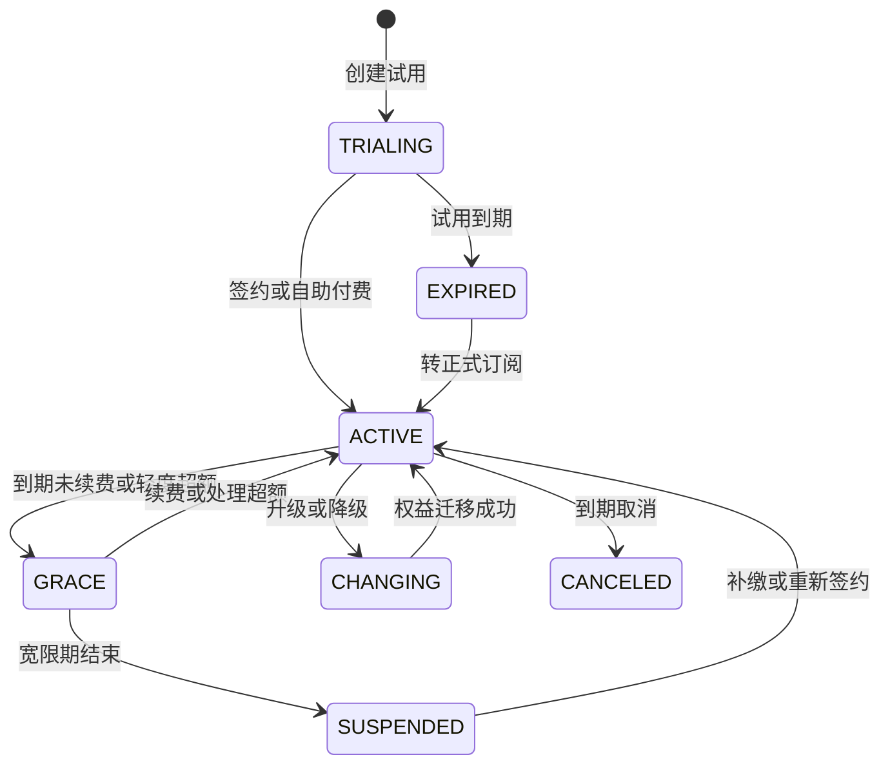

# 8. 功能需求

[返回章节目录](README.md)

## 8.1 FR-01 事件接入

### 8.1.1 接入方式

- 三类事件分别进入 `login-events`、`order-events`、`activity-events`。
- 事件格式为 UTF-8 JSON，时间戳使用 Unix 毫秒。
- 事件网关根据 API Key、OAuth Client 或 Kafka 凭证解析租户、应用和环境，并写入受信任的事件信封。
- 默认按 `tenantId + appId + environment + userId` 进行 CEP 分组；`userId` 不能为空，任何状态不得跨租户或跨生产/测试环境聚合。
- 标准版可使用共享 Topic；企业版可配置专属 Topic。两种模式使用相同事件协议和隔离校验。
- Kafka 消息 Key 使用 `tenantId|appId|environment|userId`，保证同一租户业务主体的事件有序路由。
- Flink 接受最多 5 秒乱序事件，超过允许迟到范围的事件进入迟到事件侧输出，不得静默丢弃。
- 接入管理页按租户和环境展示 Topic、协议版本、必填字段、样例、消费延迟及最近接入时间。

### 8.1.2 公共字段

| 字段 | 类型 | 必填 | 说明 |
|---|---|---:|---|
| `tenantId` | String | 系统注入 | 租户 ID；必须与接入凭证绑定租户一致 |
| `workspaceId` | String | 系统注入 | 工作空间 ID；V1.0 默认工作空间可省略展示 |
| `appId` | String | 是 | 租户内应用 ID |
| `environment` | Enum | 是 | `DEV`、`TEST`、`PROD` |
| `eventId` | String | 是 | 来源事件唯一 ID，用于追踪和幂等 |
| `eventType` | Enum | 是 | `LOGIN`、`ORDER`、`ACTIVITY` |
| `userId` | String | 是 | 风控主体 ID |
| `timestamp` | Long | 是 | 事件发生时间，Unix 毫秒 |
| `attributes` | Object | 否 | 扩展属性，需受字段白名单和大小限制 |

### 8.1.3 场景字段

| 事件 | 关键字段 |
|---|---|
| 登录 | `ip`、`deviceId`、`success`、`failureReason`、`location`、`browser` |
| 订单 | `orderId`、`amount`、`productId`、`productName`、`quantity`、`paymentMethod`、`deliveryAddress` |
| 活动 | `activityId`、`activityName`、`couponCode`、`couponValue`、`actionType`、`channel`、`source` |

### 8.1.4 校验与异常处理

- 必填字段缺失、枚举非法、金额为负、时间戳异常时进入坏数据 Topic，并记录错误码和原始消息摘要。
- `tenantId + appId + environment + eventId + eventType` 作为来源事件幂等键；不同租户可使用相同的业务事件 ID，重复事件不得重复参与模式计算。
- 支持协议版本字段，新增字段保持向后兼容，删除或改义必须升级主版本。
- 管理端可查看最近坏数据、错误原因和重放状态。
- 凭证绑定的租户、应用、环境与消息声明不一致时直接拒绝，并产生安全审计；不得采用消息中的声明覆盖受信任上下文。

## 8.2 FR-02 行为模式检测

### 8.2.1 当前标准模式

| 模式编码 | 场景 | CEP 触发条件 | 窗口 | 当前上下文 |
|---|---|---|---:|---|
| `LOGIN_FAILURE` | 登录 | 同一用户 3 次 `success=false` | 60 秒 | `failCount`、IP、设备、位置、浏览器 |
| `LOCATION_CHANGE` | 登录 | 同一用户 2 次 `success=true`，规则再判断前后 IP | 60 秒 | `prevIp`、`currIp`、位置、设备 |
| `ORDER_FREQUENT` | 订单 | 同一用户 3 次 `amount>0` | 60 秒 | `orderCount`、`totalAmount`、末次订单信息 |
| `ORDER_RAPID` | 订单 | 同一用户 2 次 `amount>100` | 30 秒 | `intervalMs`、末次订单信息 |
| `ACTIVITY_FREQUENT` | 活动 | 同一用户 4 次 `actionType=PARTICIPATE` | 60 秒 | `participationCount`、活动、渠道、来源 |
| `COUPON_REPEAT` | 活动 | 同一用户 3 次 `actionType=CLAIM_COUPON` | 60 秒 | `participationCount`、优惠券、渠道、来源 |

CEP 使用宽松连续匹配，满足条件的事件之间可以穿插不相关事件。V1.0 需明确匹配后跳过策略，避免同一事件组合产生大量重叠结果。

### 8.2.2 模式管理要求

- V1.0 模式定义由研发维护，管理端只读展示模式编码、条件、窗口和上下文变量。
- 模式窗口必须以代码实际配置为准并自动暴露给管理端，禁止页面硬编码另一套口径。
- 变更模式条件需要版本号和回归用例，不允许只改说明文档。
- 后续版本可提供可视化模式编排，但不纳入 V1.0。

## 8.3 FR-03 规则中心

### 8.3.1 规则字段

| 字段 | 必填 | 说明 |
|---|---:|---|
| 所属租户 | 系统生成 | 从当前租户上下文写入，不允许表单修改 |
| 应用与环境 | 是 | 规则生效的应用和 DEV/TEST/PROD 环境 |
| 规则 ID | 系统生成 | 全局唯一、不可修改 |
| 规则名称 | 是 | 同一场景内不可重名 |
| 场景类型 | 是 | 登录、订单、活动、通用；必须独立存储，不再从名称推断 |
| 适用模式 | 是 | 选择一个或多个 CEP 模式，或选择“单事件规则” |
| 表达式 | 是 | Aviator 表达式 |
| 风险等级 | 是 | LOW、MEDIUM、HIGH、CRITICAL |
| 执行动作 | 是 | 标准动作字典中的一个值 |
| 权重 | 是 | 同等级规则的优先级，建议范围 1～100 |
| 描述 | 是 | 业务意图和风险说明 |
| 生效时间 | 否 | 不填则发布后立即生效 |
| 失效时间 | 否 | 到期自动停用 |
| 版本 | 系统生成 | 每次发布递增 |
| 状态 | 系统生成 | 草稿、待发布、已发布、已停用、已归档、已回滚 |

### 8.3.2 列表与查询

- 按名称、场景、模式、风险等级、动作、状态、创建人、更新时间筛选。
- 支持分页、刷新、排序、批量启停、批量导出。
- 列表展示名称、场景、模式、等级、动作、版本、状态、命中次数、更新时间和操作人。
- 风险等级、动作和状态使用统一字典，不允许出现未映射的裸值。

### 8.3.3 新建与编辑

- 提供登录、订单、活动三类参考模板，并允许复制现有规则。
- 表达式编辑器根据选中的模式展示可用变量、类型、说明和样例。
- 不允许引用当前模式不存在的变量。
- 保存草稿不影响线上规则；发布成功后才进入 Flink 广播状态。
- 已发布规则不可原地覆盖，编辑时创建新版本。
- 规则名称唯一性、复制、版本和审批均限定在租户、应用和环境作用域内；平台管理员无权直接修改租户业务规则。

### 8.3.4 规则校验与测试

- 保存前执行语法编译校验；错误需定位到表达式位置并给出可理解提示。
- 校验 `=~` 正则语法，统一采用 Aviator 支持的正则字面量。
- 校验风险等级、动作、权重、时间范围和变量类型。
- 支持输入上下文 JSON 或选择标准样例，返回：是否命中、全部命中规则、最终规则、分数、动作、执行耗时。
- 支持发布前回放最近一段历史样本，展示预计命中量和结果变化；V1.0 可先实现小样本回放。

### 8.3.5 发布、热更新与回滚

- 发布需填写变更原因；高风险动作规则需负责人审批。
- 发布后 60 秒内在所有 Flink 并行实例生效，并展示生效状态。
- 规则广播状态按 `tenantId + appId + environment` 保存快照；更新一个租户规则不得重建或覆盖其他租户的规则集。
- 发布失败时保留旧版本，不得把空规则集当作正常发布。
- 支持一键回滚到上一已发布版本。
- 紧急停用无需等待常规审批，但必须填写原因并触发告警。

## 8.4 FR-04 决策引擎

- 同一模式结果可以命中多条规则，系统必须保存全部命中规则及最终决策规则。
- 规则查询和执行必须使用事件中的受信任租户、应用、环境上下文，只能访问完全相同作用域的已发布规则快照。
- 最终优先级遵循“风险等级 > 权重”；若仍相同，按显式优先级或规则 ID 稳定决胜，确保可复现。
- 风险分数与等级映射需配置化。V1.0 默认分数：LOW=10、MEDIUM=50、HIGH=80、CRITICAL=100。
- 单事件规则必须有独立执行入口。当前实现只有 CEP 命中后才执行规则，因此“单笔大额订单”等规则并非对所有订单生效；V1.0 必须修正执行模型或在产品上禁止创建此类误导规则。
- 决策结果至少包含：决策 ID、来源事件 ID 列表、用户、事件类型、模式、等级、分数、动作、全部命中规则、最终规则、关键上下文、决策时间、规则版本和引擎状态。
- 决策结果必须包含 `tenantId`、`workspaceId`、`appId`、`environment`，作为查询、存储、输出和计量的强制隔离字段。
- 降级策略按场景配置：`FAIL_OPEN`、`FAIL_CLOSED`、`VERIFY_ONLY`。规则未加载、规则引擎异常、下游不可用时必须记录降级原因。

## 8.5 FR-05 风险记录

### 8.5.1 列表

- 按用户 ID、事件类型、模式、风险等级、动作、规则、处置状态和时间范围筛选。
- 租户用户只能查询当前租户及获授权应用/环境的记录；平台人员默认只能看到聚合指标和脱敏故障信息。
- 默认按检测时间倒序，支持分页和 CSV 导出。
- 展示决策 ID、用户、场景、模式、等级、分数、动作、最终规则、处置状态、检测时间。
- 支持从概览和看板带筛选条件跳转到列表。

### 8.5.2 详情

- 基本信息：用户、事件、模式、风险等级、分数、动作和时间。
- 事件链：参与本次判断的事件按发生时间排列，显示关键字段。
- 决策解释：全部命中规则、最终规则、规则版本、表达式和实际变量值。
- 输出状态：Redis、MySQL、Kafka 各通道是否成功、重试次数和最后错误。
- 处置记录：业务执行结果、审核结果、操作人、原因和更新时间。
- 敏感信息按权限脱敏，原始详情不直接暴露数据库 JSON。

## 8.6 FR-06 审核与处置闭环

- `REVIEW` 结果自动进入审核队列，支持待处理、处理中、已通过、已拒绝、已关闭。
- 审核员可以查看事件链和规则解释，填写结论、原因和备注。
- `VERIFY`、`LIMIT`、`DISABLE`、`BLOCK` 等动作由业务系统执行，并通过接口或 Kafka 回传执行结果。
- 回传字段包括决策 ID、执行状态、执行时间、业务流水号、失败原因和最终业务结果。
- 分析师可标注“确认风险、误报、待确认”，为规则效果分析提供标签。

## 8.7 FR-07 系统概览与数据看板

### 8.7.1 系统概览

- 租户工作台展示本租户的规则总数、已发布规则数、今日风险事件数、今日高风险事件数。
- 登录、订单、活动场景分布。
- LOW、MEDIUM、HIGH、CRITICAL 等级分布。
- Kafka 消费延迟、规则最近同步时间、Sink 异常数和配额使用率摘要。
- 平台控制台展示租户总数、活跃租户、各套餐租户数、事件量、决策量、资源水位和异常租户数，不默认展示租户业务明细。

### 8.7.2 数据看板

- 支持今日、近 7 日、近 30 日和自定义时间范围。
- 展示风险总量趋势、高风险趋势、场景分布、动作分布和 Top 规则。
- 规则效果指标包括命中数、独立用户数、阻断数、确认风险数、误报数和误报率。
- 点击图表可下钻到带筛选条件的风险记录。
- 指标口径在页面展示定义；“命中规则数”需区分规则种类数与命中次数。
- 租户看板只聚合当前租户数据；平台看板使用独立的脱敏聚合表，不通过绕过租户过滤直接查询业务明细。

## 8.8 FR-08 决策输出与业务接入

### 8.8.1 输出通道

| 通道 | 用途 | 当前实现 | V1.0 要求 |
|---|---|---|---|
| Redis | 低延迟临时查询 | Key 为 `risk:{eventType}:{userId}:{eventId}`，TTL 1 小时 | 内容包含完整决策摘要；支持按决策 ID 查询 |
| MySQL | 历史检索与分析 | 写入 `risk_result` | 增加决策唯一键、规则版本、模式、处置状态和输出状态 |
| Kafka | 下游实时订阅 | `risk-results` | 定义协议版本、幂等键、重试与死信 Topic |

SaaS V1.0 的 Redis Key 调整为 `risk:{tenantId}:{environment}:{eventType}:{userId}:{decisionId}`；Kafka 共享输出 Topic 的消息 Key 必须包含租户和决策 ID，企业专属 Topic 通过租户订阅权益配置。

### 8.8.2 幂等与一致性

- 生成稳定的 `decisionId`，同一模式实例重复处理时保持一致。
- MySQL 对 `decisionId` 建唯一索引，使用幂等写入。
- Kafka 消息 Key 使用 `decisionId` 或明确的业务幂等键。
- 任何通道失败必须可观测、可重试；不得仅写日志后忽略。
- 不承诺三通道分布式事务，但必须记录每个通道状态并提供补偿任务。

## 8.9 FR-09 用户、权限与审计

- 支持用户名密码或企业统一身份认证接入。
- 身份账号与租户成员关系分离：一个用户账号可加入多个租户，在各租户拥有不同角色和应用范围。
- 平台角色与租户角色使用两套权限命名空间，禁止给租户角色授予平台权限。
- 租户侧至少提供所有者、管理员、只读、运营、审批、分析、审核、接入八类预置角色，并支持自定义角色。
- 页面、接口和数据字段三层权限控制。
- 审计日志不可由普通用户删除，默认保留 1 年。
- API 错误响应不返回服务端堆栈和数据库敏感信息。
- 生产环境禁止通配来源 CORS，按域名白名单配置。

## 8.10 FR-10 运行监控

- 展示 Flink Job 状态、Checkpoint 成功率、重启次数、反压、各算子吞吐和延迟。
- 展示 Kafka Topic 积压、消费速率、坏数据和迟到事件数量。
- 展示 MySQL、Redis、Kafka Sink 成功率、耗时、重试和失败数量。
- 展示当前规则版本、规则数量、最后同步时间和各并行实例同步状态。
- 支持对作业失败、规则空集、同步超时、消费积压、Sink 失败率超阈值发送告警。
- 所有核心指标必须包含 `tenantId`、`appId`、`environment` 标签或等价的安全聚合维度。
- 平台运维可以查看各租户资源使用和服务质量；租户运维只能查看本租户数据，且不能由查询参数切换到其他租户。

## 8.11 FR-11 SaaS 平台控制台

### 8.11.1 租户管理

- 平台运营可创建、审核、编辑、暂停、恢复和发起注销租户。
- 租户字段包括租户 ID、名称、编码、企业主体、联系人、区域、时区、状态、套餐、到期时间、隔离等级和备注。
- 开通任务自动创建默认工作空间、生产前测试环境、租户所有者、预置角色、基础配额和审计上下文。
- 租户详情展示基本资料、订阅、配额、用量、成员数、应用数、服务健康、告警和生命周期记录。
- 暂停、恢复、注销和隔离等级变更属于高危操作，需要二次确认、原因和审批记录。

### 8.11.2 套餐与权益

- 套餐采用版本化设计。修改套餐只影响新订阅，存量租户需显式迁移。
- 权益分为功能权益和数值配额，例如是否支持生产环境、审核队列、SSO、专属 Topic、专属计算资源。
- 支持按租户覆盖套餐默认配额，但覆盖项必须记录原因、有效期和审批人。
- 套餐到期、超额或降级时先做影响预览，不得直接删除规则、风险数据或密钥。

### 8.11.3 平台支持与安全

- 平台客服只能查看租户基础配置、用量和脱敏故障上下文。
- 进入租户支持会话必须绑定工单、租户授权、有效期和操作范围，页面持续显示“支持模式”。
- 平台支持会话不能创建、发布或删除租户规则，除非走独立的紧急授权流程。
- 全局记录跨租户访问、异常导出、连续鉴权失败、密钥泄露风险和隔离校验失败。

## 8.12 FR-12 租户工作台

### 8.12.1 租户初始化与切换

- 首位开通用户成为租户所有者，并通过向导完成企业信息、应用、环境、场景和接入方式配置。
- 多租户用户登录后选择租户；切换租户会刷新访问令牌、菜单、角色、应用列表和缓存数据。
- 页面顶部始终显示当前租户、应用和环境，生产环境使用明显标识。
- 浏览器多标签页切换租户时不得复用上一租户的接口缓存或表单草稿。

### 8.12.2 成员与组织

- 支持邮箱或手机号邀请成员、撤回邀请、禁用成员、移交所有者。
- 角色可绑定全部应用或指定应用，并可限制 DEV/TEST/PROD 环境。
- 成员离开租户后，其个人令牌、未完成审批和临时支持授权立即失效。
- 最后一个租户所有者不能被删除或主动退出，必须先移交所有权。

### 8.12.3 应用与环境

- 租户可按套餐创建应用，每个应用具有稳定 `appId`。
- 每个应用支持 DEV、TEST、PROD 环境；不同环境拥有独立凭证、规则版本、CEP 状态、结果和回调配置。
- 规则从 DEV 向 TEST、PROD 发布时生成发布单，展示差异、测试结果和目标环境审批。
- 删除应用前必须停用接入、导出数据并经过等待期；生产应用默认只能归档。

### 8.12.4 接入凭证

- 支持创建、查看一次、禁用、轮换 API Key、OAuth Client 和 Kafka 凭证。
- 凭证绑定租户、应用、环境、权限范围、来源 IP 白名单和失效时间。
- Secret 只在创建时展示一次，服务端只保存安全哈希或加密密文。
- 密钥轮换支持新旧凭证短期并行，避免业务中断；所有使用和变更均可审计。

## 8.13 FR-13 多租户隔离

### 8.13.1 隔离等级

| 等级 | 适用套餐 | 计算与消息 | 数据存储 | 说明 |
|---|---|---|---|---|
| 共享逻辑隔离 | 开发版/标准版 | 共享 Flink 作业和 Kafka Topic | 共享库表，强制 `tenant_id` | 成本优先，必须完成全链路租户过滤 |
| 增强隔离 | 专业版 | 共享集群、租户独立 Topic 或作业槽位 | 独立 Schema 或分片 | 适合较高吞吐和合规要求 |
| 专属隔离 | 企业版 | 专属 Topic、Flink 作业或集群 | 独立数据库/Redis | 提供独立容量、密钥和 SLA |

隔离等级可以升级，降级必须先完成数据和资源迁移评估。V1.0 默认实现共享逻辑隔离，同时预留路由到专属资源的能力。

### 8.13.2 全链路隔离规则

| 层级 | 强制要求 |
|---|---|
| 身份与请求 | JWT/API Key 绑定当前租户；网关生成租户上下文；Body 中的租户字段仅用于一致性校验 |
| 数据库 | 所有租户业务表包含 `tenant_id`；DAO/ORM 自动注入租户条件；唯一键和索引包含租户作用域 |
| Redis | Key 必须以租户和环境为前缀；禁止全局模糊扫描后在应用层过滤 |
| Kafka | 凭证 ACL、消息租户信封和消费端三重校验；共享 Topic 消息 Key 包含租户作用域 |
| Flink Keyed State | Key 为租户、应用、环境和业务主体的组合，禁止只按 `userId` 分组 |
| Flink Broadcast State | 规则按租户、应用和环境分桶，单租户更新不得全量覆盖全局状态 |
| Sink | 落库、缓存和输出前再次校验决策上下文完整且与目标资源绑定一致 |
| 文件与导出 | 导出文件使用租户独立路径和临时签名地址，下载时再次鉴权 |
| 日志与指标 | 日志中的敏感字段脱敏；租户指标通过授权查询，平台侧仅看安全聚合 |
| 备份与删除 | 具备按租户定位、导出、恢复和删除的能力，并保留操作证明 |

### 8.13.3 防越权控制

- 业务服务内部统一使用 `TenantContext`，禁止 Controller 将客户端传入的 `tenantId` 直接下传到查询条件。
- MyBatis 层启用租户拦截器或等价机制；对原生 SQL、异步任务和批处理建立扫描与测试规则。
- 所有缓存、消息、异步任务、定时任务都必须显式携带租户上下文；上下文缺失时拒绝执行，不使用“默认租户”。
- 在 CI 中执行双租户隔离测试：使用相同用户 ID、事件 ID、规则名和业务流水号验证结果互不可见。
- 对跨租户读取、租户上下文缺失和凭证声明不一致建立高优先级安全告警。

## 8.14 FR-14 套餐、配额与用量

### 8.14.1 建议套餐模型

下表为产品结构建议，不包含最终价格，需商业评审后确认。

| 权益 | 开发版 | 标准版 | 企业版 |
|---|---|---|---|
| 适用场景 | 接入验证与 PoC | 中小规模生产使用 | 高吞吐、强隔离与合规场景 |
| 环境 | DEV/TEST | DEV/TEST/PROD | DEV/TEST/PROD |
| 应用数 | 少量固定配额 | 可扩展配额 | 合同约定 |
| 月事件量与峰值 EPS | 低额度 | 分档额度 | 合同容量 |
| 活跃规则数 | 基础额度 | 较高额度 | 合同约定 |
| 数据保留 | 短周期 | 标准周期 | 可定制 |
| 成员数 | 少量 | 可扩展 | 可定制 |
| SSO | 不支持 | 可选 | 支持 |
| 资源隔离 | 共享 | 共享或增强 | 专属可选 |
| 服务支持 | 社区/文档 | 工作时段支持 | 专属支持与 SLA |

### 8.14.2 配额项

- 月接收事件数、峰值 EPS、日决策数。
- 应用数、生产环境数、活跃规则数、成员数和 API 凭证数。
- 风险数据保留天数、导出次数、单次导出行数和并发导出任务数。
- Webhook 数、通知通道数、历史回放量和审核席位数。

### 8.14.3 超额策略

- 支持 `SOFT_LIMIT` 告警、`THROTTLE` 限流、`HARD_LIMIT` 拒绝三种策略。
- 达到 70%、85%、100% 时向租户管理员和平台运营发送分级提醒。
- 已接收事件的计量与处理必须保持一致；不得先接收计费后因内部配额判断静默丢弃。
- 生产环境默认优先限流并返回明确错误码，是否允许超额继续使用由订阅约定决定。

### 8.14.4 用量计量

- 计量事件使用独立、不可变、可幂等的使用账本，至少包含租户、应用、环境、指标、数量、时间桶和来源 ID。
- 区分接收成功、协议拒绝、参与计算、产生决策和结果输出，避免一个模糊“事件量”同时承担运营和计费口径。
- 租户可查看小时、日、月用量及配额预测；平台可按租户、套餐和资源池对账。
- 用量修正必须通过冲正记录完成，不直接修改历史计量行。

## 8.15 FR-15 同步在线决策

### 8.15.1 请求模型

- 接口示例：`POST /openapi/v1/decisions/evaluate`。
- 租户、应用和环境从接入凭证解析；客户端不能通过 Body 切换作用域。
- 请求至少包含 `eventId`、`eventType`、`subjectId`、`timestamp`、场景编码和事件属性。
- 请求头必须包含 `Idempotency-Key`；同一租户、应用、环境下在幂等窗口内唯一。
- 支持同步决定是否将本次事件同时写入异步事件流，默认写入，保证在线决策与后续行为检测可关联。

### 8.15.2 响应模型

| 字段 | 说明 |
|---|---|
| `requestId` | 本次接口调用追踪 ID |
| `decisionId` | 稳定的风险决策 ID |
| `riskLevel` / `riskScore` | 风险等级和分数 |
| `action` | ALLOW、WARN、VERIFY、REVIEW、LIMIT、DISABLE、BLOCK |
| `reasonCode` | 面向业务系统的稳定原因码，不直接依赖可变规则名称 |
| `matchedRules` | 按租户配置返回规则 ID/名称摘要，敏感表达式默认不返回 |
| `ruleSnapshotVersion` | 实际执行的规则快照版本 |
| `effectiveConfigVersion` | 实际执行的租户运行档案版本 |
| `engineStatus` | NORMAL、DEGRADED、FAILED |
| `expireAt` | 该决策允许被业务复用的截止时间，可为空 |

### 8.15.3 执行约束

- 同步主链路只使用内存规则快照、低延迟在线特征和有明确超时预算的依赖。
- 任何外部名单或特征调用必须配置独立超时、熔断、缓存和降级方式，不允许无限等待。
- 规则运行时必须返回确定性结果；相同配置版本、相同特征快照和相同输入得到相同决策。
- 决策响应成功后，即使异步留痕短时失败，也不得再次要求业务执行相同动作；通过决策 ID 补偿留痕。
- 业务系统必须回传执行状态，区分“平台建议 BLOCK”和“业务实际已 BLOCK”。

## 8.16 FR-16 注册、认证与租户激活

### 8.16.1 获客与注册

- 官网的“免费开始”进入开发者试用注册，“预约演示”进入销售线索流程，两者状态独立。
- 注册必须完成邮箱或手机号验证，并经过验证码、频率限制、设备/IP 风险检测和黑名单检查。
- 用户账号是全局身份，不直接等于租户；创建企业、接受邀请或申请加入后才生成租户成员关系。
- 一个用户可以属于多个租户，但同一时间只在一个当前租户上下文内操作。
- 企业版支持销售代录租户申请，但首位所有者必须本人接受邀请并完成 MFA。

### 8.16.2 首次激活向导

首次进入租户工作台时按以下顺序完成激活：

1. 完善企业资料、行业、区域和默认时区。
2. 选择试用/正式套餐，并确认数据处理及服务条款。
3. 创建首个应用，选择账号、交易、营销等场景。
4. 创建 DEV 环境和测试凭证。
5. 通过请求构造器发送首个事件或同步决策请求。
6. 从模板创建第一条规则并完成样例测试。
7. 查看首个决策结果后标记租户“技术激活完成”。
8. 申请 PROD 环境时再次完成企业认证、套餐和安全检查。

激活看板至少跟踪“创建租户、创建应用、发送事件、创建规则、产生决策、邀请成员、进入 PROD”七个里程碑，用于客户成功运营。

### 8.16.3 认证与会话

- 支持密码、验证码、MFA 和企业 SSO；生产高危操作强制二次认证。
- Access Token 短时有效，Refresh Token 可撤销并绑定设备；租户切换重新签发令牌。
- 成员禁用、角色收回、所有权移交、租户暂停或密码重置后，相关会话和个人令牌立即失效。
- 登录、失败、MFA、设备、会话撤销和账号恢复全部进入身份审计。

## 8.17 FR-17 商业化、订阅与账单

商业对象必须区分套餐定义、套餐版本、租户订阅、实际权益、配额、用量账本和账单，禁止只在租户表保存一个套餐名称。

### 8.17.1 套餐与报价

- 套餐由不可变 PlanVersion 定义；名称、价格、功能权益和数值配额变更时创建新版本。
- 支持开发者、专业和企业三类标准套餐，以及租户级 Custom Entitlement。
- 报价展示基础费用、包含用量、超额单价、专属资源、SLA、服务期和折扣。
- 试用权益与正式套餐权益分离；试用默认不开放 PROD、专属资源和高风险批量导出。

### 8.17.2 订阅变更

- 支持开通、续费、升级、降级、暂停、恢复和取消。
- 升级可以立即生效；降级默认在下一周期生效，并提前检查应用数、规则数、保留周期和专属资源影响。
- 任何权益变更先生成影响预览和新 EntitlementVersion，再由运行档案发布流程生效。
- 套餐到期或欠费不得删除租户数据；按 TRIALING/ACTIVE/GRACE/SUSPENDED 状态控制接入和写操作。

### 8.17.3 用量、账单与财务

- 用量中心展示小时、日、月趋势、配额百分比、预测值和超额明细。
- 账单快照由不可变用量账本聚合，支持出账、确认、冲正和下载，不允许修改历史账单行。
- V1.0 支持后台维护合同和账单明细；在线支付、自动开票和多币种进入后续版本。
- 平台运营与租户财务看到的统计口径必须一致，并可以按用量来源 ID 对账。

## 8.18 FR-18 开发者中心与接入体验

- 所有公开 API 使用版本化 OpenAPI 定义，并由同一份定义生成文档、SDK 类型和契约测试。
- 文档按当前应用和环境展示 Base URL、权限范围、限流、幂等、错误码和可复制样例。
- 快速开始必须让用户在 15 分钟内完成“创建测试凭证 → 发送请求 → 查看决策”。
- 凭证 Secret 只展示一次；页面显示名称、前缀、范围、创建人、失效时间、最后使用和来源 IP。
- Webhook 支持签名、时间戳防重放、测试发送、指数退避、失败记录、手工重放和死信。
- API 日志至少展示请求 ID、时间、接口、状态码、耗时、应用、环境和错误码；请求体按数据策略脱敏。
- 协议或 API 发生破坏性变更时提供弃用日期、迁移说明、双版本并行期和调用方影响清单。
- 沙箱与 PROD 使用完全独立的凭证、规则、状态和数据，不允许将沙箱结果计入生产账单。

## 8.19 FR-19 通知、告警、工单与客户服务

### 8.19.1 消息中心

- 统一管理审批、发布、配额、账单、成员、安全和系统公告等消息类型。
- 每条消息包含租户、接收人、严重级别、业务对象、跳转地址、去重键和过期时间。
- 支持站内、邮件、短信、Webhook 和企业 IM 通道；通道失败可重试并可查看投递状态。
- 用户可配置普通消息偏好，但账号安全、生产故障、套餐暂停等强制通知不可全部关闭。

### 8.19.2 告警中心

- 告警规则支持指标阈值、持续时间、恢复条件、严重级别、接收组和静默时段。
- 同一故障使用指纹聚合，避免持续重复通知；恢复时发送恢复消息。
- 平台告警和租户告警分域。平台人员不得把包含租户敏感数据的告警发送到非授权群组。

### 8.19.3 工单与支持会话

- 工单分类至少包括接入、故障、计费、安全、产品建议和数据请求。
- 工单具有优先级、状态、SLA、负责人、评论、附件、关联告警和服务记录。
- 需要查看租户运行上下文时，必须由租户所有者/管理员批准限时支持会话。
- 支持会话默认只读、字段脱敏、持续提示、到期自动关闭并全量审计。

## 8.20 FR-20 平台运营与产品治理

- 平台总览分别展示经营、客户、产品使用、服务质量和安全五类指标，不能只展示技术吞吐。
- 提供租户健康度：激活完成度、近 7/30 日使用、错误率、配额、工单、到期时间和续费风险。
- 提供模板中心，管理场景模板、规则模板、变量字典、动作字典和默认看板；模板发布版本化，不覆盖租户已复制内容。
- 提供功能开关和灰度能力，可按套餐、租户、区域或白名单开放新功能，并记录有效期与变更原因。
- 资源中心维护共享/增强/专属资源池、容量水位、租户路由和迁移任务。
- 故障管理记录事件级别、影响范围、时间线、处置、恢复、根因和改进行动，并向受影响租户发布状态。
- 数据治理中心管理数据分类分级、保留周期、导出审批、删除任务和租户数据处理请求。
- 运营配置不得直接绕过版本、审批和审计写入实时数据面。

---

