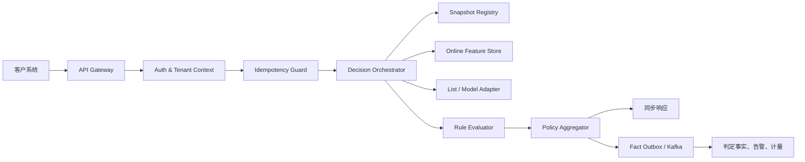
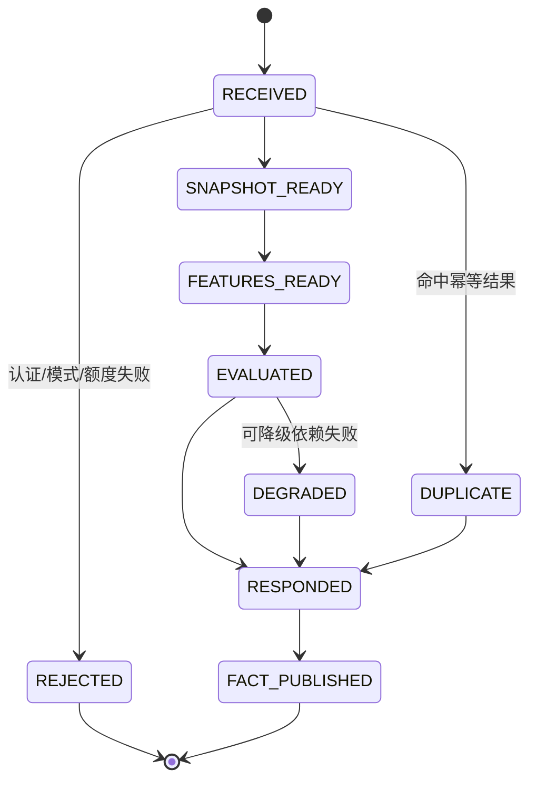

# 06 在线决策服务设计

> 状态：评审稿  
> 版本：v0.1  
> 目标：默认依赖条件下服务端 P95 ≤ 200 ms，并提供明确的幂等、隔离和降级语义。

## 1. 职责与结构

在线决策服务负责认证后的上下文校验、快照加载、在线特征、规则/名单/模型执行、结果聚合、同步响应和异步事实发布；不负责策略编辑、审批、账单生成和离线特征计算。

服务本身无状态；不可变快照与编译产物放本地内存，Redis 仅承担共享状态、在线特征和短期幂等记录。

## 2. 处理状态机

## 3. P95 时延预算

| 环节 | 预算 | 约束 |
|---|---:|---|
| 网关认证、限流 | 15 ms | 凭证映射与配额预检 |
| 校验、幂等 | 15 ms | 模式本地缓存 + Redis |
| 快照定位 | 2 ms | 内存读取，禁止查 MySQL |
| 在线特征 | 50 ms | Redis pipeline/Lua |
| 名单、模型适配 | 50 ms | 独立超时与熔断 |
| 规则执行、聚合 | 25 ms | 预编译表达式 |
| 事实可靠入队 | 8 ms | Kafka 或持久化 outbox |
| 网络和抖动余量 | 35 ms | GC、调度、序列化 |
| 合计 | 200 ms | deadline 向下游传播 |

下游调用超时不得超过请求剩余预算。

## 4. 运行时快照

内存注册表为 `RuntimeScope -> AtomicReference<CompiledSnapshot>`。快照包含版本、事件模式、编译规则、优先级/组合图、特征计划、名单/模型引用、动作矩阵、失败策略、校验和与来源发布单。

激活时原子替换引用；进行中的请求继续使用旧对象，新请求使用新对象。旧快照在引用归零和安全保留期后释放。

实例启动流程：

1. 加载分配作用域的活动快照索引。
2. 校验 schema、最低运行时版本和 checksum。
3. 编译、自检并预热核心租户。
4. 达到最小就绪比例才通过 readiness。
5. 单租户加载失败只隔离该作用域，并回退上一稳定版本。

## 5. 在线特征

| 类型 | 示例 | 来源 |
|---|---|---|
| 请求内 | 金额、渠道、设备 | 请求 |
| 主体画像 | 注册时长、等级 | Redis/特征库 |
| 滑动窗口 | 5 分钟交易数 | Redis 原子窗口或流式预聚合 |
| 名单 | 黑白名单 | 本地 Bloom + 精确存储 |
| 外部 | 设备指纹、模型分 | 受控适配器 |
| 派生 | 金额/均值 | 运行时 |

Redis 键：

~~~text
rf:{tenantId}:{appId}:{env}:feat:{subjectType}:{subjectHash}
rf:{tenantId}:{appId}:{env}:window:{featureCode}:{subjectHash}:{bucket}
rf:{tenantId}:{appId}:{env}:idem:{requestId}
~~~

主体 ID 先哈希；窗口用 Lua 原子更新；每个特征定义 TTL、缺失值、最大集合和 BEFORE_DECISION/AFTER_DECISION 更新时点。同一请求先形成 `FeatureSnapshot`，所有规则复用，避免重复读取和前后不一致。

## 6. 规则执行与聚合

执行顺序：

1. 紧急开关和静态白名单。
2. 事件模式校验。
3. 批量加载特征。
4. 路由到单事件/CEP/模型路径。
   - 单事件场景：事件本身直接走规则表达式与阈值判定。
   - CEP 场景：先经过相关模式判定后再评估该模式绑定规则。
   - 模型路径：仅在规则声明了模型特征时调用。
5. 低成本名单/阈值规则。
6. 表达式规则。
7. 按需调用模型或外部服务。
8. 聚合风险分、动作和原因码。
9. 应用动作覆盖、白名单和失败策略。

表达式只能访问声明字段和函数白名单，禁止反射、类加载、文件、网络、线程和动态脚本；每条规则有耗时、集合长度和内存预算。编译在发布阶段完成，运行时只执行验证产物。

默认动作优先级为 `REJECT > CHALLENGE > REVIEW > ALLOW`；`terminal=true` 可提前终止；白名单不能覆盖监管/安全硬规则；最终结果必须至少有一个稳定原因码。

## 7. 幂等

Redis 状态包括：

- PROCESSING：owner token、载荷哈希和短 TTL。
- COMPLETED：响应摘要和 24 小时 TTL。
- FAILED_RETRYABLE / FAILED_FINAL。

Lua 脚本原子创建或读取：同键同哈希返回首次结果；同键不同哈希返回 409；PROCESSING 未过期则短等或返回处理中，禁止重复计算。Redis 是请求优化，Kafka/MySQL 的作用域唯一键提供最终去重。

## 8. 事实发布

同步路径不串行写 MySQL、Redis、Kafka 三份结果：

1. 完成判定。
2. 最小判定事实可靠写入 Kafka。
3. Kafka 不可用则写本地持久化 outbox。
4. 异步消费者写明细、命中、告警、用量和 Webhook。

仅在 Kafka 确认或 outbox 持久化后返回成功。两者均不可用时返回 503 或按环境策略返回保守降级结果，绝不能静默丢事实。

## 9. 业务处置回传与再平衡

决策链路与业务回传解耦，保持决策可用性，但通过两条链路持续对账：

- 线上判定事实：`decision_fact` + `rule_hit_fact`。
- 业务处置事实：`decision_disposition`。

状态机：

1. decision 完成后写入判定事实并标记 `disposition_pending=true`。
2. 业务系统在 TTL 内回传处置；平台写入 `DECISION_DISPOSITION_RECEIVED`。
3. 若超时未回传，进入告警队列并按规则触发自动催单或补偿。
4. 对账任务比较 pending 与已回传事件，生成 `MISSING_CALLBACK` 或 `CONFLICT_RESULT`。

幂等规则：

- `decisionId + idempotencyId` 为处置主键。
- 同一决策可重复回传，第一次外加 `MISMATCH` 标记可更新对账结论。

回传一致性规则：

- `decisionId` 对应多个场景时，仅更新最新快照版本的处置。
- 冲突结果保留全部快照并打上 `reconciliation_version`。
- 处置失败可驱动工单，不直接回退判定模型。

## 10. 降级策略

| 故障 | 默认行为 |
|---|---|
| 当前快照缺失 | 回退上一稳定快照并告警 |
| Redis 特征超时 | 使用已声明缺失值并标记降级 |
| 外部模型超时 | 跳过模型或应用静态分数 |
| Kafka 异常 | 写本地持久化 outbox |
| 幂等存储异常 | 返回 503 或保守动作，不盲目重复 |
| 单规则异常 | 隔离规则并执行规则级失败策略 |

环境策略可选 FAIL_OPEN、FAIL_CLOSED、STATIC_ACTION；推荐默认 STATIC_ACTION=REVIEW/CHALLENGE。响应必须显式返回 `degraded=true` 和原因码，降级率单独进入 SLO。

## 11. 隔离与扩缩容

- 网关按租户令牌桶与最大并发限流。
- 服务内为租户设置 bulkhead，外部模型使用独立线程池和熔断器。
- 快照内存有租户配额，冷租户按需加载。
- HPA 同时参考 CPU、并发、P95、队列深度和 outbox 占用。
- 企业租户通过 ResourceRoute 指向专属服务、Redis 和 Kafka。

## 12. 指标与验收

记录 traceId/requestId/decisionId、作用域、snapshotVersion、规则数、命中数、阶段耗时、动作和降级状态；普通日志不得记录完整事件与明文主体。

基准：10k EPS 总量、单租户 1k EPS、每请求 50 条规则/20 个特征/1 次 Redis pipeline，20% 调用模型桩，正文 P95 8 KB。

验收：

- 稳态 P95 ≤ 200 ms、P99 ≤ 350 ms。
- 重复 requestId 不产生重复事实与用量。
- 新旧快照原子切换，无半更新。
- 单租户突发不使其他租户 P95 超基线 2 倍。
- Redis、Kafka、模型和快照故障均通过自动化演练。
