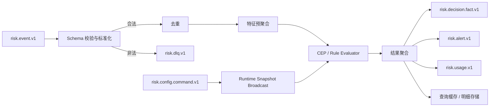

# 07 Flink 流式风控运行时

> 状态：评审稿  
> 版本：v0.1  
> 当前基线：Flink 2.2.1、Kafka 输入、MySQL/Redis/Kafka 输出、MySQL 30 秒规则轮询。  
> 目标：把当前单作用域演示 Job 演进为支持多租户、版本快照、可靠状态和可运维发布的数据面。

## 1. 目标流水线

运行时不能再直接轮询 MySQL 规则表。配置由发布服务编译为不可变快照，经 Kafka 命令分发；数据库只作为控制面事实源。

## 2. 作业类型

| 作业 | 输入 | 输出 | 状态特点 |
|---|---|---|---|
| EventNormalizeJob | 客户事件 topic | 标准事件、DLQ | 轻状态 |
| FeatureAggregateJob | 标准事件 | 在线/离线聚合特征 | 大状态、窗口 |
| StreamingDecisionJob | 标准事件 + 配置 | 判定事实、告警 | Broadcast + CEP |
| DecisionSinkJob | 判定事实 | MySQL/分析库/Redis | 幂等 IO |
| ReplayJob | 归档事件 + 指定快照 | 重放结果 | 隔离资源，不进入正式处置 |

V1 可以将标准化、特征和判定合并为一个 Job 降低运维复杂度，但代码边界和消息模型仍保持可拆分。

## 3. 事件模型与分区

统一 `EventEnvelope` 必须包含 tenant/workspace/app/environment、eventId、eventType、occurredAt、traceId、subject。

业务状态键：

~~~text
TenantSubjectKey(
  tenantId,
  appId,
  environment,
  subjectType,
  subjectIdHash
)
~~~

Kafka key 使用相同顺序的稳定编码，保证同一运行时作用域与主体进入同一分区。禁止只按 `userId` 分区，否则不同租户同名用户会共享状态。

对需要设备、IP、商户等多主体关联的场景：

- 主事件选择一个主键进入核心判定流。
- 其他维度由特征聚合作业预计算。
- 不在同一 Job 中随意 `keyBy` 切换并复制大量状态。

## 4. 时间语义与迟到数据

### 4.1 Watermark

默认使用事件时间：

- 默认最大乱序：5 秒。
- 每个事件类型可在 1 秒到 10 分钟范围内配置。
- Kafka 分区空闲 60 秒后标记 idle，避免拖住全局 watermark。
- 配置时间参数必须作为快照一部分发布。

### 4.2 迟到分级

| 迟到程度 | 处理 |
|---|---|
| watermark 前到达 | 正常计算 |
| watermark 后、allowed lateness 内 | 更新窗口并产出修正事实 |
| 超过 allowed lateness | 进入 late-event side output |
| 无法解析时间 | 进入 DLQ |

修正事实携带 `supersedesDecisionId` 或 `correctionVersion`，不能覆盖原判定历史。在线处置默认不因迟到修正自动撤销，除非场景明确配置补偿流程。

## 5. 去重与顺序

- 事件去重键为完整作用域 + eventId。
- Keyed State 保存去重指纹和首次处理时间，TTL 默认大于 Kafka 最大重试/回放窗口。
- 高基数去重可使用分桶 Bloom + 精确短期集合，但必须量化误判率。
- 客户若提供 `sequenceNo`，运行时可检测乱序与缺口；平台不承诺跨 Kafka 分区全局顺序。
- 配置命令按 `snapshotVersion` 单调处理，旧命令不得覆盖新状态。

## 6. 配置 Broadcast State

广播状态键不能使用单个 null 对应全局规则列表。目标模型：

~~~text
MapStateDescriptor<RuntimeScope, RuntimeSnapshot>
RuntimeScope = tenantId + appId + environment
~~~

命令类型：

- PREPARE：下载、校验并编译快照，保存为候选版本。
- ACTIVATE：原子切换活动版本。
- REVOKE：禁止指定版本继续激活。
- EVICT：释放冷租户旧快照。
- EMERGENCY_POLICY：更新紧急停用/静态动作。

配置处理必须校验 schemaVersion、checksum、最低 runtimeVersion 和版本单调性，并向 `risk.config.ack.v1` 返回实例、作业、版本、状态和错误。

## 7. CEP 与规则状态

### 7.1 模式规范

每条 CEP 规则明确：

- begin/next/followedBy 语义。
- within 时间窗。
- after-match skip strategy。
- 最大部分匹配数。
- until/终止条件。
- allowed lateness 与迟到策略。

默认启用合适的 skip strategy，防止组合爆炸。发布编译阶段估算状态规模，超过租户上限拒绝发布。

### 7.2 状态隔离与 TTL

所有 Keyed State 同时受租户、应用、环境、主体约束。规则停用后不能立即删除其状态：

1. 快照切换后停止创建旧版本新状态。
2. 保留至少最大窗口 + allowed lateness。
3. Savepoint 验证后通过 state processor 或自然 TTL 清理。
4. 指标确认旧版本状态归零。

### 7.3 规则异常

单条表达式或模式异常写入错误侧输出，按规则失败策略继续；同一规则错误率超过阈值时触发熔断和告警，不能让整个 TaskManager 反复重启。

## 8. Checkpoint、Savepoint 与一致性

推荐生产配置：

- Checkpoint 间隔 30—60 秒，超时 10 分钟。
- Exactly-once checkpoint mode。
- RocksDB/ForSt 兼容的增量状态后端，远端持久化到对象存储。
- 最少保留最近 3 个成功 checkpoint。
- 发布 Job、升级 Flink、改变状态结构前创建 savepoint。
- 开启 unaligned checkpoint 需先验证反压场景和恢复时间。

端到端语义按 Sink 声明：

| Sink | 语义 | 实现 |
|---|---|---|
| Kafka | exactly-once | Flink KafkaSink 事务 |
| MySQL | effectively-once | 唯一键 + 幂等 upsert |
| Redis | effectively-once | Lua 比较 decision/version |
| Webhook | at-least-once | 独立投递服务 + eventId |

不得把 MySQL/Redis 异步写简单描述为端到端 exactly-once。

## 9. 异步 IO 与反压

当前 `orderedWait` 会因慢请求产生队头阻塞。目标：

- 不要求顺序的查询使用 `unorderedWait`。
- 可预加载/广播的小表不走逐事件数据库查询。
- 外部 IO 设置独立并发、连接池、超时、重试和熔断。
- 重试只覆盖明确可重试错误，并保持事件幂等。
- 监控 busy/backpressured/idle 时间、pending async requests 和 checkpoint alignment。

当外部 Sink 长期失败时，优先写 Kafka 事实流并由独立 Sink Job 消化，避免核心判定 Job 被拖垮。

## 10. 多租户公平性

共享作业实施：

- 单租户每秒事件和并发状态配额。
- 大事件/热 Key 检测与隔离。
- 按租户等级设置输入限速和资源权重。
- 快照大小、规则数、CEP 部分匹配数上限。
- tenant tier 级别的指标，完整 tenantId 放日志/分析系统，避免指标标签爆炸。

超过阈值或对共享池造成持续影响的租户，通过 ResourceRoute 迁移到增强或专属 Job/Topic，而不改变外部 API。

## 11. 部署与升级

- Job 产物、配置 schema、状态 schema 分别版本化。
- 兼容升级：savepoint → 部署新 Job → 恢复 → 校验水位和输出。
- 不兼容状态变更：提供显式 state migration 工具和回滚 savepoint。
- 共享池按地域部署；专属租户独立 namespace、service account、checkpoint path 和 Kafka ACL。
- ReplayJob 使用独立 consumer group、输出 topic 和资源队列，禁止向正式告警/计费写入。

## 12. 观测与验收

核心指标：

- source lag、watermark lag、late-event rate。
- records in/out、反压、busy time、checkpoint 成功率与时长。
- keyed/broadcast state 大小、热 Key、TTL 清理量。
- snapshot prepared/active/ack、版本不一致实例数。
- 规则执行失败、CEP 部分匹配数、DLQ 量。
- Sink 延迟、重试和去重冲突。

验收：

- 同名主体跨租户不共享任何状态。
- 恢复后不重复产生业务事实和用量。
- ACTIVATE 对每个 Subtask 原子可见。
- 迟到、乱序、重复、配置乱序均有确定性测试。
- 在 Kafka、Redis/MySQL Sink 故障和 TaskManager 重启下完成恢复演练。

