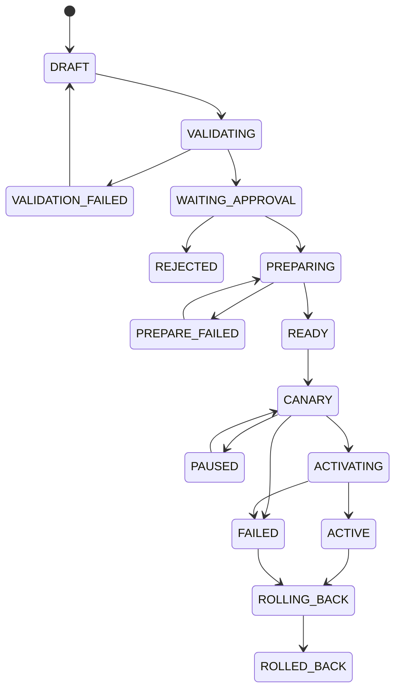

# 08 配置编译与发布设计

> 状态：评审稿  
> 版本：v0.1

## 1. 设计原则

- MySQL 中的策略版本和发布单是控制面事实源。
- 运行时只消费经过编译和校验的不可变快照。
- “数据库已提交”不等于“运行时已生效”。
- 发布过程不使用跨 MySQL、Kafka、Flink 的分布式事务；采用状态机、Outbox、回执和可重试补偿。
- 回滚是重新激活一个已知稳定快照，不在运行时反向计算差异。

## 2. 配置对象层级

一个 `TenantRuntimeProfile` 至少包含：

- 完整 RuntimeScope。
- snapshotVersion、schemaVersion、checksum。
- 事件模式、特征定义和字段访问计划。
- 编译规则、CEP 模式和动作矩阵。
- 名单/模型引用及版本。
- 配额、失败策略、时间参数和紧急开关。
- minRuntimeVersion、buildId 和 sourceRevision。

## 3. 编译流水线

1. 冻结发布修订：确定策略集、规则版本和引用资源。
2. 结构校验：JSON Schema、必填字段、引用完整性。
3. 语义校验：类型、变量、函数白名单、窗口边界。
4. 安全校验：禁用函数、复杂度、集合大小和表达式预算。
5. 依赖解析：特征、名单、模型、原因码和动作。
6. 冲突分析：优先级、终止规则、白名单覆盖与循环依赖。
7. 自动测试：规则样例、回归样例和基准性能。
8. 编译：生成稳定 IR/字节码缓存和 CEP 定义。
9. 打包：规范化排序、压缩、计算 checksum 并签名。
10. 保存快照元数据与正文，进入 PREPARED。

相同 sourceRevision 与编译器版本必须产生相同 checksum，确保构建可复现。

## 4. 发布状态机

所有状态迁移记录操作者、时间、来源状态、目标状态、理由和 traceId，并通过乐观锁防止重复操作。

## 5. PREPARE/ACTIVATE 协议

### 5.1 PREPARE

发布服务在数据库事务内：

1. 将发布状态更新为 PREPARING。
2. 创建 `CONFIG_PREPARE_REQUESTED` outbox。
3. Outbox 发布 `PREPARE(scope, version, uri, checksum)`。

运行实例下载并验证快照、编译与预热，随后回执：

- READY
- INCOMPATIBLE_RUNTIME
- CHECKSUM_MISMATCH
- COMPILE_FAILED
- RESOURCE_LIMIT
- DEPENDENCY_UNAVAILABLE

### 5.2 就绪判定

共享运行时按 Job/Subtask 和服务实例分别计算就绪：

- 生产默认 100% 目标实例 READY。
- 容许扩缩容瞬态时，可配置“所有当前 ready 实例 + 最小副本数”。
- 回执有租约，过期实例不参与当前 quorum。
- 超时未就绪则 PREPARE_FAILED，不自动激活。

### 5.3 ACTIVATE

达到就绪条件后发布 ACTIVATE 命令。每个运行实例仅执行内存原子指针切换，并返回 ACTIVE 回执。控制面只有在达到激活 quorum 后将发布单标为 ACTIVE，并更新环境的 `active_snapshot_version`。

若部分实例激活失败：

- 立即停止扩散。
- 网关/路由避免流量进入版本不一致实例。
- 在恢复成功或回滚前保持发布 FAILED/PAUSED。
- 绝不把“命令已发出”显示为发布成功。

## 6. 灰度发布

灰度维度：

- 影子：只计算不影响动作。
- 实例：部分决策实例。
- 主体：按 subject hash 稳定分桶。
- 流量比例：1% → 5% → 20% → 50% → 100%。
- 指定客户业务单元或渠道。

灰度门禁比较新旧版本：

- 技术指标：错误率、P95/P99、超时、状态增长。
- 风险指标：ALLOW/REJECT/REVIEW 比例、命中率、分数分布。
- 业务指标：转化率、人工审核量和已确认欺诈率。
- 保护阈值：硬错误或重大拒绝率偏移自动暂停。

灰度分桶算法与 salt 必须写入发布记录，保证重试和扩缩容时样本稳定。

## 7. 审批策略

- dev/test 可自动发布。
- staging 至少需要策略负责人确认。
- prod 默认提交人与审批人分离。
- 高影响规则、动作改为 REJECT、专属模型变更需要双人审批。
- 紧急发布允许简化前置审批，但必须使用受限角色、明确原因、缩短有效期，并在 24 小时内补审。

## 8. 回滚与紧急控制

回滚步骤：

1. 选择最近已验证稳定快照。
2. 创建类型为 ROLLBACK 的新发布单。
3. 对目标版本重复 PREPARE/ACTIVATE。
4. 保留失败版本与事实，不做删除。
5. 对发布期间的结果生成影响分析。

紧急控制通道支持：

- 停用单条/一组规则。
- 固定 STATIC_ACTION。
- 禁止特定外部依赖。
- 租户/应用熔断。

紧急配置使用独立权限、短 TTL、最高审计级别；过期后必须恢复正式快照策略，避免永久旁路。

## 9. Outbox、回执与重试

- 发布命令 eventId 唯一，消费者按 scope + version + command 幂等。
- 同版本 PREPARE/ACTIVATE 可重复发送。
- 运行时忽略低于当前活动版本的普通激活，回滚命令必须显式携带 `releaseType=ROLLBACK`。
- 回执落库唯一键为 `releaseId + runtimeType + instanceId + stage`。
- 未确认命令指数退避，达到阈值转人工处理。
- 控制台展示预期实例、已就绪、已激活、失败与失联数量。

## 10. 验收标准

- 任意环境能查询“控制面期望版本”和“每个实例实际版本”。
- 发布全过程可恢复、可重复执行，不因消息重复造成错误状态迁移。
- 新快照在单个请求或单条事件内保持一致，不半新半旧。
- 灰度异常能自动暂停，回滚不依赖原失败版本可运行。
- MySQL、Kafka、对象存储和运行实例分别故障时均有演练记录。

