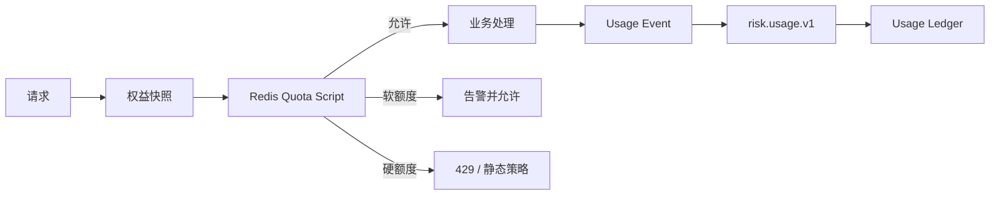

# 09 计量、配额与计费设计

> 状态：评审稿  
> 版本：v0.1

## 1. 边界

计量回答“实际用了多少”，权益回答“允许用多少”，计费回答“应收多少”。三者数据相关但职责分离：

- entitlement：套餐、功能开关、硬/软额度。
- quota enforcement：请求路径实时放行或限制。
- metering：产生不可变用量事实。
- billing：按合同与价格快照聚合账单。
- reconciliation：对请求、判定事实、用量、账单进行核对。

## 2. 计量指标

| metric_code | 单位 | 计量时点 |
|---|---|---|
| decision.sync.request | 次 | 在线请求被接受 |
| event.ingested | 条 | 异步事件可靠接收 |
| decision.stream.output | 条 | 流式判定事实产生 |
| feature.online.read | 千次 | 在线特征批量读取 |
| model.invocation | 次 | 实际发起模型调用 |
| rule.active.count | 规则/月 | 日峰值或合同口径 |
| data.hot.storage | GB-day | 每日快照 |
| webhook.delivery | 次 | 首次及重试按合同口径 |
| dedicated.compute | 实例小时 | 专属资源运行时间 |

同一业务动作只选择一个主要计费指标，避免同步请求、判定输出被重复收费。内部重试默认不增加客户计费用量。

## 3. 实时配额



Redis 配额键：

~~~text
rf:{tenantId}:quota:{metricCode}:{period}
rf:{tenantId}:{appId}:{env}:rate:{apiCode}
~~~

配额脚本原子执行额度读取、扣减、阈值判断和短期去重。Redis 不是账单事实源；故障恢复后由账本重新校准。

额度策略：

- HARD：超过立即拒绝。
- SOFT：允许并告警，进入超额计费。
- THROTTLE：降低速率或并发。
- OBSERVE：只记录不限制。

关键风控决策不应因非必要统计配额服务异常而静默失败；按合同配置短时本地额度租约或保守策略。

## 4. 用量事件与账本

用量事件：

~~~json
{
  "usageEventId": "use_01...",
  "tenantId": "ten_01...",
  "appId": "app_01...",
  "environment": "prod",
  "metricCode": "decision.sync.request",
  "quantity": 1,
  "occurredAt": "2026-08-16T10:01:02.123Z",
  "sourceType": "DECISION",
  "sourceId": "dec_01...",
  "pricingDimensions": {
    "region": "cn-east",
    "serviceTier": "shared"
  }
}
~~~

`usage_ledger` 仅追加，`usageEventId` 唯一。更正通过 REVERSAL 和 ADJUSTMENT 流水，不更新原记录。计量消费者允许重复消息，但写账必须幂等。

## 5. 聚合模型

- 分钟聚合用于控制台近实时展示。
- 小时聚合用于容量和异常检测。
- 日聚合用于运营与配额核对。
- 账期聚合用于计费。

每个聚合保存：

- 原始时间区间。
- 数量和唯一事件数。
- 首末 usageEventId 或水位。
- 迟到数据修订版本。
- 计算任务版本与时间。
- price_version 尚不在计量阶段绑定，防止数据与价格混合。

迟到用量在账单未结算时自动重算；账单结算后进入下期调整项并显示原因。

## 6. 价格与账单

价格模型支持：

- 固定订阅费。
- 包含量。
- 阶梯计价。
- 超额单价。
- 专属资源费。
- 一次性服务费和折扣。

`price_book_version` 和合同币种、税率、舍入规则在账单生成时冻结。账单计算：

1. 锁定账期和计量水位。
2. 汇总有效用量与调整。
3. 应用订阅权益快照和价格版本。
4. 生成账单行与计算明细。
5. 自动核对。
6. 进入 DRAFT → REVIEWED → ISSUED。
7. 已出账单不可修改，只能创建贷项/补项。

V1 可只生成用量与账单草稿，不直接接支付；支付、发票通过后续适配器集成。

## 7. 对账

每日执行：

| 核对 | 目标 |
|---|---|
| 网关接受请求 vs decision facts | 发现事实丢失 |
| Kafka offset vs usage ledger | 发现消费缺口/重复 |
| decision facts vs decision usage | 发现少计或多计 |
| 配额计数 vs ledger aggregate | 校准 Redis |
| 月聚合 vs bill lines | 验证账单 |
| 专属实例时长 vs compute usage | 验证资源费 |

差异超过阈值创建 `reconciliation_issue`，包含范围、差异、疑似原因、处理人和调整流水，不能直接改原账。

## 8. 通知与超额体验

默认阈值 70%、85%、100%、120%。同一租户、指标、周期和阈值只通知一次，升级或额度调整后重新计算。

控制台展示：

- 当前套餐、周期、已用、剩余与预测。
- 计量口径和更新时间。
- 按应用/环境/指标拆分。
- 软硬额度及超额行为。
- 账单明细到价格阶梯和调整项。

## 9. 安全与权限

- 价格、手工调整、账单出具和退款分别授权。
- 手工用量调整必须双人审批、原因与附件。
- 租户只能看到自身用量；平台运营跨租户查询全审计。
- 计量事件不携带完整业务载荷和明文主体。
- 账单导出使用短时签名链接和水印。

## 10. 计费适配器边界（V1.0+）

计费链路按“核心事实内聚 + 外部支付编排”分离，避免支付抖动影响决策可用性。

- `metering-billing-core`：负责权益快照、用量账本、账单草稿和调整建议。
- `billing-adapter`：处理支付、收款、税务、发票的可替换外部对接。
- 两层之间仅通过事件和状态回执交互；决策链路无需等待支付结果。

### 10.1 外部事件模型

计费事件采用 `risk.billing.v1` 主题/队列，要求 `at-least-once + 去重`：

- `billing.invoice.draft.generated`
- `billing.invoice.review_requested`
- `billing.invoice.settlement.requested`
- `billing.settlement.result`
- `billing.refund.requested`
- `billing.adjustment.applied`

每条事件必须携带：

- `billingEventId`（幂等主键）
- `tenantId`、`appId`、`environment`
- `invoiceId` / `contractId`
- `amount`、`currency`
- `version`（契约版本）
- `cause`（账期切换、人工调整、逆向补差）
- `requestId`（若由外部回调触发）

消费者必须先在 dedupe 表判定是否已处理，确保重复投递不会改变状态。

示例 `billing.settlement.result`：

~~~json
{
  "eventId": "bevt_01...",
  "eventType": "billing.settlement.result",
  "schemaVersion": 1,
  "tenantId": "ten_01...",
  "appId": "app_01...",
  "environment": "prod",
  "invoiceId": "inv_202608",
  "billingEventId": "bevent_01...",
  "status": "PAID",
  "amount": {
    "value": 1280.00,
    "currency": "CNY"
  },
  "settledAt": "2026-08-17T02:00:00.000Z",
  "providerRef": "wx_20260817001",
  "provider": "stripe-like-adapter",
  "requestId": "wxpay_req_abc",
  "occurredAt": "2026-08-17T02:00:30.000Z",
  "traceId": "trace_..."
}
~~~

### 10.2 状态和回执

建议账单生命周期：

`DRAFT -> REVIEWED -> EXPORTED -> ISSUED -> PAID_OR_SETTLED -> CLOSED`

回执能力：

- `ACK` / `RETRY` / `FAILED`。
- `FAILED` 不阻塞账务可见性，只触发告警并进入人工复核。
- 手工兜底：可暂停推送适配器、切回手工出账。
- 失败订单可发起 `reconciliation_issue`，并与 incident 联动。

### 10.3 一致性与演进

- 适配器接口版本化，`compat_version` 不兼容变更必须双写适配阶段。
- 适配器升级可并行运行两套消费者，按权重切流。
- 对账任务每小时执行：账单状态、外部回执、退款与税务票据三方核验。

## 11. 事故与处置闭环

`incident` 承接告警、故障、付款失败和账期异常等横向事件，统一支撑平台治理与复盘。

建议生命周期：

- OPEN：待识别
- INVESTIGATING：分析中
- MITIGATING：已开始应急
- ROOT_CAUSED：根因明确
- RESOLVED：已恢复
- VERIFIED：验证完成
- CLOSED：归档关闭

状态机动作要求与告警/工单关联：

- 告警聚合可自动创建 incident。
- 支持会话必须绑定 incident 并受字段白名单限制。
- 工单关闭前需更新 incident timeline（发现时间、影响范围、修复动作、验证方法）。
- 公告发布可引用 incident ID，并显示预计修复窗口。

## 12. 验收

- 重复、乱序和迟到用量不会造成重复收费。
- Redis 配额清空后可由账本校准。
- 任意账单行可追溯到聚合、用量流水、价格版本和权益快照。
- 内部重试不增加客户计费用量。
- 计量丢失与账单差异具备自动发现和补偿流程。
- 外部计费适配器故障不影响在线决策/发布稳定性。
- incident 可统一串联告警、工单、通知与处置时间线。

## 13. 计费落地：最小数据库 DDL（MySQL）

以下为 V1 可直接执行的数据表（按最小可运行集）：

```sql
CREATE TABLE tenant_subscription (
    subscription_id CHAR(26) PRIMARY KEY,
    tenant_id VARCHAR(32) NOT NULL UNIQUE,
    plan_code VARCHAR(64) NOT NULL,
    billing_cycle VARCHAR(16) NOT NULL COMMENT 'MONTHLY/QUARTERLY/YEARLY',
    status VARCHAR(20) NOT NULL,
    started_at DATETIME(6) NOT NULL,
    ended_at DATETIME(6) NOT NULL,
    entitlement_snapshot_json JSON NOT NULL,
    price_book_version VARCHAR(32) NOT NULL,
    updated_at DATETIME(6) NOT NULL,
    updated_by VARCHAR(64) NOT NULL,
    created_at DATETIME(6) NOT NULL,
    created_by VARCHAR(64) NOT NULL,
    INDEX idx_tenant_subscription_status (status, ended_at)
) ENGINE=InnoDB;

CREATE TABLE usage_ledger (
    usage_event_id CHAR(26) PRIMARY KEY,
    tenant_id VARCHAR(32) NOT NULL,
    workspace_id VARCHAR(32) NOT NULL,
    app_id VARCHAR(32) NOT NULL,
    environment VARCHAR(32) NOT NULL,
    period_id CHAR(7) NOT NULL COMMENT 'YYYY-MM',
    metric_code VARCHAR(64) NOT NULL,
    quantity BIGINT NOT NULL,
    currency CHAR(3) NOT NULL DEFAULT 'CNY',
    pricing_dimensions_json JSON,
    source_type VARCHAR(32) NOT NULL COMMENT 'DECISION/INGESTION/WEBHOOK',
    source_ref_id VARCHAR(64) NOT NULL,
    occurred_at DATETIME(6) NOT NULL,
    created_at DATETIME(6) NOT NULL,
    dedupe_key VARCHAR(64) AS (CONCAT(tenant_id,'|',app_id,'|',environment,'|',source_type,'|',source_ref_id)) STORED,
    INDEX idx_usage_scope_time (tenant_id, app_id, environment, occurred_at),
    INDEX idx_usage_metric_time (tenant_id, metric_code, period_id),
    INDEX idx_usage_dedupe (dedupe_key),
    UNIQUE KEY uk_usage_ledger_event (tenant_id, app_id, environment, source_type, source_ref_id)
) ENGINE=InnoDB;

CREATE TABLE invoice (
    invoice_id CHAR(24) PRIMARY KEY,
    tenant_id VARCHAR(32) NOT NULL,
    subscription_id CHAR(26) NOT NULL,
    period_id CHAR(7) NOT NULL,
    cycle_start_at DATETIME(6) NOT NULL,
    cycle_end_at DATETIME(6) NOT NULL,
    price_book_version VARCHAR(32) NOT NULL,
    entitlement_snapshot_id VARCHAR(64) NOT NULL,
    subtotal_amount DECIMAL(18,4) NOT NULL DEFAULT 0,
    tax_amount DECIMAL(18,4) NOT NULL DEFAULT 0,
    total_amount DECIMAL(18,4) NOT NULL DEFAULT 0,
    currency CHAR(3) NOT NULL DEFAULT 'CNY',
    status VARCHAR(20) NOT NULL COMMENT 'DRAFT/REVIEWED/EXPORTED/ISSUED/PAID_OR_SETTLED/CLOSED',
    currency_scale TINYINT NOT NULL DEFAULT 2,
    version INT NOT NULL DEFAULT 1,
    created_at DATETIME(6) NOT NULL,
    updated_at DATETIME(6) NOT NULL,
    created_by VARCHAR(64) NOT NULL,
    INDEX idx_invoice_tenant_period (tenant_id, period_id),
    INDEX idx_invoice_status (status),
    CONSTRAINT fk_invoice_subscription FOREIGN KEY (subscription_id) REFERENCES tenant_subscription(subscription_id)
) ENGINE=InnoDB;

CREATE TABLE invoice_line (
    invoice_line_id CHAR(26) PRIMARY KEY,
    invoice_id CHAR(24) NOT NULL,
    metric_code VARCHAR(64) NOT NULL,
    metric_source_scope_json JSON,
    usage_qty DECIMAL(20,4) NOT NULL DEFAULT 0,
    unit_price DECIMAL(18,6) NOT NULL DEFAULT 0,
    line_amount DECIMAL(18,4) NOT NULL DEFAULT 0,
    adjustment_type VARCHAR(32) NOT NULL,
    ledger_start DATETIME(6) NOT NULL,
    ledger_end DATETIME(6) NOT NULL,
    calculation_json JSON,
    created_at DATETIME(6) NOT NULL,
    INDEX idx_line_invoice (invoice_id, metric_code),
    CONSTRAINT fk_invoice_line_invoice FOREIGN KEY (invoice_id) REFERENCES invoice(invoice_id)
) ENGINE=InnoDB;

CREATE TABLE billing_adapter_event (
    billing_event_id CHAR(26) PRIMARY KEY,
    tenant_id VARCHAR(32) NOT NULL,
    invoice_id CHAR(24) NOT NULL,
    event_type VARCHAR(64) NOT NULL COMMENT 'invoice_draft_generated/request_settlement_result/refund_requested/adjustment_applied',
    direction VARCHAR(8) NOT NULL COMMENT 'OUTBOUND/INBOUND',
    payload_json JSON NOT NULL,
    schema_version INT NOT NULL DEFAULT 1,
    retry_count INT NOT NULL DEFAULT 0,
    next_retry_at DATETIME(6) NULL,
    event_status VARCHAR(16) NOT NULL COMMENT 'ACK/RETRY/FAILED/SKIPPED',
    provider_ref VARCHAR(128),
    request_id VARCHAR(64),
    trace_id VARCHAR(64),
    occurred_at DATETIME(6) NOT NULL,
    created_at DATETIME(6) NOT NULL,
    INDEX idx_billing_event_invoice (tenant_id, invoice_id),
    INDEX idx_billing_event_status (event_status, next_retry_at),
    UNIQUE KEY uk_billing_event_unique (tenant_id, invoice_id, event_type, request_id)
) ENGINE=InnoDB;

CREATE TABLE reconciliation_issue (
    issue_id CHAR(26) PRIMARY KEY,
    tenant_id VARCHAR(32) NOT NULL,
    scope VARCHAR(128) NOT NULL,
    issue_type VARCHAR(48) NOT NULL COMMENT 'USAGE_MISMATCH/COUNTER_DIFF/ADAPTER_ERROR/BILLING_REFUND',
    entity_type VARCHAR(32) NOT NULL,
    entity_id VARCHAR(64) NOT NULL,
    severity VARCHAR(8) NOT NULL COMMENT 'P1/P2/P3',
    status VARCHAR(16) NOT NULL COMMENT 'OPEN/ACKNOWLEDGED/IN_PROGRESS/RESOLVED/CLOSED',
    detected_at DATETIME(6) NOT NULL,
    fixed_at DATETIME(6) NULL,
    closed_at DATETIME(6) NULL,
    owner VARCHAR(64) NULL,
    incident_id VARCHAR(24) NULL,
    remediation_json JSON,
    created_at DATETIME(6) NOT NULL,
    updated_at DATETIME(6) NOT NULL,
    INDEX idx_recon_scope_status (tenant_id, scope, status),
    INDEX idx_recon_type (issue_type, detected_at)
) ENGINE=InnoDB;
```

> 说明：`tenant_subscription.subscription_id`、`invoice.invoice_id` 与 `billing_adapter_event` 外键建议在 V1 以应用层约束优先；先上线上述结构后通过服务层保证跨表一致性，分库分表与归档表在 6.x 阶段加入。

## 14. 计费事件 JSON Schema（risk.billing.v1）

### 14.1 通用 Envelope

~~~json
{
  "$schema": "https://json-schema.org/draft/2020-12/schema",
  "$id": "https://example.com/schemas/risk.billing.event.envelope.json",
  "type": "object",
  "required": ["eventId", "eventType", "schemaVersion", "tenantId", "invoiceId", "occurredAt"],
  "properties": {
    "eventId": { "type": "string", "pattern": "^bevt_[0-9a-zA-Z_-]{8,64}$" },
    "eventType": {
      "type": "string",
      "enum": [
        "billing.invoice.draft.generated",
        "billing.invoice.review_requested",
        "billing.invoice.settlement.requested",
        "billing.settlement.result",
        "billing.refund.requested",
        "billing.adjustment.applied"
      ]
    },
    "schemaVersion": { "type": "integer", "minimum": 1 },
    "tenantId": { "type": "string", "minLength": 3 },
    "appId": { "type": "string", "minLength": 3 },
    "environment": { "type": "string", "enum": ["prod", "pre", "test"] },
    "invoiceId": { "type": "string", "minLength": 5 },
    "contractId": { "type": "string" },
    "amount": {
      "type": "object",
      "required": ["value", "currency"],
      "properties": {
        "value": { "type": "number" },
        "currency": { "type": "string", "pattern": "^[A-Z]{3}$" }
      },
      "additionalProperties": false
    },
    "occurredAt": { "type": "string", "format": "date-time" },
    "requestId": { "type": "string" },
    "traceId": { "type": "string" },
    "idempotencyKey": { "type": "string" },
    "payload": { "type": "object" },
    "signature": {
      "type": "object",
      "required": ["alg", "value", "ts", "nonce"],
      "properties": {
        "alg": { "type": "string" },
        "value": { "type": "string" },
        "ts": { "type": "string", "format": "date-time" },
        "nonce": { "type": "string" }
      }
    },
    "attributes": { "type": "object" },
    "cause": { "type": "string" }
  },
  "additionalProperties": false
}
~~~

### 14.2 `billing.settlement.result`

~~~json
{
  "allOf": [
    { "$ref": "https://example.com/schemas/risk.billing.event.envelope.json" },
    {
      "type": "object",
      "required": ["status", "provider"],
      "properties": {
        "eventType": { "const": "billing.settlement.result" },
        "status": {
          "type": "string",
          "enum": ["PAID", "FAILED", "PENDING"]
        },
        "provider": { "type": "string" },
        "providerRef": { "type": "string" },
        "settledAt": { "type": "string", "format": "date-time" }
      }
    }
  ]
}
~~~

### 14.3 `risk.incident.v1` 生命周期 Envelope（附）

```json
{
  "$schema": "https://json-schema.org/draft/2020-12/schema",
  "$id": "https://example.com/schemas/risk.incident.event.envelope.json",
  "type": "object",
  "required": ["eventId", "eventType", "schemaVersion", "tenantId", "incidentId", "occurredAt", "occurredBy"],
  "properties": {
    "eventId": { "type": "string", "pattern": "^inc_[0-9a-zA-Z_-]{8,64}$" },
    "eventType": {
      "type": "string",
      "enum": ["incident.opened", "incident.acknowledged", "incident.mitigating", "incident.root_cause_found", "incident.resolved", "incident.verified", "incident.closed"]
    },
    "schemaVersion": { "type": "integer", "minimum": 1 },
    "tenantId": { "type": "string", "minLength": 3 },
    "workspaceId": { "type": "string" },
    "appId": { "type": "string", "minLength": 3 },
    "environment": { "type": "string", "enum": ["prod", "pre", "test"] },
    "incidentId": { "type": "string", "minLength": 5 },
    "severity": { "type": "string", "enum": ["P1", "P2", "P3"] },
    "impactRadius": { "type": "string" },
    "ticketId": { "type": "string" },
    "supportSessionId": { "type": "string" },
    "summary": { "type": "string" },
    "occurredAt": { "type": "string", "format": "date-time" },
    "occurredBy": { "type": "string", "description": "系统账号、支持人或自动化任务" },
    "traceId": { "type": "string" },
    "signature": {
      "type": "object",
      "required": ["alg", "value", "ts", "nonce"],
      "properties": {
        "alg": { "type": "string" },
        "value": { "type": "string" },
        "ts": { "type": "string", "format": "date-time" },
        "nonce": { "type": "string" }
      }
    }
  },
  "additionalProperties": false
}
```

## 15. 计费/incident 落地清单（上线前）

1. 先启用 `metering-billing-core` 的内部账本与账单状态机（V1 先不依赖外部回调）。
2. 将外部回执事件改为 `outbox + inbox` 式，默认 `RETRY` 3 次/1min/5min/30min，超限转 `FAILED`。
3. 上线 `billing_invoice` 与 `reconciliation_issue` 只读 API，先不放开退款写路径。
4. 通过 `risk.billing.reconciliation.v1` 做周期性对账，输出 `issue` 到 incident pipeline。
5. 计费 adapter 与订单系统采用 `adapterEventId` 幂等；同一 `id` 重放不允许产生重复账务影响。
6. 与 `incident` 进行强绑定：账单异常必须强制关联 `incidentId` 并触发公告模板。
