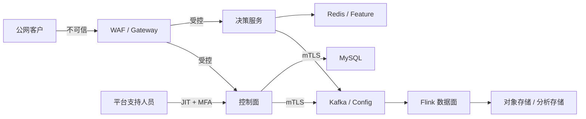

# 10 安全与合规设计

> 状态：评审稿  
> 版本：v0.1  
> 原则：默认拒绝、最小权限、纵深防御、数据最小化、全链路可审计。

## 1. 威胁边界

主要威胁：

- 伪造 tenantId 或凭证访问其他租户。
- 规则表达式注入、资源耗尽或任意代码执行。
- Kafka/Redis/对象存储的跨租户读写。
- 密钥泄露、重放攻击和 Webhook SSRF。
- 高权限平台人员越权查询。
- 导出、日志、链路追踪泄露敏感数据。
- 配置供应链或运行时快照被篡改。

## 2. 安全控制矩阵

| 风险 | 预防 | 检测 | 响应 |
|---|---|---|---|
| 租户越权 | 可信 TenantContext、资源归属校验 | 跨租户探针、审计告警 | 冻结凭证、调查影响 |
| 凭证泄露 | KMS、短期 token、轮换 | 异常 IP/调用模式 | 吊销、双密钥切换 |
| 表达式攻击 | DSL 沙箱、复杂度预算 | 规则错误/超时指标 | 隔离规则、回滚 |
| 消息伪造 | mTLS、ACL、schema、签名快照 | checksum/生产者异常 | 隔离 topic/工作负载 |
| 支持人员滥用 | JIT、MFA、只读默认 | 会话录审计 | 立即终止、复核 |
| 数据泄露 | 分级、脱敏、加密、DLP | 导出/查询异常 | 撤销链接、事件响应 |

## 3. 身份与访问

- 用户登录使用 OIDC/OAuth2，管理员和高风险操作强制 MFA。
- 服务间使用短期工作负载身份和 mTLS，不使用共享静态密码。
- Token 必须有 audience、issuer、subject、tenant membership、scopes、iat/exp/jti。
- 业务层按权限 + 资源归属 + 环境 + 套餐权益四层校验。
- 平台管理员不是天然租户数据管理员；跨租户支持必须通过临时支持会话。
- 高风险操作采用重新认证、双人审批和不可抵赖审计。

## 4. 密钥与凭证

- 数据库、Kafka、Redis、对象存储和第三方凭证统一存 Secrets Manager/KMS。
- Git、镜像、配置文件和日志禁止出现生产密钥。
- API Secret 仅创建时展示一次，数据库保存摘要或密文引用。
- 支持两把有效密钥重叠轮换；长期未使用凭证自动禁用。
- KMS 密钥分环境、地域和敏感级别；企业专属租户可使用独立数据密钥。
- 轮换失败、密钥访问异常和解密量激增必须告警。

## 5. 网络与基础设施

- 公网仅暴露 WAF/CDN/Gateway。
- 控制面、决策面、数据面分别使用网络策略和服务账户。
- MySQL、Redis、Kafka、Flink 管理端口不对公网开放。
- 出站访问默认拒绝，仅模型/Webhook 等适配器按域名或代理放行。
- Webhook 解析后禁止访问环回、链路本地、私网和云元数据地址；重定向关闭。
- 管理后台配置 CSP、CSRF、防点击劫持、安全 Cookie 和严格 CORS。

## 6. 数据保护

### 6.1 分级

| 级别 | 示例 | 控制 |
|---|---|---|
| L1 公共 | 产品文档 | 基础完整性 |
| L2 内部 | 配置元数据 | 认证、审计 |
| L3 敏感 | 事件属性、判定原因 | 加密、脱敏、最小权限 |
| L4 高敏 | 身份证、银行卡、密钥 | 字段加密、独立授权、默认不落库 |

- 传输使用 TLS 1.2+，存储使用云盘/数据库/对象存储加密。
- 高敏字段应用层信封加密，租户/地域数据密钥隔离。
- 主体 ID 在状态键、指标和普通日志中使用哈希。
- 原始载荷默认不保存；需保存时使用明确目的、短 TTL 和访问审计。
- 非生产环境不得复制未脱敏生产数据。

### 6.2 导出与删除

导出经过权限、目的、范围、行数阈值和审批检查，使用短时签名链接、水印和下载审计。删除按数据地图传播到 OLTP、缓存、Kafka 可删除层、对象存储和分析副本；法律保留数据进入隔离冻结状态。

## 7. 规则与模型安全

- 表达式函数白名单；禁止反射、类加载、文件、网络、进程和线程。
- AST 节点数、递归深度、集合长度、正则复杂度和执行时间受限。
- 发布时执行静态扫描、沙箱测试和最坏路径基准。
- 模型文件校验签名、来源、格式和大小，推理运行时隔离。
- 快照包带 checksum 和平台签名，运行时验证后加载。
- 外部模型请求只发送必要字段，并应用超时、熔断和数据处理协议。

## 8. 审计与防篡改

必须审计：

- 登录、MFA、凭证创建/吊销。
- 成员、角色、权限、支持会话。
- 规则创建、测试、审批、发布、回滚和紧急开关。
- 名单、案件、反馈和大批量导出。
- 套餐、额度、价格、账单和手工调整。
- 平台人员跨租户访问。

热审计保存在查询库，定期写入启用对象锁/WORM 的归档；归档批次保存 Merkle/hash chain 摘要并由 KMS 签名。

## 9. 安全开发与供应链

- CI 执行 SAST、依赖漏洞、Secret 扫描、IaC 扫描和镜像扫描。
- 生成 SBOM；基础镜像固定 digest，生产镜像签名验证。
- 严重漏洞阻断发布；例外必须有责任人、期限和补偿控制。
- 数据库迁移脚本经过权限和破坏性检查。
- 渗透测试至少覆盖认证、租户隔离、API、表达式、上传和 Webhook。

## 10. 事件响应

分级：

- SEV1：确认跨租户泄露、生产密钥泄露、核心服务大面积被攻陷。
- SEV2：可利用高危漏洞、单租户高敏泄露。
- SEV3：低影响异常或被控制的扫描事件。

流程：检测 → 控制 → 证据保全 → 根除 → 恢复 → 通知 → 复盘。证据访问只读、带 custody 记录；密钥吊销、token 全失效、租户冻结均应有预演脚本。

## 11. 合规落地清单

正式商用前至少具备：

- 数据地图、处理目的、保留期限和删除机制。
- 隐私政策、数据处理协议和子处理方清单。
- 访问评审、权限回收和员工离职流程。
- 备份恢复、漏洞管理、事件响应和供应商管理证据。
- 按目标市场进一步评估等保、网安法/数安法/个保法、GDPR 或行业监管要求。

本章是技术控制设计，不替代专业法律合规意见。

## 12. 验收

- 跨租户接口、数据库、Redis、Kafka、Flink 状态和导出均通过隔离测试。
- 生产密钥不出现在 Git、镜像、普通配置与日志。
- 快照篡改、重放签名、SSRF、表达式逃逸均被自动化测试覆盖。
- 支持会话有 MFA、时限、授权范围、录审计和即时终止能力。
- 高危依赖漏洞和未签名镜像不能进入生产。

