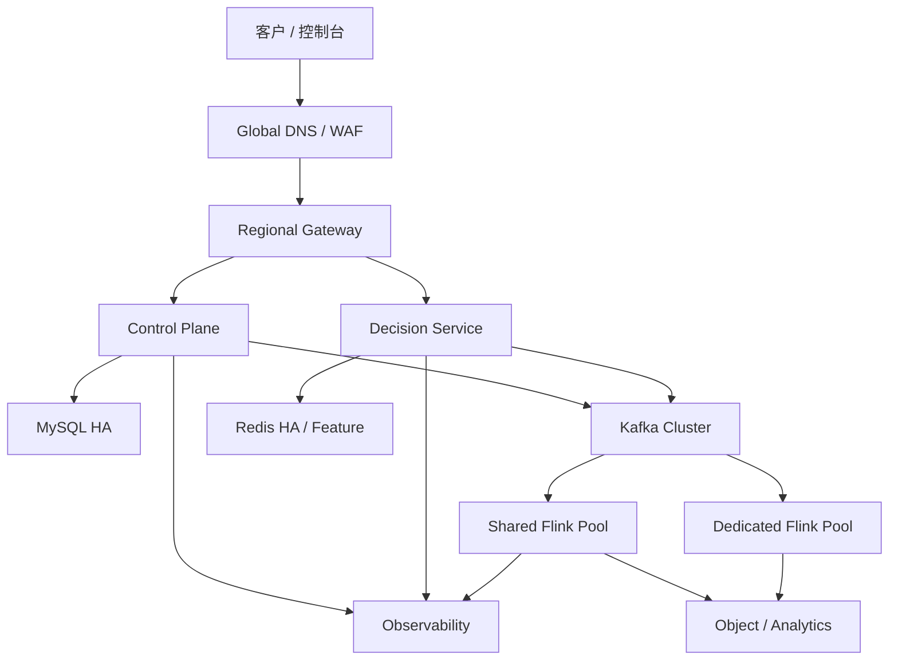

# 12 部署、容灾与迁移设计

> 状态：评审稿  
> 版本：v0.1

## 1. 环境与部署原则

- local：Docker Compose，保留现有快速启动体验。
- dev/test：共享 Kubernetes 集群，数据与凭证隔离。
- staging：生产同构，用于性能、发布和恢复演练。
- prod：按地域部署，控制面与数据面分离，禁止手工漂移配置。

所有变更通过 CI/CD 和 IaC；镜像按 digest 部署，配置、schema、数据库迁移和应用版本可追溯。

## 2. 生产拓扑

Kubernetes namespace 建议按环境和运行面划分；专属租户独立 namespace/service account/network policy。MySQL、Kafka、Redis 优先使用成熟托管服务或经过验证的高可用方案。

## 3. 工作负载

| 工作负载 | 扩容方式 | 有状态 |
|---|---|---|
| Web frontend | CDN/多副本 | 否 |
| Gateway | HPA | 否 |
| Control plane | HPA，模块化单体 | 否 |
| Decision service | HPA + 预热 | 本地快照缓存 |
| Config distributor | leader/分片 worker | Outbox 状态 |
| Async worker | 队列深度扩容 | 否 |
| Flink shared pool | Slot/Job 扩容 | Checkpoint/Savepoint |
| Flink dedicated | 租户资源路由 | 独立状态 |
| Observability collectors | Daemon/Deployment | 缓冲 |

## 4. 配置与密钥

- 非敏感配置通过版本化 ConfigMap/配置中心。
- 密钥通过 Secrets Manager + CSI/工作负载身份注入。
- 不把生产密钥写入 `application.yml`、Compose、Helm values 或 CI 日志。
- 环境变量只传秘密引用，不传可长期复用明文。
- 配置变更先验证 schema，关键参数需发布记录和回滚版本。

## 5. 数据库迁移

采用 Flyway/Liquibase 之一统一管理：

- expand → migrate/backfill → switch → contract。
- 新代码先兼容新旧字段，回填任务可暂停、重入和限速。
- 大表加索引使用在线方式并观测复制延迟。
- 破坏性 DDL 与应用发布分开，至少跨一个稳定版本。
- 上线前备份并验证恢复，不把“备份成功”视为“可恢复”。

## 6. 高可用与容灾目标

建议 V1 目标：

| 数据/服务 | RPO | RTO |
|---|---:|---:|
| 在线决策服务 | 近 0 | 15 分钟 |
| MySQL 控制面 | ≤ 5 分钟 | 30 分钟 |
| Kafka 事实流 | 近 0（同地域） | 30 分钟 |
| Flink 状态 | 最近成功 checkpoint | 30 分钟 |
| Redis 在线特征 | ≤ 5 分钟或可重建 | 30 分钟 |
| 对象存储快照/归档 | 近 0 | 4 小时 |

同地域多可用区为 V1 必需；跨地域主动-被动先用于灾备。跨地域切换前必须明确 tenant data region、DNS TTL、Kafka/数据库复制和密钥可用性。

## 7. 备份与恢复

- MySQL：全量 + binlog/PITR，定期恢复到隔离环境。
- Kafka：多副本；关键 topic 同步/异步复制到灾备地域。
- Redis：AOF/RDB 或从事实流重建，明确各特征可恢复程度。
- Flink：checkpoint 自动化、重大变更 savepoint 长期保存。
- 快照与审计：对象存储版本化、跨区复制、对象锁。
- 恢复后执行租户作用域、配置版本、消息水位和计量完整性核对。

## 8. 当前项目迁移路线

### Phase 0：基线固化

- 给现有 Ant Design Pro 前端、Spring Boot、Flink Job 建立 smoke test。
- 固定当前 Kafka 输入/输出和 MySQL 数据校验样本。
- 清理硬编码凭证，Docker Compose 仅作为 local profile。

### Phase 1：SaaS 骨架

- 新增 tenant/application/environment 与可信 TenantContext。
- 现有数据归入 default tenant/app/prod。
- 所有表、Redis key、Kafka envelope 和 Flink key 补作用域。
- 引入统一身份、RBAC 和审计。

### Phase 2：策略版本与发布

- 将 `rule_config` 迁移为 definition/version/release/snapshot。
- 控制面继续兼容旧接口，但内部双写新模型。
- 发布服务生成快照，Flink 同时观察旧 MySQL 与新配置流并比较结果。
- 完成一致性后停止 MySQL 轮询。

### Phase 3：在线决策

- 新建独立 Decision Service。
- 先影子流量对比现有/预期结果。
- 小租户灰度，再逐步扩大。
- 判定事实统一进入 Kafka，异步落 MySQL/Redis。

### Phase 4：计量和商业化

- 用量事件先只观测不收费。
- 与请求/判定进行每日对账。
- 连续两个账期准确后启用额度和账单草稿。
- 支付/发票作为独立适配阶段。
- 计费数据库先补充 `tenant_subscription`、`usage_ledger`、`invoice`、`invoice_line`、`billing_adapter_event`、`reconciliation_issue` 等落表脚本；
  先上最小可运行 DDL，再进行数据回填（订阅快照、历史事件映射、可观测指标）。

### Phase 4A：计费与 incident 迁移切片（建议执行顺序）

切片目标是做到“先上线可回退，再逐步打开计费能力”：

#### 4A-1：最小数据面（T0）

- 运行 `V1_01_billing_core_schema.sql`：补齐 `tenant_subscription`、`usage_ledger`、`invoice`、`invoice_line`、`billing_adapter_event`、`reconciliation_issue`。
- 同步创建 `outbox_event / inbox_event` 去重表（若已有，补足计费/incident 键）。
- 通过 feature flag 仅写 `usage_ledger`（不产生 invoice）。
- 验收：
  - `usage_ledger` 接收端到端 10 分钟内可查询；
  - 重放测试中同一 `usageEventId` 不重复账。

#### 4A-2：计量只读与对账（T0+1 周）

- 增加 `GET /billing/usage-ledger` 与 `GET /billing/reconciliation-issues` 只读接口。
- 追加 `risk.usage.v1` 与 `risk.billing.reconciliation.v1` 的消费者，形成日报差异清单。
- 支持会话、告警仍不触发自动冻结动作。
- 验收：
  - 对账差异率、Kafka lag、snapshot version 与请求/判定链条一致性满足 99.9%；
  - `reconciliation_issue` 与 incident 可手动联动但不自动升级。

#### 4A-3：发票草稿与人工复核（T0+2 周）

- 开启 `invoice` 生成作业（状态机 `DRAFT -> REVIEWED -> EXPORTED`）。
- 启用 invoice_line 与手工调整入口，人工必须双人审批；
- `billing.adapter` 仍仅影子模式，`adapterEvent` 不自动调用外部系统。
- 验收：
  - 同租户同账期账单草稿结果 100% 可重跑；
  - `EXPORTED` 草稿可回放比对，不影响在线决策。

#### 4A-4：incident 闭环联动（T0+3 周）

- 启用 `risk.incident.v1` 消费与 `incident` timeline 写入。
- 配置 `告警 -> incident -> 工单 -> 通知` 的自动关联规则（按严重级别/受影响范围）。
- `incident` 与 `support-session` 的白名单字段和到期回收规则走数据库约束。
- 验收：
  - 每起告警可在 3 分钟内生成 incident；
  - incident timeline 具备 `ack/escalate/mitigate/resolved/verified` 节点；
  - incident 关闭时具备不可改写审计链。

#### 4A-5：外部回执接入（T0+4 周）

- 打开 `billing-adapter` 外部回执消费者（`risk.billing.event.v1`）：
  - `delivery` 失败仅影响状态，不阻断决策 API；
  - 重试走统一 backoff 后转 DLQ。
- 启动 `billing.settlement.result` 与账单状态机联动（`PAID/FAILED/PENDING`）。
- 验收：
  - 回执延迟 P95 < 10 分钟；
  - `FAILED` 回执触发告警、工单并生成 `reconciliation_issue`；
  - 外部回撤回调不会产生账务重复变化。

### 4B：上线护栏与回退机制（阶段收官）

- 每一阶段保留 1 个发布周期的并行双写：
  - 新链路写入 + 旧链路只读；
  - 发现计费误差超过阈值立即回到旧链路。
- 切换标准：
  - 连续 2 个账期对账无关键问题；
  - incident+告警处理流程无手工阻塞；
  - 错误预算异常恢复到常态值 2 天内。

### Phase 5：增强隔离与规模化

- ResourceRoute 支持专属库、Kafka、Flink、Redis。
- 引入分析存储和冷热分层。
- 完成区域灾备、自动扩缩容和成本治理。

## 9. 双写与切换

每次切换遵循：

1. 新路径影子读取/写入。
2. 按记录数、业务键、校验和和抽样语义核对。
3. 修复差异并连续稳定观察。
4. 读流量切到新路径，旧路径保留回退。
5. 稳定一个发布周期后停止旧写。
6. 达到保留期后执行 contract 清理。

禁止在同一发布中同时更改数据库 schema、消息主版本、Flink 状态结构和外部 API。

## 10. 回滚

- 应用：回滚到上一镜像 digest，数据库必须向后兼容。
- 配置：重新激活上一稳定快照。
- Flink：从兼容 savepoint 恢复上一 Job 版本。
- 数据：优先补偿/反向流水，不直接删除事实。
- 路由：ResourceRoute 恢复上一版本。
- 切换后验证 API、版本水位、Kafka lag、Flink checkpoint、计量和跨租户隔离。

## 11. 上线门禁

- 代码、依赖、镜像和 IaC 安全扫描通过。
- 数据迁移演练、性能、故障和回滚测试通过。
- OpenAPI/消息/状态 schema 兼容性通过。
- SLO 仪表盘、告警、Runbook 和值班安排就绪。
- 容量至少承受预测峰值 2 倍和单可用区故障。
- 变更单明确影响、灰度、观察指标、停止条件和回滚人。
