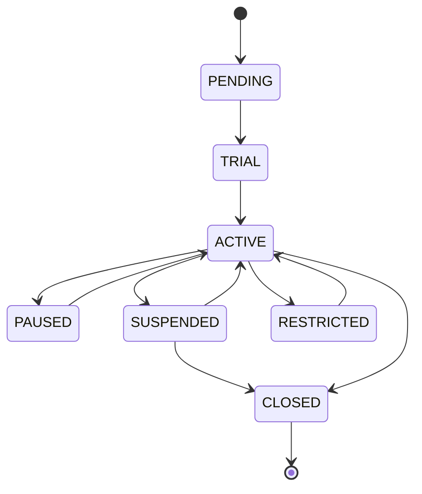

# 14 SaaS 平台架构与运营模型

[返回技术方案目录](README.md)

> 状态：评审稿  
> 版本：v0.1  
> 适用场景：从“风控规则系统”升级为“完整 SaaS 风控平台”

## 1. 为什么要补 SaaS 平台架构

当前实现里，规则能力是核心价值，但离完整 SaaS 产品仍有三层缺口：

1. 平台侧没有“租户经营能力”（开通、运营、支持、回访和续费闭环）。
2. 控制面/数据面缺少“资源隔离与租户生命周期”的统一模型。
3. 商业能力（套餐、配额、计费）与技术运行能力没有形成同一链路。

本章把 PRD 中“完整 SaaS 六大产品域”落到技术体系：

- 统一平台面向获客、运营、财务、客服的能力分离。
- 租户/应用/环境作为运行作用域，贯穿鉴权、配置、规则、状态和计费。
- 平台化组件以最小侵入方式托底，后续扩展可拆分为独立微服务。

## 2. SaaS 平台形态与控制面边界

### 2.1 组织边界

```text
产品官网（展示与转化） 
    └─ 平台控制台（平台运营、合规、SLA、工单）
        └─ 租户控制台（租户管理、规则、看板、团队）
            └─ 决策运行（在线决策、流式决策、输出）
```

边界规则：

- 平台控制台与租户控制台共享身份体系，但授权域不同，平台只在“支持/运维授权”场景下访问租户域。
- 决策运行面不直接访问租户管理敏感字段，需通过权威快照与引用 ID 对齐。
- 技术资源（MySQL、Kafka、Redis、Flink）允许分层共享，但通过 `ResourceRoute` 与 `Scope` 约束。

### 2.2 SaaS 运行面职责映射

| 平台职责 | 对应技术模块 | 技术落点 |
|---|---|---|
| 平台开通与配置 | tenant-iam、application、entitlement | 租户注册、应用绑定、环境初始化、套餐生效 |
| 技术配置与发布 | strategy、release、configuration/distributor | 规则版本、发布审批、快照下发 |
| 风控运营 | risk-ops、notification-support | 风险查看、处置、告警、工单 |
| 商业化 | entitlement、metering-billing | 权益、配额、账本、账单 |
| 平台安全与审计 | identity、audit-governance | 登录、RBAC、审计、数据访问与合规 |
| SRE | observability stack | 指标、告警、故障分级、回放与恢复 |

## 3. 租户生命周期工程化设计

### 3.1 生命周期状态机



| 状态 | 触发条件 | 技术动作 |
|---|---|---|
| PENDING | 注册、销售录入 | 建租户资料、默认工作流、基础权限模型 |
| TRIAL | 试用开启 | 自动创建 app/environment/credential，启用试用配额 |
| ACTIVE | 签约成功 | 生效订阅快照、开启计量、允许生产流量 |
| PAUSED | 主动休眠/欠费但可保留数据 | 冻结生产接入，保留读权限与账单查询 |
| SUSPENDED | 风控异常/安全事件/严重违规 | 强制阻断决策写入并进入人工审核 |
| RESTRICTED | 轻微风控策略 | 仅读可见、仅允许特定环境 |
| CLOSED | 到期注销 | 关闭凭证、导出归档、触发清除周期 |

生命周期转换必须产生审计事件、变更原因、变更人和追踪 ID。

### 3.2 租户自助开通“最短链路”

1. 注册与企业认证。
2. 平台创建租户（`PENDING`）并分配默认 Workspace。
3. 自动触发试用订阅（`TRIAL`）并输出接入向导。
4. 平台返回 `appId`、`environment`、`credential`、SDK 文档。
5. 5 分钟内可完成第一笔事件接入或决策请求。

开通流程全部使用模板化工单：每个租户开通均可回放，便于运营复盘与 SRE 审计。

### 3.3 租户停用与恢复

停用不是直接删库，而是执行四阶段：

1. 资源冻结（停止生产流量并锁定配额）。
2. 证据保全（风险与审计以租约时间窗口导出到归档）。
3. 计量结账（生成剩余账期账单与欠费清单）。
4. 数据清理（按策略窗口执行，支持法务保留和删除）。

恢复流程反向执行：先恢复凭证与环境，再恢复流量与配额。

## 4. SaaS 平台关键运行模型

### 4.1 统一作用域与对象模型

核心作用域：

`tenantId -> workspaceId -> appId -> environment`

共享库和服务必须使用“完整作用域元组”作为主键前缀，禁止以 `userId` 或 `eventId` 作为全局主键。数据库、缓存、消息、决策 Key 都以该元组开头，确保全链路可追溯。

### 4.2 资源隔离分级

| 级别 | 目标对象 | 适用对象 | 技术策略 |
|---|---|---|---|
| 共享(SHARED) | 控制面表、Kafka Topic、Flink 池 | 新租户、低风险租户 | 共享 Schema + `tenantId` 强隔离 |
| 增强(ENHANCED) | Topic 分区或专属 Redis/DB | 关键客户、合规要求高 | 增加 Topic 分片与专属资源池 |
| 专属(DEDICATED) | Flink 作业、Kafka 命名空间、数据库实例 | 企业级/高峰值租户 | `ResourceRoute` 绑定专属资源，关闭共享退路 |

升级到增强/专属的触发器：峰值 EPS、合规要求、隔离性、误差预算、SLA 约束。

### 4.3 配置与运行一致性

- 平台侧只存“目标状态”（发布单/快照/订阅快照）。
- 运行侧上报“实例状态”（已就绪版本/实例激活版本）。
- 仅当平台检测到 `expected==actual` 的租户范围内一致性时，才标记为可控发布成功。
- 任何运行期差异保留 `RECONCILIATION` 告警，要求在 TTL 内修复。

## 5. SaaS 商业化与技术联动

### 5.1 商业动作映射到技术动作

| 商业动作 | 技术动作 |
|---|---|
| 升级套餐 | 更新 `entitlement` 快照并同步配额脚本 |
| 降配 | 同步降额/限流策略并生成告警 |
| 超额 | 自动进入告警队列，按套餐配置决定软降级或硬降级 |
| 续费失败 | 触发 `PAUSED`/`SUSPENDED` 的状态机 |
| 终止订阅 | 资源冻结 + 账期对账 + 证据归档 |

### 5.2 计量口径与业务动作一致性

技术约束：

- 配额在 Redis 中做近实时控制，但最终账单以 `usage_ledger` 为准。
- 决策 API、流式事件、Webhook 回调事件各自独立计量，禁止重复上报相同业务动作。
- 任何内部重试必须带 `idempotency`，且不产生额外计量账目。

### 5.3 账单可解释性

每条账单明细都能回溯：

- 计量快照版本
- 计量指标定义
- 关联计量事件时间窗口
- 生成时的订阅权益快照
- 调整/冲正流水

### 5.4 开通、支持与工单模型

标准开通任务必须可重放：

- 创建租户任务后固定进入 `VERIFY -> PROVISION -> CREDENTIAL_INIT -> DEV_SANDBOX -> TRIAL_DECISION`。
- 每一阶段记录 `task_step`、执行者、失败码、重试次数和耗时。
- 阶段失败自动停留，不越权继续执行；重试只允许从失败步恢复。
- 完成后输出不可变 `onboarding_report` 与开通审计。

客服支持与运维动作：

- 工单系统承接 `technical`、`billing`、`incident`、`security` 类型。
- 开启支持会话前必须绑定工单与字段白名单。
- 支持会话到期后立即撤销敏感字段访问和导出能力。
- 所有支持动作写入 `support_session_id`，并进入审计链。

平台公告与通知：

- 公告按租户范围定向下发。
- 通知分两层：平台级系统消息与租户级运营消息。
- 对缺陷/维护公告必须保留 `publish_at`、`impact_scope`、`rollback_plan`。

## 6. 平台级 SRE 与可运维性

### 6.1 双层 SLA

1. 平台 SLA：API 可用性、发布成功率、账单准确性。
2. 租户 SLA：自有租户决策可用性、指标延迟、对接成功率。

### 6.2 运维动作标准化

故障处理按事件分级：

- `P0`：平台不可恢复、跨租户影响。优先级最高，通知全体并进入灾备流程。
- `P1`：单租户数据面故障。先流量隔离，再回滚快照。
- `P2`：单租户功能异常（计量、规则命中偏差）。执行回放分析与补偿。

每次平台运维都需记录“前置条件-动作-结果-验证-回滚点”，并与审计模型打通。

### 6.3 客服与支持模式

平台支持不是越权管理员直通。支持行为必须有：

- 工单绑定
- 有效期
- 访问字段白名单
- 全量审计
- 数据脱敏策略
- 支持结束后自动回收

支持会话在 UI 与 API 均显式提示“当前处于支持模式”。

### 6.4 处置回传与对账闭环

决策不等于执行成功：

- 判定结果写入后进入 `pending_disposition`。
- 业务回传可延迟到达，不会阻塞风控响应。
- 回传结果按 15 分钟、1 小时、24 小时窗口进入分层告警。
- 缺失回传纳入工单，支持会话和故障演练复用同一链路。
- 对账冲突优先进入 `risk_case`，再关联影响范围公告。

### 6.5 Incident 与工单状态映射（V1）

| incident 状态 | 支持字段 | 触发工单动作 | 工单状态要求 | 核心 SLA | 自动动作 |
|---|---|---|---|---|---|
| OPEN | 一级标题、服务影响、受影响租户 | 自动创建 `incident` 与 `support-ticket`（类型：incident） | NEW | 5 分钟内确认受影响租户 | 触发公告草稿 |
| INVESTIGATING | 初步归因、证据链、关联告警 | `assign` 运维负责人（支持会话未开始） | ACKNOWLEDGED | 15 分钟内响应 | 锁定影响租户配置变更路径 |
| MITIGATING | 缓解动作、回退窗口、变更单 | 更新工单：Mitigating + 变更单号 | IN_PROGRESS | 30 分钟内开始缓解 | 开启事件抑制、发布暂停 |
| ROOT_CAUSED | 根因、复现步骤、可复现证据 | `comment` 附根因与影响范围 | WAITING_APPROVAL 或 RESOLVED | 根因发布窗口由 Sev 级别决定 | 若涉及数据变更要求二次审核 |
| RESOLVED | 业务恢复确认、验证点 | 标记工单已恢复待验证 | RESOLVED | 2 小时内准备验证材料 | 写入 `incident.timeline`（恢复时间） |
| VERIFIED | 验证通过、回归完成 | 工单转“待归档” | VERIFIED | 24 小时内完成复盘草稿 | 触发 MTTR/MTTD 计算 |
| CLOSED | 复盘纪要已归档、责任链闭环 | 工单归档 | CLOSED | 按时区 8 个工作小时内归档复盘 | 防篡改存证生成归档快照 |

约束规则：

- 工单与 incident 必须一一绑定 `incidentId`；允许一个 incident 关联多个 ticket，但 ticket 列表不能脱离当前 incident。
- `incident` 进入 `ROOT_CAUSED` 后，`MITIGATING`/`RESOLVED` 的操作必须留下 `evidenceRef`（日志、查询结果、变更单）。
- `CLOSED` 前必须至少完成两条 timeline：`first_ack_at` 和 `verified_at`。
- 任何 `CLOSED` 的 incident 若缺少复盘快照，自动触发 `VERIFIED` 撤销（不得闭环）。

## 7. 与现有技术章节的映射关系

本章作为技术架构总入口，要求与以下章节联动更新：

- 01 目标架构：平台与租户边界说明
- 02 多租户架构：TenantContext 与隔离矩阵
- 04 领域与数据：租户生命周期与计量模型
- 08 配置与发布：发布与租户生命周期一致性
- 09 计量与计费：订阅动作映射
- 10 安全与合规：支持会话、跨域访问和留痕
- 11 可观测性与 SRE：平台-租户双层 SLA
- 13 测试与验收：跨租户场景与运维演练

## 8. 本章验收标准（针对 SaaS 架构）

1. 一个租户从开通到首决策的链路有指标和日志可完整回放。
2. 平台可独立查看租户状态、订阅、隔离级别、快照版本和运行差异。
3. 任一租户的计量账本、配额、账单与快照变更有闭环追踪。
4. 平台支持会话、导出、降级操作都留下审计且无法改写。
5. 共享与增强/专属模式切换有清晰回退策略，不依赖人工猜测。
6. 决策与业务处置对账缺口有月度对账报告。
