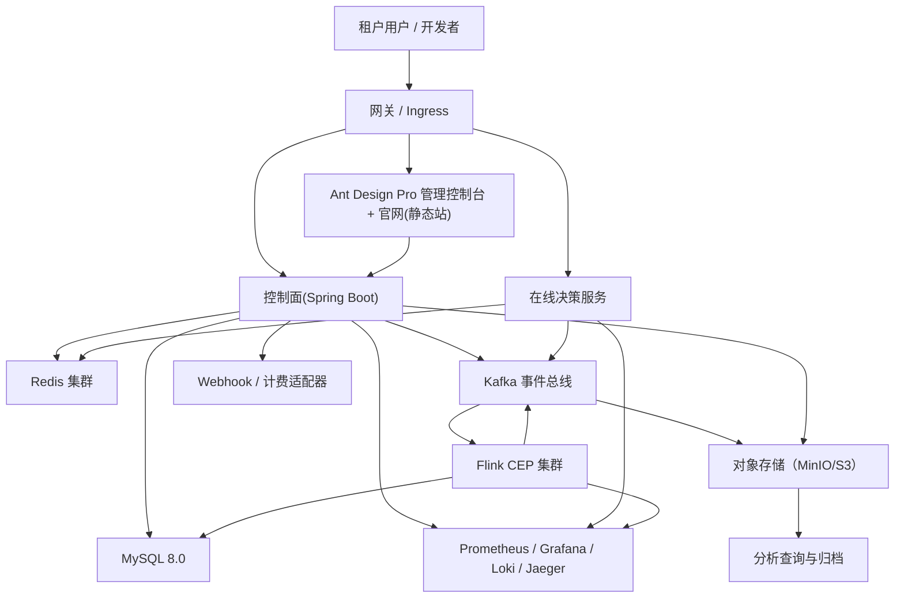

# 15 技术选型方案（Technology Stack Selection）

> 状态：评审稿  
> 版本：v1.0  
> 目标：与 RiskFlow 风控 SaaS 产品方案与技术设计保持一致，形成可执行的技术基线

本文档定义本项目在**产品化 SaaS 阶段**的技术选型。  
原则是：先把 V1.0 的稳定可交付性打牢，再预留到 V2 的扩展空间；所有技术栈均围绕“租户隔离、低延迟决策、可追踪与可回滚”四个核心目标展开。

## 1. 选型范围与约束

### 1.1 选型边界

- 覆盖范围：平台控制面、在线决策服务、Flink 数据面、官网/工作台、计量计费、可观测性、发布与运维、数据与安全合规。
- 不在本文件内展开：具体数据表字段、接口细节和业务规则语义（分别由 DB 设计与领域章节管理）。
- 生效时间：自 V1.0 立项起作为默认技术基线，除非提交 ADR 并通过评审。

### 1.2 约束条件

1. 保留现有可复用资产（Spring Boot、Flink、MySQL、Kafka、Redis、Ant Design Pro）；
2. MySQL 版本固定为 **8.0.x**（与既定数据库设计一致）；
3. 多租户隔离优先于单租户性能优化；
4. 需要支持租户级配置快照、审批发布、可回滚；
5. 支持控制面与数据面的独立扩展和独立容灾；
6. 兼容逐步从共享实例走向企业专属资源池（Dedicated）路线；
7. 生产环境默认必须有可观测性闭环（指标、日志、链路、告警、SLO 证据）。

## 2. 技术决策（技术栈总表）

| 层 | 组件 | 选型 | 采用理由                           | 备选项/替代 | 风险与应对 |
|---|---|---|--------------------------------|---|---|
| 平台/管理端前端 | **Ant Design Pro（React + TypeScript + Vite + React Router）** | 保留现有栈，兼容中后台效率与图表组件；开发速度快，生态成熟 | ant-design-pro                 | 组件生态成熟但需统一交互约束与权限模型落地 |
| 静态官网 | **Vite + Nginx + CDN + 对象存储回源** | 轻量高端展示页可独立发布，不影响控制面发布周期 | Next.js（SSR/ISR）、传统 CMS        | 当前方案前端较静态，SEO 与国际化需在构建配置中提前约束 |
| API 入口与网关 | **Ingress + 反向代理（Nginx / Cloudflare）+ API Gateway（分阶段）** | MVP 阶段优先减少复杂度；支持后续接入 OAuth/OIDC、限流与 WAF | Kong Gateway、APISIX、腾讯云 API 网关 | 暂不引入全链路网关可快速上线；待流量与安全要求上升后补充专用网关 |
| 身份认证 | **Keycloak（SaaS 内建 IdP）+ OAuth2/OIDC + JWT** | 支持 SSO、租户上下文映射、组织结构、会话与审计 | Authing/Okta/企业内建 IdP          | 企业客户若要求统一 IdP 时增加联邦登录映射（SAML、LDAP） |
| 后端控制面（平台端） | **Spring Boot 3.2 + Java 17 + Spring Security + Spring Validation + MyBatis-Plus** | 与现有 `flink-risk-web` 一致，生态完整，文档与社区成熟 | Quarkus、NestJS                 | JDK 17 与 Java 8 模块边界需管理清晰，避免共享模型被高版本 API 约束 |
| 在线决策服务 | **独立部署的 Spring Boot 3.x 同步服务（与控制面拆分）** | 决策链路要求低延迟，必须与控制面发布节奏解耦 | 将决策内嵌控制面（短期方案）                 | 不能与控制面同进程部署，避免发布抖动连带影响 |
| 流式风险检测 | **Apache Flink 2.2.1 + CEP + Java（兼容 8）** | 已有代码与 Job 框架一致；CEP 与事件驱动匹配持续监控场景 | Flink 1.17 LTS、Kafka Streams   | Flink 2.2.1 生态与 Java 版本边界较敏感，需 PoC 校验 JDK 升级路径 |
| 规则表达与策略执行 | **Aviator 表达式引擎 + 决策快照（snapshot）** | 可控、可预编译、可审计 | Drools、OpenPolicyAgent、CEL     | 表达式能力不如 BPMN，复杂策略需要外部模型服务配合 |
| 工作流/审批 | **自研轻量流程服务 + 配置状态机 + 人工审批面板** | 避免一开始引入重流程引擎，先落地必需功能 | Camunda、Flowable、Temporal      | 自研范围需限制在“发布审批/冻结/回滚”内，避免无限扩张 |
| 规则/配置版本 | **数据库快照表 + Outbox + 版本签名 + 发布流水** | 与现有结构匹配，便于回溯复核 | GitOps（文件仓库）+ CRD 模式           | 文件型版本更强协作，但开发复杂度高，先以数据库快照为主 |
| 持久化数据库 | **MySQL 8.0（主）+ 只读副本 + 逐步引入分片中间件（按租户）** | 已确认数据库方向；开发与运维成本低，支持事务与分析场景 | PostgreSQL、TiDB                | MySQL 单写瓶颈和大表热点在高租户下显著，需按租户分库分表 roadmap |
| 缓存与会话态 | **Redis 8（单独部署 + 集群化）** | 决策链路幂等、特征窗口与热点配置缓存的首选 | Dragonfly、KeyDB                | 单机模式风险高，生产阶段建议从复制到集群 |
| 消息与事件总线 | **Kafka（3.x）** | 保障事件可靠性、顺序与重放，适合 Flink 与异步补偿链路 | RabbitMQ、Pulsar                | Kafka 运维门槛高，需 topic 规范、ACL 与 DLQ 标准化 |
| 对象存储 | **MinIO（本地）→ 兼容 S3 的对象存储（公有云）** | 存放规则快照、审计归档、导出报告 | OSS/MinIO/SeaweedFS            | 跨环境对象一致性必须建立 manifest 与清单扫描机制 |
| 分析与归档 | **短期：MySQL + 定时归档；中期：ClickHouse（可选）** | 先满足业务需求，再补 OLAP，避免过早引入复杂度 | Doris、StarRocks                | 历史审计与风控分析量大时必须提前纳入列式仓库 |
| 搜索与检索 | **MySQL + 全文 + 规划中的搜索服务（OpenSearch）** | 先满足基础查询与分页，后期接入更强检索体验 | Elasticsearch、MeiliSearch      | 查询量/自由检索上升时需迁移到 OpenSearch |
| 日志/指标/链路 | **Prometheus + Grafana + Alertmanager + Loki + OpenTelemetry + Jaeger** | 形成闭环可观测栈，覆盖 SLO 与故障定位 | ELK + Zipkin、DataDog           | 指标/日志 schema 不统一会拉长排障时间，需定义统一 label 约定 |
| 任务编排与异步执行 | **Cron/队列任务（Spring Scheduler + MQ Consumer）+ 统一幂等任务框架** | 与当前架构兼容，无额外平台依赖 | Airflow、Dagster                | 复杂 DAG 场景下任务重试和依赖管理需要外部引擎 |
| 搜索与分析可视化 | **Grafana + 自研报表 API** | 快速交付、和指标系统同源 | Superset、Metabase              | 大屏与用户自定义指标需后续规划数据语义层 |
| 对外 API 契约 | **OpenAPI（网关层）** | 对租户/第三方提供稳定、可版本化 REST 接口 | JSON-RPC、GraphQL | 对外契约与内部模型可能偏离，需统一领域字典 |
| 内部服务通信 | **Apache Dubbo + Triple（gRPC 兼容）** | 平台内部共享服务低耦合高性能调用 | gRPC、Spring Cloud OpenFeign | 与 Spring 生态耦合度高，需服务治理与版本兼容策略 |
| 配置中心 | **数据库驱动配置 + 版本化发布通道（逐步过渡）** | 和当前发布模型匹配，便于灰度验证 | Nacos、Apollo、Consul            | 单点更新风险，需双写与发布幂等 |
| CI/CD | **GitHub Actions + Maven + pnpm + Docker Buildx + Trivy + SBOM** | 轻量实施，支持多模块并行构建和安全扫描 | GitLab CI、Jenkins              | 并发作业策略不当会导致流水线抖动，需资源配额 |
| 基础设施与部署 | **Kubernetes + Helm + Terraform + GitOps（Argo CD）** | 与 SaaS 多环境一致性最好，便于回滚和审计 | ECS/Fargate、Cloud Run、传统 VM    | K8s 学习成本高，但长期性价比和稳定性最优 |
| 监控告警与事件响应 | **Prometheus Alerts + 响应模板 + 告警路由 + 工单化链接** | 告警可追踪到具体租户和决策版本 | PagerDuty、Opsgenie             | 报警噪音问题需通过分级策略和静默规则治理 |
| 支付与财务 | **首期：Stripe/Chargebee 适配器 + webhook 计费模型（影子）** | 商业化测试周期短，先对齐账务主链路 | Adyen、 Paddle                  | 第三方账务策略差异影响税务字段映射，需提前抽象适配层 |

## 3. 统一技术约定（V1.0 默认值）

### 3.1 代码与版本约定

- 后端：`Java 17`（控制面、在线决策服务）；
- Flink Job：保持与现有兼容的 `Java 8` 运行时（待 PoC 后再统一升级）；
- 前端：`Node 20+`、`TypeScript strict`、`Ant Design Pro 规范化页面骨架与菜单模型`；
- 数据库：`InnoDB`，`utf8mb4`，`collation=utf8mb4_unicode_ci`；
- 时区：统一使用 `UTC` 存储，UI 与租户区展示时再转本地；
- 接口：版本化（如 `/api/v1/...`）、`trace-id` 贯穿网关→决策→Flink；
- 接口契约：对外先行 OpenAPI，对内先行 Dubbo；对外与对内契约变更必须同步评审，关键字典与错误码必须保持同义映射；
- 安全：所有服务支持 `TLS1.2+`，密钥不入 Git、镜像和日志。

### 3.2 多租户与命名约定

- 全量资源命名必须携带：`tenant_id` + `app_id` + `environment`；
- 请求级主键统一包含：`request_id`、`tenant_id`、`decision_id`；
- 数据分层使用 “`rf:{tenant}:{app}:{env}:...`” 作为通用命名约定；
- 消息 envelope 必须包含版本、租户、应用、环境、schema version、签名字段；
- 所有可审计事件都必须保留 `actor`、`source`、`justification`（变更原因）。

### 3.3 交付约定

1. 采用“影子发布 + 对账 + 灰度”；
2. 任何关键能力必须具备 `回退路径`（回退到上一稳定快照/镜像/路由）；
3. 变更必须可追溯到 PR、发布工单、审计记录；
4. 公开 API 与消息 schema 变更必须有兼容性说明。

## 4. 数据与计算链路架构（技术选型落地图）

## 5. 关键技术选型决策说明（ADR 化摘要）

- **ADR-PLT-001：控制面先模块化单体，数据面分离部署**  
  原因：快速交付与可控隔离比“纯微服务化”更符合 V1.0；
  约束：领域边界必须提前定义，禁止控制面直接调用 Flink 状态接口。

- **ADR-PLT-002：在线决策与 Flink 异步决策分离**  
  原因：在线链路强调 p95 延迟，Flink 强调吞吐与事件相关规则；职责分离可显著降低耦合；
  风险：指标口径可能分歧，需通过同一 decision_fact 进行统一对账。

- **ADR-PLT-003：MySQL + Redis + Kafka 作为 V1.0 三位一体底盘**  
  原因：满足事务、实时和缓冲三类诉求，团队已有经验；
  应对：提前定义“共享 Schema 下的租户路由规范”和“超大租户迁移门槛”。

- **ADR-PLT-004：先数据库配置快照而非 GitOps 首发**  
  原因：避免把配置与发布系统同时重构；优先稳定业务发布和回滚；
  应对：新增配置 schema 校验与签名验证。

## 6. 技术债与短期规避项（V1.0）

| 当前技术债 | 本期处理方式 | 复盘/清除时机 |
|---|---|---|
| Flink 与 Web 代码一致性（Java 版本差异） | 短期分开编译与运行目标；公共模型限制在兼容语法 | 完成 Flink 升级 PoC 后统一 |
| 生产环境凭证与部署安全 | 当前采用环境变量注入 + 密钥引用 | 接入 KMS/Vault 后逐步移除明文占位 |
| 事件 schema 验证 | 先 JSON Schema + 运行时校验 | 引入 Schema Registry 后统一管理 |
| 多租户专属资源自动化 | 目前支持路由与抽象，未完全自动扩容 | 3–6 个月内补足 |
| 运维自动化与告警分级 | 基础告警已覆盖主要指标 | 完整值班流程、Runbook 与演练标准待补充 |

## 7. 验收与切换规则（技术选型生效门槛）

1. 代码构建与部署：所有服务在 CI 可在 `main` 打包镜像并推送 digest；
2. 可观测性：核心服务具备 P95、错误率、队列 lag、checkpoint、快照切换时延；
3. 多租户隔离：无租户数据串读/误路由的自动化回归测试通过；
4. 发布回退：任何一次发布必须证明“一键回退”到上一镜像 + 上一快照有效；
5. 账务与事件一致性：计量事件、风险事实、发布版本可追踪并对账；
6. 安全基线：密钥不进入镜像、日志不落敏感数据、TLS 覆盖所有外部通信。

## 8. 下一步

技术选型确认后，建议直接进入实施节奏：

1. **先冻结选型文档**（本文件）并补齐 ADR；
2. 在 `docs/technical-design/README.md` 与技术任务看板标注“技术栈已约定”；
3. 进入开发时按章节输出：
   - 基础环境与开发脚手架（环境、Docker/K8s、CI）；
   - 控制面与决策服务双 repo/双服务工程结构确认；
   - 可观测性与告警链路验收脚本；
   - Figma/设计与前后端交互契约补齐。 

---

## 9. 版本与变更记录

| 版本 | 日期 | 更新人 | 变更要点 |
|---:|---|---|---|
| v1.0 | 2026-08-17 | 系统协作 | 新建“技术选型方案”并形成技术基线与分层决策 |
